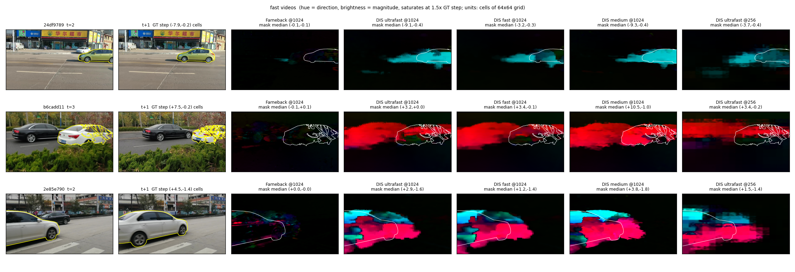
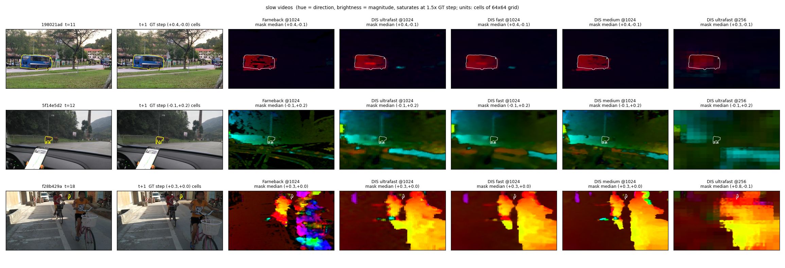
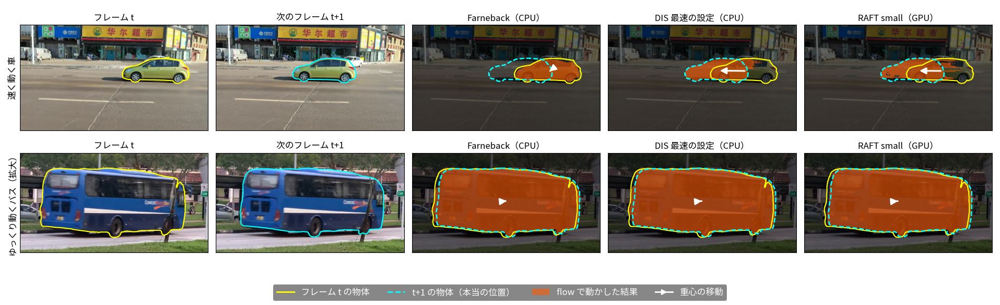
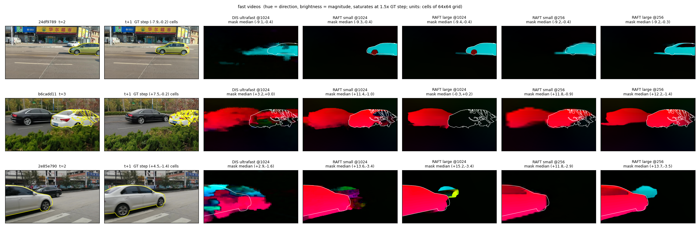
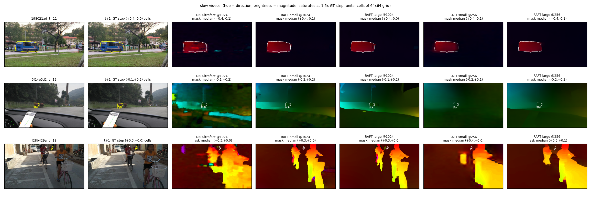

# OpenCVのoptical flow（Farneback・DIS）の計算時間と見た目（A-a の宿題）

11/6 MTGの宿題（[議事録](../meetings/2026-11-06-mtg.md)の①-a）：optical flowをとりあえず計算して、計算量が高いと言えるかを確かめる。flowと潜在表現のマスとの対応の取り方は扱わない。SAM2やMambaのコードには手を入れていない。

スクリプト・生データ・図：[figures/2026-11-11-optical-flow-cost/](figures/2026-11-11-optical-flow-cost/)（実行したコマンドは [manifest.md](figures/2026-11-11-optical-flow-cost/manifest.md)）。

## 結論

- **DIS なら、計算量は A-a をやらない理由にならない。** DIS ultrafast は、SAM2の入力と同じ 1024×1024 で 1フレームあたり 14.8 ms（1スレッド）、256×256 で 0.9 ms だった。比べる相手は、SAM2 の 1物体・1フレームあたり 約30 ms（RTX A4000、[10/26の計測](2026-10-26-view-speed-memory-benchmark.md)）。
- **Farneback（OpenCVのサンプルどおりの設定）は重く、速い動きを取れない。** 1024×1024 で約250 ms かかり、スレッドを増やしても速くならなかった。速い動画では、1024 で flow がほぼ0になり、動きを取れていない。512 でも大部分を取りこぼす。
- **DIS は、速い物体でも向きは合う。** ただし、背景へのはみ出し（前のフレームで物体があった場所）や取りこぼしがある。遅い物体では、どの手法もマスク内の中央値がほぼ正解の重心の移動どおりだった（差は0.3マス以下）。
  - 速い物体の大きさの正しさは、重心の移動との比較では判断できない（後で気づいた。下の RAFT の節）。速い3本はどれも物体が画面の端から出入りしていて、見えている部分の重心は実際の動きより小さく動く。DIS の値（重心の移動との差 1〜2マス）は、むしろ動きを小さく見積もっている可能性がある。
- **GPU の RAFT は、DIS より遅いが、flow はずっときれい（追記、同日）。** RTX A4000 で1フレームあたり、RAFT small が 1024 で 91 ms・256 で 37 ms、RAFT large が 1024 で 214 ms・256 で 60 ms（更新12回）。256 の DIS ultrafast（CPU、0.9 ms）より何十倍も遅く、SAM2 の約30 ms も超える。見た目は、flow が物体の形どおりに出て、背景へのはみ出しがほとんどない。
- **前処理の時間に注意する。** INTER_AREA で 1920×1080 から縮小してグレースケールにする時間は、1スレッドで 8〜18 ms だった。256 の DIS ultrafast（0.9 ms）より長い。SAM2 はもともと 1024 に縮小するので、組み込むときは、その画像を使い回すか縮小の方法を変えるかで減らせる見込み（今回は測っていない）。
- **比べるときの注意。** flow は CPU（この環境の cv2 は CUDA なしのビルド）での値で、SAM2 と A-b（類似度 0.8 ms＋softmax 0.3 ms、[11/4](2026-11-04-temporal-mamba-latent-correspondence.md)）は GPU での値。装置が違う。

## 方法

- **動画**：プロジェクトで val として使っている tuning の125本（MOSE train から切り出したもの。全フレームに正解マスクがある）から、決まったルールで選んだ（`select_videos.py`）。
  - ルール：元の大きさが 1920×1080、物体が全部同じ速さの層（11/4 の三分位の区切り 0.62・1.23 マス）、21フレーム以上。この条件に入る18本から、動画ごとの物体の中央値で速い順に3本と遅い順に3本を選んだ。
  - 速い動画：24df9789（7.89マス/フレーム）、b6cadd11（5.55）、2e85e790（4.51）。遅い動画：198021ad（0.20）、5f14e5d2（0.26）、f28b429a（0.32）。マスは、1024×1024 の入力を16画素ごとに区切った 64×64 の1マス。
  - 公式の MOSE valid は、正解が最初のフレームにしかないので使っていない。
- **手法**：Farneback（pyr_scale 0.5、levels 3、winsize 15、iterations 3、poly_n 5、poly_sigma 1.2）、DIS の ULTRAFAST・FAST・MEDIUM（OpenCV の preset そのまま）。
- **解像度**：元の大きさ（1920×1080）、1024×1024（SAM2の入力と同じで、縦横比は変わる）、512×512、256×256。
- **スレッド数**：OpenCV の既定（72）と 1。
- **時間の測り方**：flow を計算する関数の呼び出しだけを測った（縮小・グレースケール化を済ませた画像をメモリに置いた状態）。各動画の最初の20組（6本で120組）を使い、各条件の最初の2回は捨てた。値は120組をまとめた中央値。前処理（INTER_AREA の縮小＋グレースケール化）は別に測った。JPEG の読み込みは測っていない。
- **ずれの目安（参考値）**：物体ごとに、フレーム t のマスクの中の flow の中央値と、正解マスクの重心の移動との差を、マスの単位で出した。flow を0とした場合の差と並べる。重心の移動は、変形や隠れがあると本当の動きとずれるので、参考値として扱う。特に、物体が画面の端から出入りするときは、見えている部分の重心が実際の動きより小さく動く（選んだ速い3本はすべてこれに当たる）。
- **環境**：host 142、Intel Xeon E5-2699 v3（72スレッド）、Python 3.12.3、numpy 2.4.4、cv2 4.13.0（pthreads、CUDA なし）、`.venv-sam2`。OpenCV の計測では GPU は使っていない（RAFT は下の節）。開始時の load average は約2。終了時は14だったが、72スレッドの DIS を回していたためと考えられる。
- **繰り返し**：1024 と 256 の1スレッドの全手法を、もう一度測った。差は −1.1〜+2.9% で、10/26 の速さの計測の基準（5%以内）に収まった。

## 結果

### flow の計算時間（ms、6本120組の中央値）

| 解像度 | スレッド | Farneback | DIS ultrafast | DIS fast | DIS medium |
|---|---|---|---|---|---|
| 1920×1080 | 72 | 571.8 | 19.4 | 34.8 | 100.0 |
| 1920×1080 | 1 | 532.2 | 29.7 | 62.6 | 305.8 |
| 1024×1024 | 72 | 255.1 | 9.8 | 20.4 | 55.7 |
| 1024×1024 | 1 | 247.2 | 14.8 | 31.4 | 154.6 |
| 512×512 | 72 | 64.2 | 2.9 | 9.3 | 20.9 |
| 512×512 | 1 | 60.0 | 3.6 | 8.1 | 37.7 |
| 256×256 | 72 | 15.4 | 0.9 | 4.7 | 8.6 |
| 256×256 | 1 | 15.5 | 0.9 | 2.0 | 9.7 |

- 速い動画と遅い動画で、時間はほぼ同じだった（1スレッド、どの条件も差は数%以内。1024 の Farneback だけ速い動画 265 ms、遅い動画 246 ms）。flow の時間は、動きの速さではなく解像度で決まる。
- Farneback はスレッドを増やしても速くならない。DIS は大きな画像ほどスレッドが効く（1024 の medium で 2.8倍）。256 では効かず、DIS fast はかえって遅くなった（2.0 → 4.7 ms）。

### 前処理（INTER_AREA の縮小＋グレースケール化、1フレームあたり ms）

| 解像度 | 72スレッド | 1スレッド |
|---|---|---|
| 1920×1080（グレースケール化だけ） | 0.29 | 1.60 |
| 1024×1024 | 2.84 | 17.99 |
| 512×512 | 4.51 | 10.24 |
| 256×256 | 7.42 | 7.83 |

- 小さくするほど遅くなるところがある（72スレッドで 1024 が 2.8 ms、256 が 7.4 ms）。INTER_AREA で倍率が整数でない大きな縮小をするときの処理によるものと考えられる（確かめていない）。

### ずれの目安（参考値、マス、物体ごとの中央値）

値は動画ごとに 24df9789 / b6cadd11 / 2e85e790（速い動画）、198021ad / 5f14e5d2 / f28b429a（遅い動画）の順。

| 解像度 | 層 | flowを0とした場合 | Farneback | DIS ultrafast | DIS fast | DIS medium |
|---|---|---|---|---|---|---|
| 1024×1024 | 速い | 7.89 / 4.87 / 4.71 | 7.80 / 4.68 / 4.71 | 1.00 / 1.13 / 1.78 | 3.15 / 1.22 / 1.84 | 1.38 / 1.45 / 1.83 |
| 1024×1024 | 遅い | 0.44 / 0.28 / 0.35 | 0.06 / 0.07 / 0.20 | 0.02 / 0.08 / 0.17 | 0.02 / 0.08 / 0.12 | 0.04 / 0.07 / 0.11 |
| 256×256 | 速い | 7.89 / 4.87 / 4.71 | 5.36 / 1.30 / 1.85 | 1.63 / 1.11 / 1.84 | 2.10 / 1.06 / 1.65 | 1.33 / 1.13 / 1.46 |
| 256×256 | 遅い | 0.44 / 0.28 / 0.35 | 0.05 / 0.08 / 0.26 | 0.07 / 0.10 / 0.36 | 0.11 / 0.09 / 0.28 | 0.06 / 0.08 / 0.18 |

- 元の大きさと 512 を含む全条件は [data/summary.md](figures/2026-11-11-optical-flow-cost/data/summary.md) にある。
- Farneback は、速い動画の 1024 で flowを0とした場合とほぼ同じで、動きを取れていない。512 でも 7.06 / 3.55 / 3.31 で大部分を取りこぼし、256 で一部取れる（ピラミッドが3段で、探せる範囲が画素単位で決まるため、画像が小さいほど大きな動きが範囲に入ると考えられる）。
- 速い動画の値は、物体が画面の端から出入りしているため、重心の移動そのものが実際の動きより小さい。ここでの差が小さいことは、正しさを意味しない（下の RAFT の節）。
- 256 の遅い動画では、f28b429a（小さい物体）の DIS ultrafast が 0.36 で、flowを0とした場合（0.35）と変わらない。小さい物体の細かい動きは、256 では取れない。

### 見た目

- 色の向きが動きの向き、明るさが動きの大きさ（正解の移動の1.5倍で飽和）。白・黄の線は最初の物体の正解マスク。
- **速い動画**：Farneback はほぼ真っ黒（flow ≈ 0）。DIS は車の動きの向きを取れているが、flow が車の後ろの背景にはみ出し（前のフレームで車があった場所）、車の前の方では取りこぼしがある。b6cadd11 は車が画面の右端から出ていくところで、マスク内の中央値は設定によって +3.2〜+10.5 マスとばらつく（正解は +7.5）。
- **遅い動画**：マスク内の中央値は、どの手法も正解とほぼ同じ。カメラが動く動画（5f14e5d2、f28b429a）では、背景全体に flow が出る。Farneback は模様の多い所でまだらになり、DIS はなめらかになる。256 の DIS ultrafast はブロック状に粗くなる。

## 追加：GPU の RAFT（2026-11-11 19:40〜）

GPU にすると速くなるかを見るため、`.venv-sam2` の torchvision 0.25 に入っている RAFT（small・large、torchvision の公式の重み `C_T_V2`・`C_T_SKHT_V2`）を GPU 0 で測った（`flow_raft.py`）。OpenCV の Farneback の GPU 版や NVIDIA Optical Flow は、CUDA 付きの OpenCV のビルドが要るので測っていない。

- **条件**：RTX A4000、torch 2.10.0、FP32（cuDNN の TF32 は既定のまま有効、matmul は無効）。動画・組・ずれの目安は上と同じ。各動画の最初の3回は捨てた。RAFT は画像の大きさが8の倍数でないといけないので、元の大きさ（1920×1080）は測っていない。
- **時間の測り方**：モデルの forward だけ（2枚とも GPU 上で [−1, 1] にそろえた後）を、`torch.cuda.synchronize()` で挟んで測った。前処理（画像を GPU に送り、antialias 付きの bilinear で縮小して正規化）は別に測った。flow は、繰り返しの更新（既定12回）の最後の値。更新6回も測った。
- **GPU の取り違え（実害なし）**：最初の動作確認（3組・256 だけ）は、`CUDA_VISIBLE_DEVICES=0` だけで動かしたため、Kaggle が使っている RTX PRO 4500（nvidia-smi の GPU 1）で約1分動いた（CUDA は既定で速い GPU を0番にするため）。使ったメモリは90 MiB 以下で、Kaggle のプロセスはその後も動いていた。この確認の値は捨て、本番は `CUDA_DEVICE_ORDER=PCI_BUS_ID CUDA_VISIBLE_DEVICES=0` で回した。スクリプトは、cuda:0 が RTX A4000 でなければ止まる。

### 計算時間（RAFT、ms、6本120組の中央値、RTX A4000）

| 解像度 | RAFT small 12回 | RAFT small 6回 | RAFT large 12回 | RAFT large 6回 | 参考：DIS ultrafast（CPU 1スレッド） |
|---|---|---|---|---|---|
| 1024×1024 | 90.7 | 65.5 | 213.7 | 148.7 | 14.8 |
| 512×512 | 37.0 | 22.3 | 62.2 | 43.0 | 3.6 |
| 256×256 | 36.8 | 22.0 | 59.8 | 34.1 | 0.9 |

- 512 と 256 で時間がほぼ同じ。小さい画像では GPU の計算量ではなく、更新のたびに小さな処理を何度も呼び出す分の時間で決まっていると考えられる（確かめていない）。
- 前処理は1フレームあたり約14 ms（どの解像度でもほぼ同じ）。元の大きさの画像を CPU で色の並びを入れ替えて GPU に送る部分が大半と考えられる（確かめていない）。
- GPU のメモリ（max_memory_allocated）：1024 で約3.7 GB、512 で約0.3 GB、256 で約0.1 GB（更新6回の値）。512・256 の更新12回の値（1.6 GB、0.16〜0.18 GB）は、前の条件のテンソルが残った状態から測っていて、正しくない。

### 説明用の図：flow で物体を動かす（MTG資料用）

- フレーム t の正解マスク（黄）の全画素を各手法の flow で動かした領域がオレンジ。次のフレームの正解マスク（水色の破線）に重なれば、動きを正しく取れている。色の flow の図（01〜04）が分かりにくかったので作った。
- 速い車は、物体が画面に収まっている組（24df9789 の t=3）を選んだ。Farneback はほとんど動かず、DIS は黄から水色の間に引き伸ばされ（物体の後ろ側を小さく見積もっている）、RAFT small はほぼ水色に重なる。
- ゆっくり動くバス（198021ad の t=11、物体の周りを拡大）は、どの手法も水色に重なる。
- Farneback の設定を変えた確認（同じ速い車の組、1024、1スレッド、使い捨ての確認で生データは残していない）：重心の移動は 1024 の画像で −149 画素。マスク内の flow の中央値は、サンプルの設定（levels 3、winsize 15）で −3 画素（278 ms）、levels 5・6 で −36 画素（338 ms）、levels 5・6 で winsize 31 にすると −11 画素（約335 ms）だった。ピラミッドの段を増やしても、大きな動きは取れなかった（levels 6 は 5 と同じ値）。ほかのパラメータ（iterations、poly_n など）は試していない。
- 1組ずつの例で、6本全体の傾向は上の数値と図 01〜04 を見る。

### 見た目（RAFT）

- **RAFT の flow は物体の形どおりに出る。** DIS のような背景へのはみ出しやブロック状の粗さがほとんどない。カメラが動く 5f14e5d2 でも、背景の flow がなめらか。256 でも形はおおむね保たれる。
- **速い動画では、RAFT は重心の移動より大きく出る。** 2e85e790 は重心の移動 +4.5 マスに対して RAFT は +11.8〜+15.2、b6cadd11 は +7.5 に対して +11.4〜+12.2。どちらも車が画面の端から出入りしていて、見えている部分の重心は実際の車より小さく動く。図で車の位置を比べると、RAFT の値の方が実際の動きに近いと考えられる（目で見た判断で、正解の flow はない）。
- **RAFT large の 1024 は、b6cadd11 で車の flow を取れなかった**（マスク内 −0.3、図でも車の中が黒い）。同じ組で RAFT small と 256 の large は取れている。

### 数値（ずれの目安、マス。動画の順は上と同じ）

| 条件 | 速い動画 | 遅い動画 |
|---|---|---|
| RAFT small 1024・12回 | 1.43 / 1.43 / 1.76 | 0.03 / 0.08 / 0.12 |
| RAFT large 1024・12回 | 1.49 / 2.08 / 1.75 | 0.04 / 0.08 / 0.12 |
| RAFT small 256・12回 | 1.33 / 1.22 / 1.36 | 0.10 / 0.11 / 0.19 |
| RAFT large 256・12回 | 1.34 / 1.29 / 1.85 | 0.04 / 0.10 / 0.12 |

- 速い動画の値は DIS と同じ程度だが、上のとおり重心の移動そのものが実際の動きより小さいので、この数値では RAFT と DIS の正しさを比べられない。遅い動画は、どれも0.2マス以下。

### この節のまとめ

- 今回の手法の中では、GPU にしても速くはならなかった。一番速いのは CPU の DIS ultrafast のまま。RAFT は精度重視の手法で、GPU でも SAM2 の1物体・1フレーム（約30 ms）と同じか、それより重い。
- flow の質は RAFT がはっきり良い。A-a で flow をモデルに入れるなら、速さの DIS と質の RAFT のどちらを使うか（または両方試すか）は spec で決める。

## 次

- 計算量の確認はここまで（11/6 の宿題は完了）。A-b の改善を主に進める。
- A-a として flow をモデルに入れる場合は、flow を 64×64 のマスへ対応させる方法と、A-b との比べ方（A-b の運ぶ部分を共通にして、対応の重み W を flow から作る案など）を brainstorm で詰め、spec を立ててから始める。
