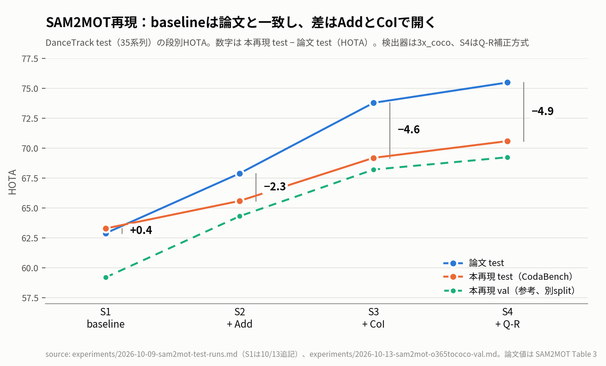
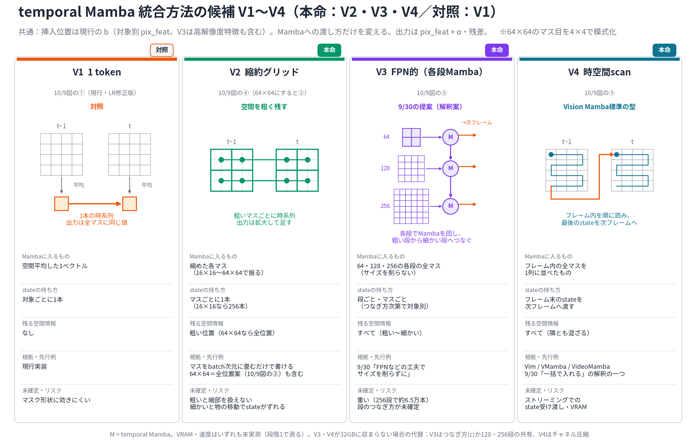
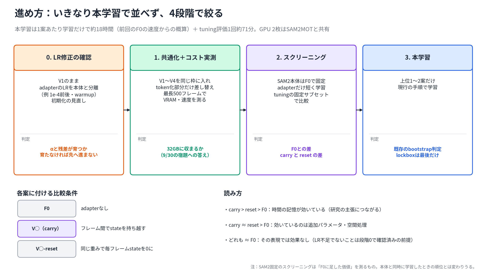

# 2026-10-14 MTG資料: 中間発表スライドの再構成、SAM2MOTの差の切り分け、temporal Mambaの統合案（10/9〜10/14の進捗）

## 0. 今日のMTGで先生に相談したいこと

1. **中間発表スライド（最優先）**: 10/9の指摘に沿って組み直した。次の3点を確認したい。
   - **目的の位置づけ**: 10/9に勧められた「KFを学習ベースに置き換え、かつMOTに対応する」から、「SAM2に対象の時間的変化をモデル化する機構を入れる（① bboxの動き予測をKFからMambaへ［実施済み］、② マスク生成の内部特徴に時間方向の情報を加える［検討中］）。MOTへの拡張は従」に変えた。比較実験ではSAMURAIも物体ごとに並列化してMOTで評価しているため、MOT対応だけでは提案とSAMURAIの差にならない、という理由。この位置づけでよいか。
   - **10/9の推奨から変えた点**: 「bboxとマスクの研究の合流」の流れ図は作ったが、本編からは外して1行の説明にした。SAM2MOTも図を入れず、本文1行だけにした。これでよいか。
   - **タイトル**: スライドは「学習ベースの動き予測を用いたSAM2ベース複数物体追跡」、ViEW原稿は「状態保持型Mambaを用いたSAM2ベース物体追跡」。揃えるべきか。
2. **SAM2MOTをどこまで続けるか**: S1をtestに提出したところ、baselineは論文と一致した。論文との差は「Addの寄与がtestでだけ半分になる」ことと「CoIのAssA低下」で生じている。
   - Addのtestでの不足はvalでは再現しない（valでは論文と一致）ため、「valを先に上げる」方針では詰められない。追うか、ここで止めるか。
   - CoIは、除外判定のうちStage 2（logit差が小さいときの判定）がほぼ五分五分だと分かった。GTで判定を直すオラクル実験（診断専用）を今日実行している。主因と確認できたら、Stage 2を直す案をvalで試す価値があるか。
3. **temporal Mambaの進め方**: 10/9以降、実装と学習は進んでいない。統合方法の候補V1〜V4と進め方の整理だけを行った。
   - 9/30の「FPNのような工夫」の意図は、V3（FPNの各段でMambaを回し、段どうしをつなぐ）の解釈で合っているか。
   - いきなり本学習で並べず、「LR修正の確認 → コスト実測 → SAM2本体を固定した短い学習でのスクリーニング → 上位1〜2案だけ本学習」の4段階で絞る進め方でよいか。
   - GPU 2枚をSAM2MOTと共有している。中間発表とViEWまでの間、どちらを優先するか。
4. **ViEW（10/30締切）**: 2ページの原稿がある。中身は既存の動き予測の結果（state carry型・sliding window型）で、temporal Mambaの結果は入れていない。この内容で出してよいか。

## 1. 現時点の結論

- **中間発表**: 10/9の流れ（MOTタスク → SAM2系の動機 → 動き予測の問題 → 目的 → Mamba）で組み直した。3手法×4パターンの定性比較動画と、sliding window型の構成・結果も入れた。PowerPointでの表示確認が残っている。
- **SAM2MOT**: 検出器を公式README版に替えてもval S4は+0.05で、**不採用**とした。test S1は論文とほぼ一致（HOTA 63.3、論文 62.9）。S4での差（−4.9）は、**Addの寄与不足（−2.7）とCoIの寄与不足（−2.3）でほぼ説明できる**。CoIでAssAが下がる主因は、トラックの分断ではなく、近くにいる人物の**取り違え**だった。
- **temporal Mamba**: 統合方法の候補をV1〜V4に整理し、進め方の案を作った。LR修正を含めて、学習は再開していない。SAM 3.1のmultiplexも調べたが、当面はベースを乗り換えない方針を提案する。

## 2. 10/9 MTGのTODOの対応状況

| 10/9のTODO | 状況 |
|---|---|
| スライドの流れを組み直す | **完了**（再構成版pptx） |
| 動き予測・MOT対応で手法比較表を作る | **完了**（動き予測の列を強調） |
| タイトルを見直す | 仮案を入れた。**要相談**（0章） |
| 3手法×4パターンの定性比較動画、補足にGT付きの大きな動画 | **完了**（本編5例、補足8例） |
| 検出器checkpointを公式版に替えてvalで比較 | **完了・不採用**（4.1節） |
| CoIの寄与が小さい原因（AssA低下）を調べる | ステップ1・2完了、**ステップ3を実行中**（4.3節） |
| temporal MambaのLR設定を直し、コードを整理する | **未着手** |
| FPNのような統合方法など、複数案を並行して試す | 候補の整理と図のみ。実装・実測はまだ（5章） |
| ViEWの原稿を準備する | 2ページの原稿あり（6章） |

## 3. 中間発表スライド

### 3.1 10/9の指摘の反映

| 10/9の指摘 | 反映 |
|---|---|
| MOTタスクから入る。従来MOT手法は1枚に | 背景にdancetrack0052の正解データ（ID付きの枠）の動画。従来手法はTBD（左）とTBA（右）の流れの概念図で1枚にした |
| SAM2を使う動機。bboxとマスクの研究の合流として見せる | 流れ図は作ったが本編から外し、補足の後ろに残した。代わりに「SAM2はマスクで物体を追い続け，MOTへの応用も進んでいる」の1行を置いた |
| SAM2・SAM2MOTを左、SAMURAIを右に1枚で | SAM2（左）とSAMURAI（右）の構成図。SAM2MOTは本文1行のみ |
| 動き予測の有無とMOT対応で表を作る | 下の表。結論は「表中の既存手法に，学習ベースの動き予測とMOTの両立はない」 |
| 目的 → その後にMamba | 目的は0章のとおり変更。Mambaは次のスライドで説明。「動き予測の2つの構成」（sliding window型とstate carry型）を新設した |
| 定性評価は成功例も失敗例も出す | 代表例（4人）＋4パターン（少人数・成功／多人数・失敗／局所・成功／局所・失敗）を3手法で比較。補足にGT付きの全体動画を8例 |
| デコーダへの統合は少し加える程度 | 「現在の研究方向」の1枚にまとめ、検証段階であることを注記した |

比較表（5枚目）:

| 手法 | 動き予測 | 追跡の表現 | 複数物体（MOT） |
|---|---|---|---|
| OC-SORT | KF | bbox | ○ |
| SAM2 | なし | マスク | △ 指定した対象のみ |
| SAM2MOT | なし | マスク | ○ |
| SAMURAI | KF | マスク | △ 単一物体向け（並列化すれば適用可。比較実験でも並列化） |
| 本研究 | 学習ベース（Mamba） | マスク | ○（評価では各対象の初出フレームでGT bbox promptを与えて初期化） |

目的のスライドには、「KFは線形な運動を仮定するため，非線形な動きや遮蔽のもとで予測がずれやすい」（OC-SORTの指摘）を示す図として、[等速の仮定による予測のずれの例](figures/2026-10-14-kf-constant-velocity-example/manifest.md)（dancetrack0052、15フレーム後に約370 pxずれる）を入れた。KFそのものの出力ではなく、等速の仮定で延ばした模式例である。

### 3.2 定量的評価の表（DanceTrack val 25系列）

| 手法 | HOTA | DetA | AssA | IDF1 | IDSW |
|---|---:|---:|---:|---:|---:|
| SAM2 | 51.3 | 45.5 | 58.3 | 58.5 | 1618 |
| SAMURAI | 54.1 | 47.9 | 61.5 | 62.3 | **1517** |
| Ours（window） | 53.3 | 46.8 | 61.0 | 61.3 | 1552 |
| Ours（state） | **55.5** | **49.6** | **62.5** | **64.2** | 1535 |

- Ours（window）を新しく追加した。HOTAとIDF1はSAMURAIをわずかに下回る。ViEW原稿の表1と同じ値。
- 定性比較の局所パターン（③④）では、Oursだけがうまくいく例と、Oursだけが失敗する例を並べている。差が動き予測の有無によるものかは、この可視化からは判断していない。

### 3.3 確認してほしい細部

- 比較表のSAM2の行は「△ 指定した対象のみ」とした。「SAM2はMOTのためのモデルではない」という指摘に合わせるなら「×」でもよい。
- 「現在の研究方向」の図の「image embedding」は、正確にはMemory Attention後の対象別の特徴。口頭で補う予定。

## 4. SAM2MOT再現

### 4.1 検出器の差し替え（val 25系列）: 不採用

採否基準（結果を見る前に確定）は「val S4 HOTAが3x_cocoより+1以上なら切り替える」。

| 段 | HOTA 3x_coco | HOTA o365tococo | ΔHOTA |
|---|---:|---:|---:|
| S1 baseline | 59.21 | 60.52 | +1.31 |
| S2 + Add | 64.32 | 65.76 | +1.44 |
| S3 + CoI | 68.22 | 68.98 | +0.76 |
| S4 + Q-R | 69.25 | 69.29 | **+0.05** |

- 検出のrecall（score ≥ 0.5）は79.8% → 82.9%に上がり、S1・S2のHOTAも上がる。しかしCoIが重複トラックのFPを大きく削るため、S3以降は差がほぼ消える。
- 系列ごとのΔHOTAは−5.7〜+7.3とばらつきが大きく、COMBINEDで±1未満の差は、この25系列では検出器の効果として判別できない。
- CoIのAssA低下は、o365tococoでも同じ向きに残る（−1.16 → −1.83）。CoIの寄与不足は検出器の弱さによるものではない。

### 4.2 S1のtest提出: 差はAddとCoIで開く

**この図で見る点**: S1では論文（青）と本再現（橙）が重なる。差はS2（Add）から開き、S3（CoI）でさらに広がる。

| 寄与 | 本再現 test | 論文 test | 差 | 本再現 val（参考） |
|---|---:|---:|---:|---:|
| baseline（S1の値） | 63.3 | 62.9 | +0.4 | 59.21 |
| Add（S2−S1） | +2.3 | +5.0 | **−2.7** | +5.11 |
| CoI（S3−S2） | +3.6 | +5.9 | **−2.3** | +3.90 |
| Q-R（S4−S3） | +1.4 | +1.7 | −0.3 | +1.03 |
| 合計（S4の値） | 70.6 | 75.5 | −4.9 | 69.25 |

- S1はHOTA・MOTA・IDF1とも論文と0.7以内で一致した（MOTA 55.1 / 55.6、IDF1 70.3 / 69.6）。SAM2 predictorの系統やスコア定義などのbaseline側の実装差は、testのS1には現れていない。
- **Addの寄与は、valでは論文と一致する（+5.11）が、testでは半分以下（+2.3）**。S2時点のMOTAの差（−8.4）も、ほぼすべてAddで生じている（ΔMOTA 本再現 +6.2、論文 +14.1）。
- S1のHOTAはval 59.21 → test 63.3と4ポイント以上違う。「valとtestの差は1ポイント程度」は、少なくともS1では成り立たない。
- testでだけAddが弱い理由の候補として、公式READMEがDanceTrack testでだけ渡している系列別の検出閾値CSV（未公開）がある。det confはObject Additionの発動を直接決めるので、向きは整合する（hypothesis。CSVの中身は不明）。
- 段の大小関係（CoI > Add > Q-R > 0）はtestでは論文と同じになった。valではCoI < Addだった。

### 4.3 CoIでAssAが下がる原因の診断

**ステップ1（既存出力とGTの照合）**: AssAの損失を4つに分けると、CoIは重複トラックを消す一方で、人物の取り違えを増やしている。

| AssA@0.5の損失（val 25系列、S2 → S3の変化） | 変化 |
|---|---:|
| 出力トラックが別の人物にもまたがる分（FPA 他GT） | **+3.11** |
| 人物が複数のIDに分かれる分（FNA 他ID） | +1.38 |
| どの人物にも対応しない出力の分（FPA 未マッチ、重複トラックなど） | −3.12 |
| どの出力にも追われていない分（FNA 未マッチ、分断） | −0.18 |

- 複数の人物にまたがる出力トラックは55 → 80本、人物の乗り移りは128 → 258回に増えた。
- 例: dancetrack0019では、2本のトラックが2人を10〜20フレームごとに入れ替えて追う往復が約200フレーム続く。S2の同じ区間では起きていない。
- 分解の計算はTrackEvalの `AssA___50` と小数第4位まで一致することを確認した。

**ステップ2（CoIの判定をログに出してGTと照合、5系列）**: 判定は「中間」（事前に決めた基準による）。

| 指標 | 値 | 基準（支持／棄却） |
|---|---:|---|
| 誤除外率（正しいトラックの方を外した割合） | 16.7% | ≥ 30% ／ < 15% |
| 誤除外の後に乗り移りが起きやすい倍率 | 1.66 | ≥ 2.0 ／ < 1.5 |

| 判定の種類 | 誤除外 | 正しい除外 | 誤除外の割合 |
|---|---:|---:|---:|
| Stage 1（logit差 > 2.0、logitの低い方を外す） | 5 | 217 | **2.3%** |
| Stage 2（logit差 ≤ 2.0、logitの分散で決める） | 37 | 28 | **56.9%** |

- **Stage 1の判定はほぼ正しいが、Stage 2はどちらを外すかを五分五分で決めているのと変わらない**。全体の誤除外率が中間にとどまるのは、正しいStage 1が多数を占めるため。
- 乗り移りが続いた衝突では、同じ衝突の中で外す側が入れ替わる割合が約3.3倍だった。Stage 2の判定が揺れていることと整合する。
- 正しく外された場合でも、57件中54件で、外されたトラックは本来の人物に戻らなかった。ただし、もともと消えてよい重複トラックも含むので、これだけでは「回復の失敗」が問題とは言えない。
- 衝突の36%は判定不能（大半は出力にboxが出ないlost状態のトラックを含む）。結論はこの範囲の外には及ばない。

**ステップ3（オラクルCoI、診断専用）**: 判定できた誤除外だけをGTで入れ替えたとき、AssAがS2との差の何割戻るかを測る。GTを追跡の判定に使うので、性能値としては報告しない。今日の朝から実行しており、主要3系列（0019・0063・0026）は出力済み、対照2系列を実行中。**結果はまだ集計していない**。判断基準（回復率50%以上でノイズ幅の2倍以上なら主因、など）は実行前に決めてある。

## 5. temporal Mamba: 統合方法の候補と進め方

10/9以降、実装と学習は進んでいない（LR修正も未着手）。この間は、9/30・10/9に出た統合方法の案を、比べられる形に整理した。

### 5.1 候補V1〜V4

**この図で見る点**: 4案とも挿入位置（対象別のpix_feat）と出力の足し方（pix_feat + α・残差）は同じで、Mambaへの渡し方だけが違う。V1は現行（LR修正版）で対照。

| 案 | Mambaに入るもの | 残る空間情報 | 主なリスク |
|---|---|---|---|
| V1 1 token（対照） | 空間平均した1ベクトル | なし | マスクの形に効きにくい |
| V2 縮約グリッド | 縮めた各マス（16×16〜64×64） | 粗い位置 | 粗いと細部を扱えない。細かいと、物体が動いたときにstateの位置がずれる |
| V3 FPN的 | 64・128・256の各段の全マス | すべて | 重い（256段で約6.5万マス）。段のつなぎ方が未確定 |
| V4 時空間scan | フレーム内の全マスを1列に並べたもの | すべて | ストリーミングでのstateの受け渡し、VRAM |

V3は9/30の「FPNなどを工夫して、サイズを削らずに入れる」の解釈案。段のつなぎ方は、(a) 粗い段のMamba出力を拡大して細かい段の入力に足す（基本形）、(b) stateどうしをつなぐ、(c) 各段を独立に回して最後に合成、の3つを考えている（[V3の詳細図](figures/2026-10-14-temporal-mamba-variants/02-v3-fpn-detail.png)）。VRAMと速度は、どの案も未実測。

### 5.2 進め方の案

**この図で見る点**: 本学習は1案あたり約18時間かかるので、4案を本学習で並べず、段階0〜2で絞る。

- 段階0で、V1のままadapterのLRを本体と分ける（例: 1e-4前後、warmup）。αと残差が育たなければ、先には進まない。
- 段階2は、SAM2本体をF0で固定し、adapterだけを短く学習する。各案に「F0（adapterなし）」「carry」「毎フレームstateを0にするreset」を付けて比べる。carry > reset > F0なら時間の記憶が効いている、と読める。
- SAM2本体を固定したスクリーニングで測れるのは「F0に足した価値」で、本体と同時に学習したときの順位とは変わりうる。
- MOSEの評価用200動画（lockbox）は前回の評価で使用済み。同じ200動画での再評価は探索的な扱いになる。新しいholdoutを切り直すかは未決。

### 5.3 SAM 3.1のmultiplex（話題提供）

V3で「対象別の64段からつなぐと、全段が対象別になり重い」問題が出たため、SAM 3.1のObject Multiplexを調べた（[論文メモ](../papers/2026-10-14-sam3-multiplex-object-sharing.md)）。

- multiplexは、最大16物体を1つのbucketにまとめ、memoryの作成からマスクデコーダまでをbucketごとに1回だけ行う。物体の区別は、slot番号ごとの学習済みembeddingで行う。
- デコーダ入力の特徴にMambaを置けば、stateはbucketごとになり、計算量は物体数の約1/16で済む。
- 一方、1本のstateに最大16物体が混ざるので、研究の軸である「トラックごとのhidden stateが誤対応で汚れる」は、今の形では定義できなくなる。
- multiplexはSAM2の重みに後付けできず、導入は実質的にSAM 3.1への乗り換えになる。中間発表とViEWの前なので、**当面は乗り換えず、今のSAM2ベースで対象別のまま進める**ことを提案したい。

## 6. ViEW原稿（10/30締切）

- 2ページの原稿（[PDF](VIEW/VIEW2026_油谷_2pages%20%283%29.pdf)）がある。タイトルは「状態保持型Mambaを用いたSAM2ベース物体追跡」。
- 内容は、SAM2の候補マスクをMambaの動き予測との整合性で選ぶ手法と、sliding window型・state carry型の比較。表は3.2節の表と同じ値。
- 結論は「state carry型がHOTA・DetA・AssA・IDF1でSAMURAIを上回り，有効性を確認した」。IDSWはSAMURAIが最少であることも書いている。
- 確認したい点:
  - 差（HOTA +1.4）は、DanceTrack val 25系列・1つのcheckpointでの値。「有効性を確認した」という言い方でよいか。
  - 原稿の実験設定には、評価に使ったsplit（val）と、各対象の初出フレームでGT bbox promptを与えて初期化していることが書かれていない。追記すべきか。

## 7. 今回言えること / まだ言えないこと

| 言えること | まだ言えないこと |
|---|---|
| SAM2MOTのbaseline（S1）は、testで論文と一致する | testでだけAddの寄与が半分になる理由（閾値CSVは仮説で、中身は不明） |
| 論文との差（S4で−4.9）は、AddとCoIの寄与不足でほぼ説明できる | 判定の誤りを直したとき、AssAがどれだけ戻るか（ステップ3の集計待ち） |
| 検出器を公式README版に替えても、val S4はほぼ変わらない | Stage 2を直せば、CoIの寄与が論文に届くか |
| CoIのAssA低下は、分断ではなく近接人物の取り違えによる | temporal Mamba（デコーダ側への統合）が効くかどうか。LRを直した学習をまだ回していない |
| CoIのStage 1の判定はほぼ正しく、Stage 2は五分五分 | V1〜V4のVRAMと速度（未実測） |
| state carry型は、DanceTrack val 25系列でSAMURAIをHOTA +1.4上回る（1つのcheckpoint、GT bbox prompt初期化） | その差が、seedや評価条件を変えても安定か。IDSWはSAMURAIより多い |

## 8. 次に進む候補

1. **中間発表**: 今日の指摘を反映し、PowerPointで表示と動画再生を確認して、練習する。
2. **SAM2MOT**: ステップ3を集計し、事前に決めた基準で判定する。判定の誤りが主因なら、Stage 2の判定を直す案（Stage 2では除外しない、衝突の間は判定を固定する など）をspecにしてvalで試す。主因でなければ、ここで再現に区切りを付ける候補とする。
3. **temporal Mamba**: 段階0（V1のままadapterのLRを分ける）を最初に回す。並行してV2〜V4を同じ枠に入れ、VRAMと速度を測る。
4. **ViEW**: 今日の指摘を反映して原稿を詰める（10/30締切）。

## 9. 図・生成物

| 図 | 内容 | 状態 |
|---|---|---|
| [01-sam2mot-test-gap-by-stage.png](figures/2026-10-14-weekly-progress/01-sam2mot-test-gap-by-stage.png) | SAM2MOTの段別HOTA（論文test・本再現test・本再現val） | 今回作成（[manifest](figures/2026-10-14-weekly-progress/manifest.md)） |
| [temporal Mamba統合候補の図](figures/2026-10-14-temporal-mamba-variants/manifest.md) | V1〜V4、V3の詳細、V4、進め方 | 既存の図を引用 |
| [等速の仮定による予測のずれ](figures/2026-10-14-kf-constant-velocity-example/manifest.md) | 中間発表の目的スライドの図 | 既存の図を引用 |
| [中間発表スライド 再構成版](2026-10-12-midterm-slides-restructured.pptx) | 10/9の指摘を反映した版 | 既存 |

## 10. 参照ファイル

- 前回: [10/9 MTG議事録](../meetings/2026-10-09-mtg.md)、[10/9週次MTG資料](2026-10-09-weekly-progress-mtg-materials.md)
- 中間発表: [スライド再構成の記録](2026-10-12-midterm-slide-restructure.md)、[定性比較動画](../experiments/2026-10-12-qualitative-pattern-videos.md)
- SAM2MOT:
  - [検出器o365tococoのval比較](../experiments/2026-10-13-sam2mot-o365tococo-val.md)
  - [test提出結果（S1は10/13追記）](../experiments/2026-10-09-sam2mot-test-runs.md)
  - [CoI診断ステップ1](../experiments/2026-10-13-sam2mot-coi-assa-diagnosis.md)、[ステップ2](../experiments/2026-10-13-sam2mot-coi-exclusion-diagnosis.md)
  - [CoI除外判定の診断spec](../specs/2026-10-13-sam2mot-coi-exclusion-diagnosis-spec.md)
  - [valを引き上げる進め方（brainstorm）](../../../../secretary/notes/brainstorm/2026-10-12-sam2mot-val-improvement-plan.md)
- temporal Mamba:
  - [MOSE追加学習の実験ログ](../experiments/2026-09-30-mose-temporal-mamba-finetuning.md)
  - [画像側の設計候補（brainstorm）](../../../../secretary/notes/brainstorm/2026-10-09-temporal-mamba-image-side-design-options.md)
  - [SAM 3.1 multiplexの論文メモ](../papers/2026-10-14-sam3-multiplex-object-sharing.md)
- ViEW: [原稿PDF](VIEW/VIEW2026_油谷_2pages%20%283%29.pdf)
