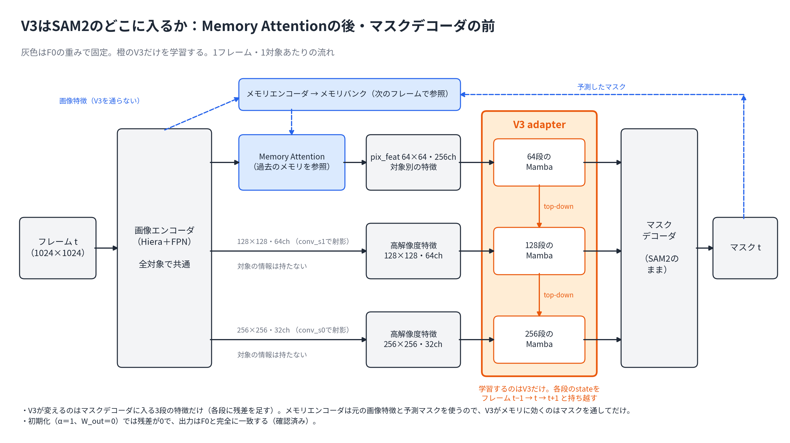
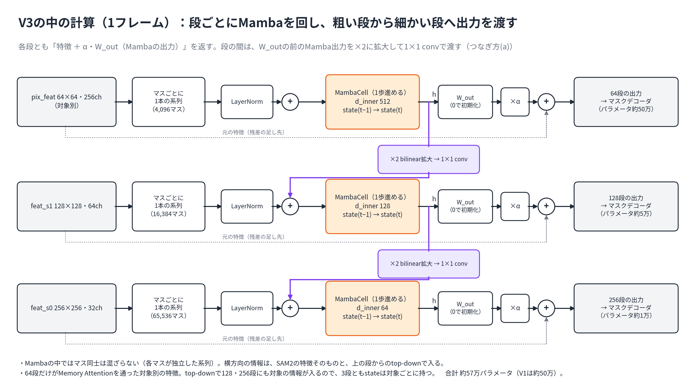
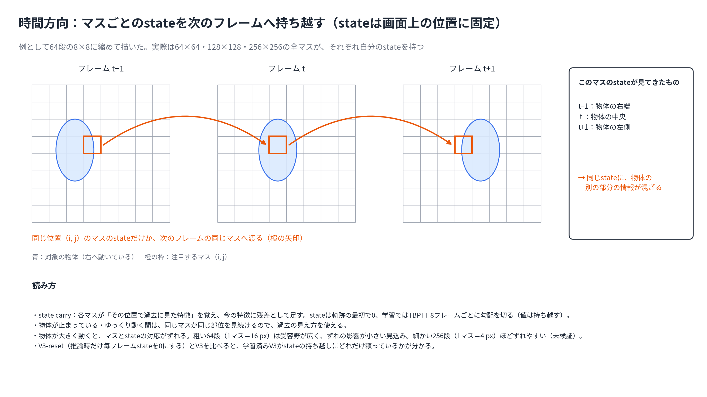
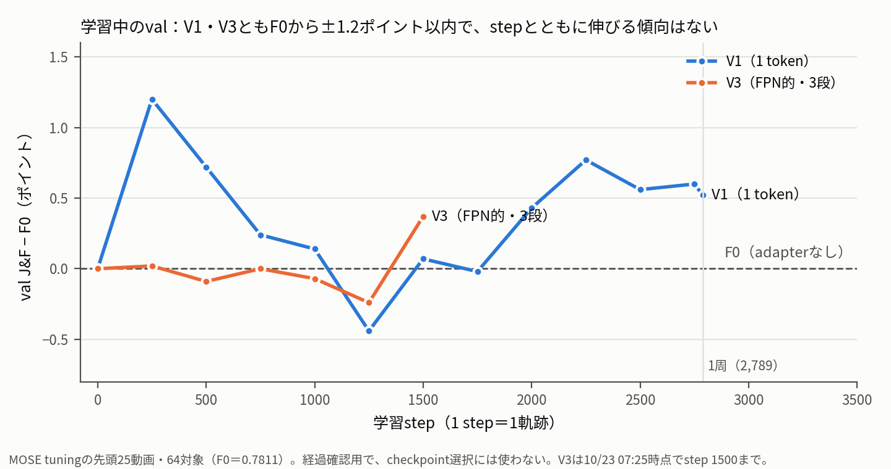

# 2026-10-23 MTG資料: temporal Mamba V1・V3の学習、ViEW 8ページ版の準備、SAM2MOTの区切り（10/14〜10/23の進捗）

## 0. 今日のMTGで先生に相談したいこと

1. **ViEW原稿（10/30締切、残り1週間）の主張の強さ**: 8ページ版を書く前に、原稿の記述と評価に使った実装を突き合わせた。window型とstate型は、モデル・入力・学習・リセットの扱いがすべて違い、**「stateを持ち越すから良い」とは言えない**ことが分かった。
   - 考察を「state carry型の構成で、SAMURAIをHOTA +1.4上回った（val 25系列・1 checkpoint）」までに弱めてよいか。
   - タイトル「状態保持型Mambaを用いたSAM2ベース物体追跡」は、このままでよいか。
   - 締切までに追加実験を1本だけ回すなら、動き予測を候補選択に使わない条件（重み0）の評価をやり直すべきか（7/27の実行は設定の取り違えで使えないと分かった）。
2. **temporal Mamba V3の解釈と、結果が出た後の進め方**: V3を実装し、V1（対照）と並べて本学習中。V1は学習を終え、学習中のvalではF0とほぼ同じ（+0.5ポイント、誤差の範囲）。V3は今日の13時ごろ学習が終わる。
   - V3の「FPN的」の形（64・128・256の各段でMambaを回し、粗い段のMamba出力を拡大して細かい段に足す。構造は3.1節に図で示した）は、9/30の先生の意図と合っているか（10/14には詳細を確認できていない）。
   - **V3の学習可能な部品は、空間方向（隣のマス）を一つも混ぜていない**と分かった（3.6節）。各マスの時間変化を見るだけで、物体の動きは捉えられない作りになっている。「FPN的」の意図に空間の関係も含まれていたか。
   - 次の方向として、V3とV4を合わせる案を考えた（3.6節(3)）。「フレーム内で空間を混ぜる」と「stateを物体の動きに追従させる」のどちらを優先すべきか。具体的には、B（粗い段はV4・細かい段はV3）とD（手法1の動き予測でstateをずらす）のどちらの方向がよいか。
   - 学習を、今の「軌跡全体をTBPTTで流す」（V3で1周約13時間）から、SAM2のように「短い区間を切り出す」形に変えて試行を速くしてよいか。長くstateを持ち越すことの学習とは引き換えになる（3.6節(4)）。
3. **SAM2MOT再現をここで区切ってよいか**: 検出器を公式版に替えたtest S4はHOTA 70.79（論文75.5）。残る差の主因はboxの位置ずれで、第三者の再実装もvalで同じ水準（HOTA 69.10）だった。「論文の記述からの再現ではval HOTA 69前後」を到達点として記録し、深追いをやめたい。

## 1. 現時点の結論

- **temporal Mamba**: 前回のF1で問題だった「adapterが学習されていない」は解消した（V1のαは約0.98、残差は特徴の約7%まで育った）。ただし、**学習中のvalではV1・V3ともF0を明確には上回っていない**。効果の有無は、tuning全体（313対象）の評価とpaired bootstrapで判定する（未実施）。また、**V3は空間方向を学習しない作り**だと分かったので、V3とV4を合わせる案と、学習のさせ方の見直しを相談したい。
- **ViEW**: 2ページ版の本文を移し、8ページ版の骨組みを用意した。手法の記述と実装の食い違いを8点洗い出し、1点は書き直す表現を決めた。
- **SAM2MOT**: 論文との差（HOTA −4.7）は、Add・CoI・Q-Rの寄与不足に分かれる。CoIの後に残る誤りの主因は、人が重なる場面でboxがGTより小さくなる位置ずれで、実装の誤りではない可能性が高い。
- **中間発表**: 10/15のFB（4点）を反映し、10/18に発表した。

## 2. 10/14 MTGのTODOの対応状況

| 10/14のTODO | 状況 |
|---|---|
| 中間発表スライドを修正して、もう一度見てもらう | **完了**。10/15にFBをもらい反映、10/18に発表 |
| temporal MambaのV3を試し、来週までにある程度形にする | 実装・正しさの確認・LR決定まで**完了**。V1は学習完了、**V3は学習中**（13時ごろ完了見込み）。評価は未実施 |
| ViEWのコメントをテキストにして共有し、優先度を付けて8ページ版に反映する | 8ページ版の骨組みと、手法の記述と実装の突き合わせは済み。**コメントのテキスト化・優先度付けは記録がない** |
| MTGで扱わなかった事項（SAM2MOTの続け方、タイトルなど）を相談する | 本資料の0章で再掲 |

## 3. temporal Mamba: V1・V3の学習

### 3.1 V3の構造

**一言で**: SAM2のマスクデコーダに入る3段の特徴（64×64・128×128・256×256）それぞれについて、**特徴マップの各マスを1本の時系列とみなしてMambaで1歩ずつ進め、その出力を元の特徴に残差として足す**。段の間は、粗い段のMamba出力を拡大して細かい段に渡す（FPNのtop-down経路と同じ形）。

#### (1) SAM2のどこに入るか

**この図で見る点**: V3はMemory Attentionの後・マスクデコーダの前に入り、デコーダに入る3段の特徴だけを変える。メモリバンクに入るのは元の画像特徴と予測マスクなので、V3はメモリにはマスクを通してしか効かない。

- 3段のうち、**対象の情報を持つのは64段だけ**（Memory Attentionで過去のメモリを参照した後の、対象別の特徴 `pix_feat`）。128段・256段は画像エンコーダのFPN特徴をデコーダ内の `conv_s1`・`conv_s0` で射影したもので、フレーム内の全対象で共通。
- SAM2本体（画像エンコーダ、Memory Attention、メモリエンコーダ、マスクデコーダ）はF0の重みで固定し、学習するのはV3だけ。
- 初期化では `W_out`＝0・α＝1なので残差は0になり、出力はF0と完全に一致する（段階0aで確認）。学習が進むと、F0からのずれとして効果が現れる。

#### (2) 1フレームの中の計算

**この図で見る点**: 3段とも同じ部品（LayerNorm → MambaCell → W_out → ×α → 元の特徴に足す）でできている。紫の経路が段どうしのつなぎ方。

粗い段（64）から細かい段（256）の順に、各段で次を行う。

1. 特徴マップ `[C, H, W]` を、H×W本の系列の1歩分の入力 `[H·W, C]` に並べ替える（各マスが独立した系列。Mambaの中でマス同士は混ざらない）。
2. LayerNormをかける。
3. 上の段があれば、上の段のMamba出力 $h$（`W_out` の前）を×2にbilinearで拡大し、1×1 convでこの段のチャネル数に合わせて足す。
4. MambaCellで1歩進める。各マスが前のフレームのstateを受け取り、更新したstateを次のフレームへ渡す。出力を $h$ とする。
5. その段の特徴に $\alpha \cdot W_{\mathrm{out}}(h)$ を足して、マスクデコーダへ渡す。$h$ は次の段のtop-downにも使う。

| 段 | 入力特徴 | マスの数（＝系列の本数） | 1マスの大きさ（入力画像上） | Mambaの内部次元 | パラメータ | SSM stateの大きさ（1対象、FP32） |
|---|---|---:|---:|---:|---:|---:|
| 64 | 256ch（対象別） | 4,096 | 16 px | 512 | 504,064 | 128 MiB |
| 128 | 64ch | 16,384 | 8 px | 128 | 53,376 | 128 MiB |
| 256 | 32ch | 65,536 | 4 px | 64 | 13,120 | 256 MiB |
| 合計 | | 86,016 | | | 570,563 | 512 MiB |

- MambaはMamba-1と同じ1歩の計算（causal conv、入力に応じたΔ・B・C、selective state update、ゲート）で、`d_state`＝16、`d_conv`＝4、`expand`＝2。パラメータの初期化は `mamba_ssm.Mamba` のものを使っている。
- 64段からのtop-downで128・256段にも対象の情報が入るので、**3段ともstateは対象ごと**に持つ。対象が増えると、stateもその数だけ増える。
- パラメータの約9割は64段にある。stateのメモリは細かい段ほど大きい。

#### (3) 時間方向：stateの持ち越し

**この図で見る点**: stateは「画面上の同じ位置のマス」から「次のフレームの同じ位置のマス」へ渡る。物体が動くと、同じマスのstateに物体の別の部分の情報が混ざる。

- stateは軌跡の最初のフレームで0から始め、最後のフレームまで持ち越す。学習ではTBPTTで8フレームごとに勾配だけを切る（stateの値は持ち越す）。1更新＝1軌跡。
- 物体が止まっている・ゆっくり動く間は、同じマスが同じ部位を見続けるので、過去の見え方を使える。大きく動くと、マスとstateの対応がずれる。粗い64段（1マス16 px）より細かい256段（1マス4 px）の方がずれやすいと考えている（未検証）。
- **V3-reset**は、同じ学習済みの重みで推論時だけ毎フレームstateを0にした条件。V3とV3-resetの差で、学習済みV3がstateの持ち越しにどれだけ頼っているかを見る（H2）。ただしresetしてもSAM2自身のメモリは残るので、「時間方向の記憶が役立つ」ことの単独の証拠にはしない。

#### (4) V1（対照）との違い

| | V1（1 token） | V3（FPN的） |
|---|---|---|
| Mambaに入れるもの | 64段の特徴を空間平均した1ベクトル | 3段の全マス（約8.6万本の系列） |
| 残差の足し方 | 64段の全マスに同じ値を足す | マスごとに違う値を、3段それぞれに足す |
| 残る空間情報 | なし | すべて（ただしstateは位置に固定） |
| パラメータ | 504,065 | 570,563 |
| 学習時のVRAM（最長軌跡） | 5.8 GiB | 12.6 GiB（checkpointingあり） |
| 学習の速さ | 約0.12秒/フレーム | 約0.23秒/フレーム |

- パラメータ数はほぼ同じ（V3が約13%多い）。違いの中心は、空間の解像度・使う段・計算量とstateの量、段どうしの接続。V3とV1を比べても（H3）、「空間情報を保ったこと」だけの効果とは言えない。

#### (5) 設計上の選択と、先生に確認したいこと

- **「FPN的」の解釈**: 9/30の「FPNなどを工夫して、サイズを削らずに入れる」を、「各段で全マスをMambaに入れ、段どうしをFPNのtop-downの形でつなぐ」と解釈した。10/14の時点で、つなぎ方は (a) 粗い段のMamba出力を細かい段の入力に足す、(b) stateどうしをつなぐ、(c) 各段を独立に回して最後に合成、の3案があり（[10/14の図](figures/2026-10-14-temporal-mamba-variants/02-v3-fpn-detail.png)）、最も素直な(a)で実装した。(b)(c)は試していない。
- **対象の情報の入り方**: 128・256段は全対象で共通の特徴なので、64段からのtop-downがなければ対象の区別がない。(a)にしたことで全段が対象別になり、メモリと計算は対象数に比例する。
- **stateが位置に固定されること**: 物体の動きに追従しない。改善しなかった場合の原因の候補で、追従させるにはV2（縮めたグリッド）やV4（時空間scan）、あるいはマスク内だけでstateを集める形などが候補になる。

### 3.2 実施したこと

[spec](../specs/2026-10-18-temporal-mamba-v3-mose-adapter-spec.md)に沿って、SAM2本体をF0で固定し、adapterだけをMOSEで学習している。

| 段階 | 内容 | 結果 |
|---|---|---|
| 0a 正しさ | 初期化直後はF0と出力が一致、学習と推論の経路が一致、SAM2本体は不変 | 合格（単体19/19） |
| 0b LR | 16軌跡・200更新のpilotで、LR 1e-4・3e-4・1e-3を比較 | V1・V3とも3e-4まで合格、1e-3は不安定。**共通のLRは3e-4** |
| 0c・1a メモリ | V3はVRAMが約21 GiBでA4000（16 GB）に入らない → MambaにactivationのcheckpointingをかけてV3（3段）を12.6 GiBに | checkpointingのオン・オフで計算結果は完全一致 |
| 1b 更新回数 | V3は約0.23秒/フレーム（V1の約2倍） | fitの1周（2,789更新）に決定 |
| 2 本学習 | V1（142）・V3（141）、どちらもRTX A4000 | V1完了（8.3時間）、V3は10/23 07:25時点でstep 1,750/2,789 |

- 前回のF1との違い: adapterのLRを本体（5e-6）から分けて3e-4にした。学習と推論で計算経路が違っていた不具合（F1では出力層が学習時に使われていなかった）も直した。
- GPU: 142のRTX PRO 4500（32 GB）が10/19以降認識されなくなり、A4000（16 GB）で回すためにcheckpointingを入れ、141のA4000も使った。

### 3.3 Evidence: 学習中のval

**この図で見る点**: 青（V1）は最初の250 stepで+1.2ポイント上がった後、−0.4〜+0.8の間で上下し、stepとともに伸びる傾向はない。橙（V3）は途中までF0とほぼ同じ。

| step | V1 val J&F | V3 val J&F |
|---|---:|---:|
| 0（＝F0） | 0.7811 | 0.7811 |
| 250 | 0.7931 | 0.7813 |
| 750 | 0.7835 | 0.7811 |
| 1,250 | 0.7767 | 0.7787 |
| 1,500 | 0.7818 | 0.7848 |
| 2,789（最終） | 0.7863（+0.52） | 学習中 |

- valはtuningの先頭25動画・64対象で、経過を見るためだけのもの（checkpointの選択には使わない）。25動画分なので、0.5ポイント程度の上下は誤差の範囲と考えている。
- V1の最終の重みで、64対象のうち改善16・悪化6・ほぼ変化なし42。
- adapterは確かに学習されている: V1は最終でα=0.975、残差の比は約0.067、Mamba本体の重みは初期値から5.84動いた。V3も3段すべてのMambaと段どうしの1×1 convに勾配が届き、重みが動いている。
- pilotの診断用lossは、V1で約22%、V3で約39%、F0より下がった。ただし学習に使った16軌跡そのもので測った値で、汎化は示さない。

### 3.4 Interpretation

- 「LRを直せばadapterは学習される」ことは確かめられた。前回F1の結果（効果なし）は、Mambaの効果を検証できていなかったと改めて言える。
- 一方、**adapterが学習されて出力を変えていても、valのJ&Fにはほとんど結び付いていない**（V1）。理由の候補は、1 tokenでは空間の情報がない（V1）、SAM2本体を固定している、学習量（1周）、MOSEのtuningでは時間方向の記憶が効く場面が少ない、など。まだ切り分けていない。
- V3は、各マスのstateが画面上の位置に固定されていて、物体が動くと同じマスが同じ部位を指さなくなる。これが効かない理由になりうる（未検証）。

### 3.5 この後の予定

1. V1の評価（tuning全体の313対象、F0との差をpaired bootstrapで）。今日から142で回せる。
2. V3の学習が終わったら、V3とV3-reset（推論時だけ毎フレームstateを初期化）を評価する。V3 > F0（H1）とV3 > V3-reset（H2）を、事前に決めた基準（95%信頼区間の下限が0より大きいか）で判定する。
3. 判定の後に、次の案（V2・V4、学習量、本体の同時学習）を決める（0章の相談2）。

### 3.6 資料作成中に気づいたこと：V3は空間方向を学習していない（相談用）

#### (1) Evidence: V3の部品はすべて「マスの中」で閉じている

実装（`ff78b57`）を部品ごとに確認した。

| 部品 | 何に沿って計算するか | 空間（隣のマス）を混ぜるか |
|---|---|---|
| LayerNorm、`W_out`・α、段間の1×1 conv | 1マスのチャネル方向 | 混ぜない |
| Mambaの中のconv1d（`d_conv`＝4） | **時間方向**（同じマスの直近4フレーム） | 混ぜない |
| MambaのSSM・ゲート・`out_proj` | 1マスのチャネル方向 | 混ぜない |
| 段間の×2 bilinear拡大 | 空間（近くの粗いマスの補間） | 混ぜるが、固定の補間で学習しない |

- V3が学習しているのは、**各マスの特徴の時間変化を、全マス共通の重みで処理する関数**（マスごとの時間フィルタ）。
- 空間の情報は、入力特徴そのもの（画像エンコーダとMemory Attentionで広い文脈が入っている）、top-downの固定の補間、後段のマスクデコーダ（固定）からしか入らない。

#### (2) Interpretation（推論、未検証）

- 物体が「どちらへ何マス動いたか」は、隣のマスと時間をまたいで比べないと分からない。V3にはその経路がないので、**動きは捉えられず**、できるのは各マスの平滑化やゲートのような処理までと考えられる。3.1(3)の「stateが位置に固定され、物体に追従しない」と同じ根の問題。
- 学習中のvalがF0から伸びないこととは辻褄が合うが、原因と確かめたわけではない（本体の固定、学習量、データの性質もありうる）。
- 9/30の「FPNなどを工夫して、サイズを削らずに入れる」の意図が「空間の関係も含めて時系列で扱う」ことだったなら、今のV3はその半分しか実装できていない可能性がある。

#### (3) V3とV4を合わせる案（たたき台）

V3は「マスごとの記憶はあるが、空間を混ぜず、位置に固定」。V4（時空間scan）は「空間は混ざるが、フレーム間に渡るのは1フレームを要約した1つのstateだけ」。欠点が逆向きなので、両立させる案を考えた。狙いは次の2つに分かれる。

- 狙い1：フレーム内で空間を混ぜる（隣のマスや物体全体の文脈を、時間の記憶と一緒に扱う）
- 狙い2：stateを物体の動きに追従させる（位置固定の問題を直す）

| 案 | 中身 | 狙い1 | 狙い2 | 実装の重さ |
|---|---|---|---|---|
| A. 分解型（空間→時間） | 各段で、フレーム内の空間の混合（A1: depthwise 3×3 conv／A2: 毎フレームstateを0にするフレーム内scan）をしてから、V3のマスごとの時間Mambaに通す | ○ | △ | A1は小（V3に足すだけ） |
| B. 粗い段はV4、細かい段はV3 | 64段（4,096マス）だけ時空間scanでstateを持ち越し、出力をtop-downで128・256段へ渡す | ○ | △ | 中（scanに初期stateを渡す実装が必要） |
| C. 畳み込み型のstate更新 | stateを空間マップとして持ち、更新式の中で近傍と畳み込む（ConvSSM。先行研究にConvS5、Smith et al., NeurIPS 2023。詳細は要確認） | ○ | ○ | 大（高速カーネルが使えない） |
| D. stateを動きでずらす | 各フレームで、前のstateを物体の動きの分だけずらしてから更新する。動きは手法1のMambaのbox予測やマスクの移動から得る | — | ◎ | 中。**手法1と手法2がつながる** |
| E. 物体中心の座標 | 物体のboxでROI-alignし、マスを物体に貼り付いた座標にする | — | ◎ | 中（boxが外れると壊れる） |

- 比べ方の案：「空間の混合 なし／conv／scan」×「時間 なし／reset／carry」の格子にすると、どちらが効いたかを分けて読める。今のV3は「なし×carry」、V4-resetは「scan×なし」にあたる。
- 気を付ける点：**SAM2のMemory Attentionはすでに時空間を混ぜている**（過去フレームの全マスにattention）。Mambaを足す意味を「長期の記憶を小さく持つ」と言うのか、「動きの規則性を学ぶ」と言うのかを決めないと、空間の混合を足しても「attentionと何が違うのか」に答えられない。
- 今の見立て：すぐ試せるのはA1。先生に方向性を聞きたいのはB（素直なV3＋V4）とD（位置固定に正面から向き合い、手法1とつながる）。

#### (4) 学習のさせ方も見直す余地がある

外部の相談（ChatGPT）で、「SAM2の学習に合わせて短い区間で学習すべきか」も整理した。文献の数値はChatGPTの調べで、こちらでは確認していない。SAM2の公式MOSE設定の値だけはリポジトリのyamlで確認した。

- 今のやり方：1更新＝1軌跡の全体を順に流し、TBPTT 8フレームで勾配だけ切ってstateの値は持ち越す。1周にV1で8.3時間、V3で約13時間かかる。
- SAM2の公式MOSE fine-tune（`sam2.1_hiera_b+_MOSE_finetune.yaml`）は、同じ物体の8フレームを動画から選ぶ（`num_frames: 8`、`max_num_objects: 3`、40 epochs、画像エンコーダも `vision_lr` 3e-6で学習）。
- 提案された方向：**連続8〜16フレームを各動画から少数だけ切り出し、その中だけでstateを持ち越して学習する。長く持ち越すことの効果は、推論時のcarry／resetの比較で見る。**学習は大幅に速くなり、案A〜Eの比較を回しやすくなる。
- ただし、短い区間の学習では「長くstateを持ち越すこと」自体は学習しない（ViEWの突き合わせで分かった、手法1が12フレームの窓でしか学習していない問題と同じ）。研究の軸をstate carryに置くなら、短い区間の学習と今の全軌跡の学習を比べる必要がある。
- そのほかの提案：間隔を空けた8フレーム（少ない計算で長い時間範囲）、画像エンコーダの出力のキャッシュ（stateに依存しないので原理的に可能。ただし今は軌跡ごとにflipなどのaugmentationをかけているので、そのままでは両立しない）、マスクデコーダも一緒に学習する比較。

## 4. ViEW原稿（10/30締切）

### 4.1 実施したこと

- 原稿の正本はOverleafで、ローカルの同期フォルダをGitで管理し始めた。2ページ版の本文を `main_abstract.tex` へ移し、8ページ版（`cameraready_view_full.tex`）の骨組みを用意した。
- MIRU原稿の手法の記述を、表の値を出した評価runのコードと突き合わせた（[突き合わせのメモ](../papers/2026-view/2026-10-23-method-implementation-check.md)）。新しい実験はしていない。

### 4.2 Evidence: 記述と実装の主な食い違い

| # | 原稿の記述 | 実装 |
|---|---|---|
| 1 | 各候補マスクのbboxをMambaに入力 | 入力するのは「選ばれた候補」のboxの履歴で、SAMの予測IoUが0.3を超えたときだけ |
| 2 | 状態ベクトルは8次元 $[c_x, c_y, w, h, \Delta c_x, \ldots]$ | state型は4次元のbox、window型はboxの差分。どちらとも合わない |
| 5 | SAM2のメモリ機構は変更していない | Mambaの予測はSAMURAIと同じくメモリ選択にも効いている |
| 6 | 過去全体を状態として持てる | 信頼度が低いと次フレームでリセットする。学習は12フレームの窓（毎回ゼロ状態から）で、長くstateを持ち越すことは学習していない |
| 7 | 考察「hidden stateとして引き継ぐことが有効」 | window型（MambaTrack、13.3M）とstate型（独自、1.38M）は、モデル・入力・学習・リセットがすべて違う。**原因をstateの持ち越しに特定できない** |
| 8 | （記載なし） | stable_frames_threshold=1、予測開始までの観測数5、推論時の±0.1 clip、各IDの初出フレームでGT bboxを与える初期化 |

- このほか、Mambaの引用（実装はMamba-1なのでGu & Daoを引く）、$s_{\mathrm{mask}}$ がSAM2の予測IoUであることの明記がある。
- 10/23に決めた方針: 概要図と手法の説明の流れはMIRU・2ページ版のまま使う。食い違い1は、「各候補の bbox を Mamba に入力」と読める一文だけを直す。関連研究の章は残す。

### 4.3 関連して分かったこと（中間発表の準備で調べた）

- **重み0（動き予測を候補選択に使わない）の7/27の評価は使えない**: 25系列中24系列が実際には重み0.5で動いていた。「動き予測があること自体の効果」は、今は示せない。有効な比較は重み0.25（HOTA 55.52）と0.5（53.92）だけ。
- **系列ごとの差は一部に集中**: Ours（state）− SAMURAIのHOTA差は、上位5系列だけで25系列の合計を超える。人数・遮蔽・速さなど系列の性質とは、はっきりした関係がない（|ρ| ≤ 0.24）。
- 計算コスト: Mambaは約138万パラメータで、推論時間全体の約4%（見積もり）。

### 4.4 Interpretation

- 表の数値（state carry型がSAMURAIをHOTA +1.4上回る）はそのまま使えるが、**その理由を「stateを持ち越すこと」に帰す記述はできない**。考察は「この構成で上回った」までにとどめ、window型との差は「構成全体の違い」として書くのが安全だと考えている。
- 10/14の未相談事項（「有効性を確認した」という言い方、評価split・GT bbox初期化の追記）も、この方針で8ページ版に反映したい。

## 5. SAM2MOT再現: 区切りの提案

### 5.1 Evidence

10/15に判断ルール（「ノイズ範囲の差なら論文・公式の設定に近い方」）で検出器を公式README版（o365tococo）に替え、testを作り直して提出した。

| test | HOTA | MOTA | IDF1 |
|---|---:|---:|---:|
| 本再現 S1 | 63.73 | 55.92 | 71.32 |
| 論文 S1 | 62.9 | 55.6 | 69.6 |
| 本再現 S4 | 70.79 | 80.04 | 78.53 |
| 論文 S4 | 75.5 | 89.2 | 83.4 |

| 寄与（test） | 本再現 ΔHOTA | 論文 ΔHOTA |
|---|---:|---:|
| Add | +2.54 | +5.0 |
| CoI | +4.38 | +5.9 |
| Q-R | +0.14 | +1.7 |

- **MOTAの差はFPの多さから来る**: S4の誤り（FN+FP+IDSW）はGT比19.96%で、論文（10.8%）の約2倍。本再現のFPだけで13.33%ある。
- **CoIの後に残るFPの最大要因はboxの位置ずれ**（val S3でFPの46%）。その9割は出力boxがGTより小さく、人どうしが重なる場面に偏る（マスクが見えている部分だけを覆うため、と考えている）。valの比率をtestに当てはめると、位置ずれはMOTAを6.7〜11.1下げていて、論文との差（9.2）と同じ規模。
- **第三者の再実装（SAM2-Animal-Tracking）も同じ水準**: 同じ検出でval HOTA 69.10（本再現S4 69.29）。重複のFPは本再現の1/3に減るが、位置ずれのFPは同じだけ残る。
- CoIのStage 2を除外に使わない案はHOTAが動かない（−0.02 / +0.15、AssA↑とDetA↓が相殺）。オラクルCoI（診断専用）でも、判定できた誤除外は主因と言えなかった。

### 5.2 Interpretation / 提案

- baseline（S1）は論文と一致し、独立した2つの再実装がval HOTA 69前後で並ぶ。**論文の記述から作れる実装としては妥当な到達点**と考える（hypothesis）。
- 残る差は、boxの作り方（位置ずれ）と、論文がtestでだけ使う系列別の検出閾値（未公開）。どちらも論文の記述からは詰められない。
- ここで深追いを区切り、temporal MambaとViEWにGPUと時間を回したい。

## 6. 今回言えること / まだ言えないこと

| 言えること | まだ言えないこと |
|---|---|
| adapterのLRを直すと、V1・V3とも学習され、SAM2本体は不変のまま出力が変わる | V1・V3がF0を上回るか（tuning全体の評価が未実施） |
| 学習中のvalでは、V1はF0から−0.4〜+1.2ポイントの範囲で上下し、伸びる傾向はない | V3が改善しない場合、その原因（位置固定のstate、学習量、本体固定、データ） |
| checkpointingは計算結果を変えずにV3のメモリを約4割減らす | V3が先生の意図した「FPN的」の形か |
| V3の学習可能な部品は空間方向を混ぜない（コードで確認） | 空間の混合を足せば改善するか。V3とV4を合わせる案（A〜E）のどれが効くか |
| state carry型はDanceTrack val 25系列でSAMURAIをHOTA +1.4上回る（1 checkpoint、GT bbox初期化） | その差がstateの持ち越しによるか。動き予測があること自体の効果（重み0の再評価が必要） |
| SAM2MOTのS1はtestで論文と一致し、残る差の主因はboxの位置ずれ | 論文側の位置ずれの頻度、系列別閾値の中身 |

## 7. 次に進む候補

1. **temporal Mamba**: V1の評価を今日から回す。V3の学習が終わり次第、V3・V3-resetを評価して判定する。次の案は、今日の相談を踏まえて、V3とV4を合わせる案（まずはA1：V3＋depthwise conv）と、短い区間での学習への切り替えを検討する。
2. **ViEW**: 今日の相談に沿って8ページ版の考察と実験設定を書く。ViEWのコメントをテキストにして優先度を付ける。重み0の再評価を回すかは0章の相談次第。
3. **SAM2MOT**: 区切る場合は、到達点と残る差をREADMEと実験ログにまとめて止める。
4. 実装上の確認（論文の前に）: 評価runの約0.8%の行で、全マスクがNO_OBJ（box [0,0,0,0]）なのに予測IoUが0.3を超えてMambaに入っている。現在の設定ファイルの重みは0.5で、表の評価（0.25）と違う。

## 8. 図・生成物

| 図 | 内容 | 状態 |
|---|---|---|
| [01-train-val-jf-vs-f0.png](../experiments/figures/2026-10-23-temporal-mamba-train-val/01-train-val-jf-vs-f0.png) | V1・V3の学習中のval J&F（F0との差） | 今回作成（[manifest](../experiments/figures/2026-10-23-temporal-mamba-train-val/manifest.md)）。V3は07:25時点 |
| [V3の構造の図](figures/2026-10-23-v3-structure/manifest.md)（3枚） | SAM2の中での位置、1フレームの中の計算、stateの持ち越し | 今回作成（実装 `ff78b57` から描いた） |
| [temporal Mamba統合候補の図](figures/2026-10-14-temporal-mamba-variants/manifest.md) | V1〜V4、V3のつなぎ方の候補 | 既存 |

## 9. 参照ファイル

- 前回: [10/14 MTG議事録](../meetings/2026-10-14-mtg.md)、[10/14 MTG資料](2026-10-14-weekly-progress-mtg-materials.md)
- temporal Mamba:
  - [V3 spec](../specs/2026-10-18-temporal-mamba-v3-mose-adapter-spec.md)、[実験ログ](../experiments/2026-10-18-temporal-mamba-v3-mose-adapter.md)
  - [統合候補の整理（brainstorm）](../../../../secretary/notes/brainstorm/2026-10-18-temporal-mamba-integration-variants.md)、[specの再レビュー（brainstorm）](../../../../secretary/notes/brainstorm/2026-10-22-temporal-mamba-v3-spec-review.md)
- ViEW: [ViEWフォルダ](../papers/2026-view/README.md)、[手法の記述と実装の突き合わせ](../papers/2026-view/2026-10-23-method-implementation-check.md)、[重み0の評価の訂正](../experiments/2026-07-28-sam2-kf-score-weight-epoch100-25seq.md)、[系列別の分析](../experiments/2026-10-18-sequence-level-gain-analysis.md)、[計算コスト](../experiments/2026-10-18-mamba-motion-cost-estimate.md)
- SAM2MOT: [test提出結果](../experiments/2026-10-09-sam2mot-test-runs.md)、[FPの内訳](../experiments/2026-10-15-sam2mot-add-fp-diagnosis.md)、[第三者の再実装との比較](../experiments/2026-10-18-sam2mot-ref-sam2-animal-tracking-val.md)、[CoI Stage 2を外す案](../experiments/2026-10-14-sam2mot-coi-stage2-skip.md)、[検出器の比較](../experiments/2026-10-13-sam2mot-o365tococo-val.md)
- 中間発表: [中間発表フォルダ](../papers/2026-midterm/README.md)、[修正計画と10/15のFB](../papers/2026-midterm/2026-10-14-midterm-slide-revision-plan.md)
