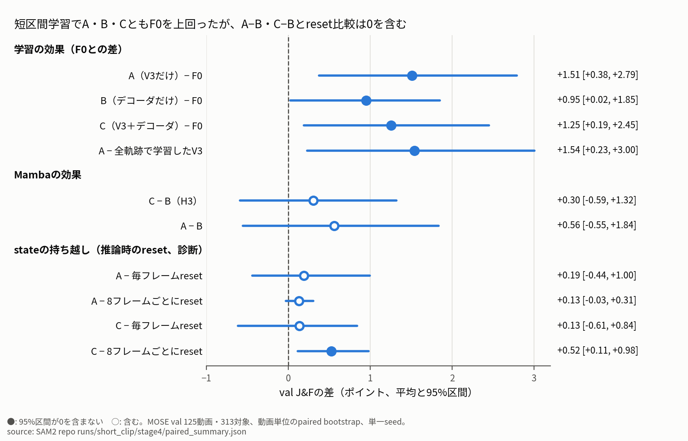
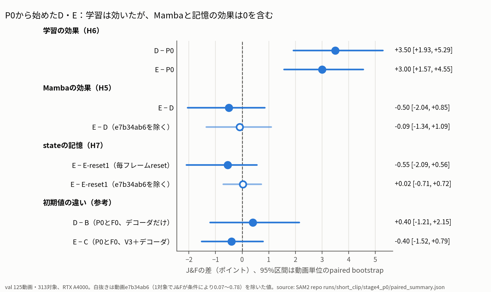
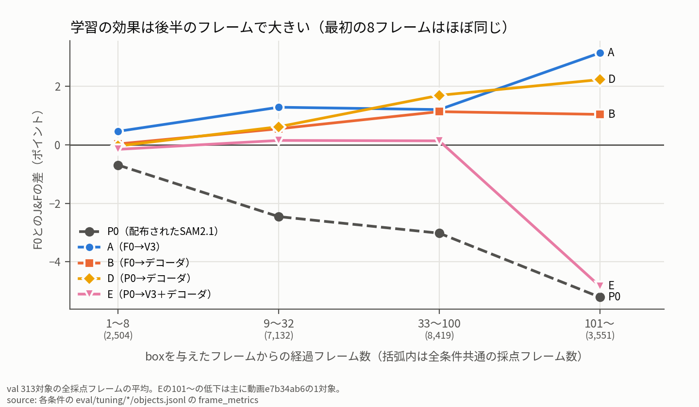
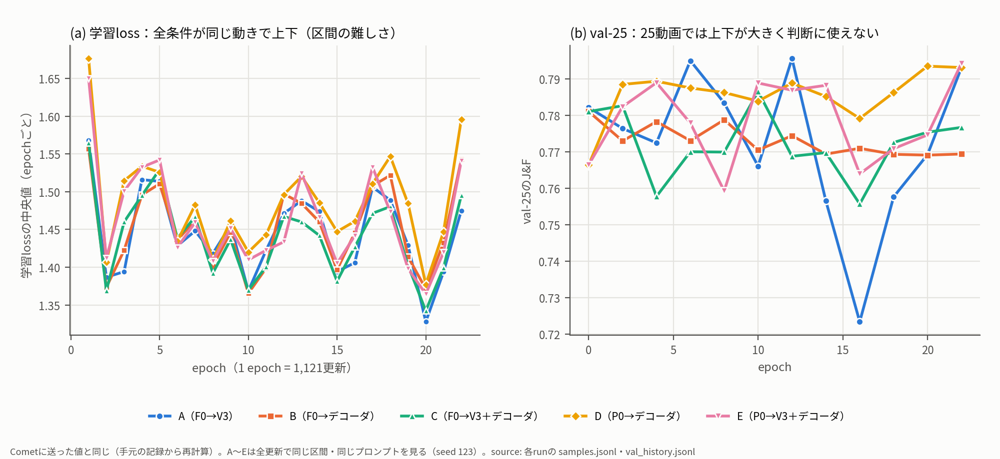
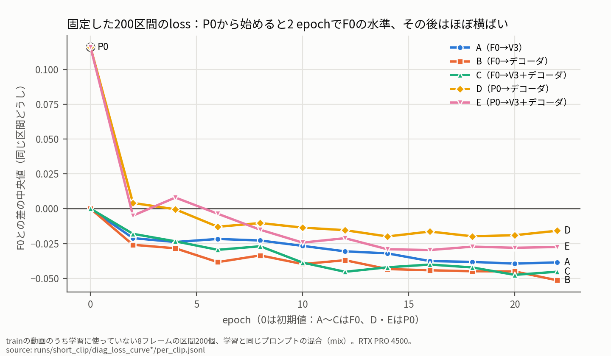

# 2026-10-30 MTG資料: temporal Mambaの短い区間での学習の結果、ViEW原稿のFB対応（10/23〜10/30の進捗）

## 0. 今日のMTGで先生に相談したいこと

**一言でいうと**: 10/23の指摘どおり8フレームの短い区間の学習に切り替え、「学習はまともに回る」ようになった（val J&F +1.5〜3.5ポイント）。ただし、**Mambaなしでも同じくらい上がり、V3は推論時にstateを毎フレーム捨てても性能が変わらない**。初期値をF0・P0のどちらにしても同じだった。

1. **結果の読み方**（3章）: 「学習は回るようになったが、今のV3は時間方向の記憶を使っていない」と判断してよいか。
   - 根拠: Mambaの有無の差（A−B +0.56、C−B +0.30、E−D −0.50）と、stateの持ち越しの有無の差（A +0.19、C +0.13、E −0.55）がすべて95%区間で0を含む。条件・初期値を変えても揃って0付近。
   - 留保: 条件の差は少数の対象の「外す／取り戻す」で決まり、今のval（MOSE 125動画）・単一seedでは0.5〜1ポイントの差は見分けられない（3.6節）。
2. **次に何をやるか**（4章）: 10/23の段階的な計画（8 → 16フレーム以上）をそのまま続けるか、**V3の構造の見直し（stateを物体に追従させる・空間方向を混ぜる）に進むか**。8フレームの区間の中でも記憶を使っていないので、区間を延ばすより構造を先に見直したいと考えている。その前に、推論のやり直しなしでできる確認（追跡を外した後の回復率）と、10/23に決めた **DanceTrackでの評価**（まだMOSE valでしか見ていない）を挟むべきか。
3. **修論の構成案**（6章）: 「SAM2・SAMURAI・SAM2MOTの2か所にMambaを入れる1本の提案」とする骨格、2月までに揃わない場合の本体の範囲、主表の評価を相談したい。

報告のみ: ViEW原稿は10/28のFBを反映し、MTG前にOKをもらった（5章）。SAM3の比較は未着手。

## 1. 現時点の結論

- **学習方法の切り替えは効いた**: 同じV3の構造で、全軌跡のTBPTT（10/22、F0との差 −0.03）から公式の短い区間の学習（A）に変えると、val（125動画・313対象）のJ&Fが **+1.54ポイント**上がった（0を含まない）。
- **Mambaの効果は分けられていない**: Mambaなし（B）でも+0.95上がっており、改善の多くは「公式の設定でMOSEをさらに学習したこと」による可能性が高い。
- **学習したV3はstateの持ち越しをほとんど使っていない**: 毎フレームresetしても差は0を含む（A +0.19、C +0.13）。
- **P0（配布されたSAM2.1）から始めても同じ結論**（10/30評価完了）: D・EともP0から+3.0〜3.5ポイント上がり、F0から始めたB・Cと同じ水準（J&F 0.78前後）になった。E−D（Mambaの効果）は −0.50、E−E-reset1（記憶の使用）は −0.55で、どちらも0を含む。この差は動画 `e7b34ab6` の1対象でほぼ説明でき、除くと −0.09・+0.02。
- **学習の効果は後半のフレームで出ている**: boxを与えた直後の8フレームはどの条件もF0とほぼ同じで、経過フレームが増えるほどF0との差が開く（A：+0.5 → 101フレーム以降 +3.1）。学習は「時間が経っても追跡を外しにくくする」方向に効いている。
- **条件どうしの差は少数の対象の「外す／取り戻す」で決まる**: 同じ対象で条件によりJ&Fが±70ポイント変わることがあり、0.5〜1ポイント程度の差は今のval（125動画）・単一seedでは見分けられない。

## 2. 前回MTG（10/23）からの流れ

| 10/23のTODO | 状況 |
|---|---|
| temporal Mambaの学習を8フレーム程度の短い区間に切り替え、1週間で数値を出す | **完了**。F0から始めたA・B・Cを学習・val評価（3章）。P0から始めるD・Eも追加で学習・val評価（3.5節） |
| ViEW原稿を直し、10/26ごろSlackで確認してもらう | 10/28にFBをもらい、対応を原稿に入れた。10/30のMTG前にOKをもらった。5章 |
| SAM3をトラッキングの比較手法として加える | **未着手** |

ほかにやったこと:

- 学習を公式の学習コード（`training/train.py`・`SAM2Train`）に移した。V3・補正クリック・プロンプトの混合を通し、正しさの確認11項目（初期化直後はF0と完全一致、stateの区間ごとの初期化、保存→復元の一致など）をすべて通した。
- 移行の途中で、MOSEのフォルダにmacOSの隠しファイル（`._*`、約19万個）があり公式のloaderが全動画で失敗すること、SAMURAI改変でIoU予測の戻り値が変わっていて公式のlossと合わないことを見つけ、どちらも読み込み・lossの側で直した。
- 旧自作学習スクリプトのリファクタリング（挙動を変えずに整理、R0〜R5）を完了。
- 全軌跡で学習したV3（10/22）のval評価を完了: F0との差 −0.03 [−0.72, +0.59]、stateのreset比較 +0.13 [−0.18, +0.42]。どちらも改善なし。

## 3. Evidence: 短い区間での学習の結果

### 3.1 条件

すべてF0（10/9に自作の設定でMOSEを学習したSAM2.1 Small）から始め、SAM2本体の残りは固定した。

| 条件 | V3 | 学習するもの |
|---|---|---|
| A | あり（3段） | V3だけ |
| B | なし | マスクデコーダだけ |
| C | あり（3段） | V3＋マスクデコーダ |

- 共通: 1対象・8フレームの区間、プロンプトは公式の混合（マスク・クリック・box、先頭1枚、途中の補正クリックあり）、公式のaugmentation・loss、24,662更新（22 epoch）、seed 123。A・B・Cは同じクリップ・同じプロンプトの列を見る。
- 評価: val 125動画・313対象、先頭にbox 1回だけ与えて追跡（追跡で実際に使う条件）。差は動画単位のpaired bootstrapの95%区間。

### 3.2 valのJ&F

**この図で見る点**: 上の4本（F0との差）はすべて0より右で区間も0を含まないが、Mambaの有無の差（A−B・C−B）とreset比較は区間が0をまたぐ。

| 条件 | J&F |
|---|---:|
| F0 | 0.7701 |
| 全軌跡で学習したV3（10/22） | 0.7698 |
| A（V3だけ） | **0.7852** |
| B（デコーダだけ） | 0.7796 |
| C（V3＋デコーダ） | 0.7826 |

- 仮説の判定: A＞F0は支持（+1.51 [+0.38, +2.79]）。C＞B（デコーダも学習する条件でのMambaの効果）は支持されない（+0.30 [−0.59, +1.32]）。
- C−（8フレームごとのreset）だけが0を含まない正の差（+0.52）だったが、毎フレームのresetとの差は0を含み、理由は確認できていない。

### 3.3 trainのloss（学習が進んでいるか）

trainの動画から、学習に使っていない8フレームの区間を200個固定して、2 epochごとのcheckpointのlossをF0と比べた（同じ区間どうしの差の中央値）。

| epoch | 2 | 10 | 22 |
|---|---:|---:|---:|
| A | −0.021 | −0.027 | −0.039 |
| B | −0.026 | −0.040 | −0.051 |
| C | −0.018 | −0.039 | −0.045 |

（公式のプロンプトの混合の場合。box 1回の場合も同じ傾向。F0のlossの中央値は約1.46）

- 3条件ともepochとともにゆっくり下がり、22 epochでもまだ下がりきっていない。
- 下がる量は、P0→F0の差（約0.12）の3分の1程度。

### 3.4 学習中のval-25は判断に使えなかった

- 学習中に見ていたval-25（valの先頭25動画）では、A・B・Cとも学習前より下がって見えた（最後の3回の平均 − 学習前: −0.89、−1.18、−0.62）。val全体では3条件ともF0を上回ったので、25動画ではこの規模の差は判断できない。以後、val-25は経過を見るだけにしている。

### 3.5 P0から始める学習（D・E）：Mambaの効果も記憶の使用も出なかった

F0の時点でtrainのlossを下げる余地が小さかった（3.3）ので、配布されたP0から始めて、下げる余地が大きい条件でMambaの効果（E−D）が出るかを見た。初期値以外はB・Cと同じ（同じクリップ・同じプロンプトの列）。学習は10/30朝に完了し、val全体の評価（P0・D・E・E-reset1）も10/30 11時に完了した。

| 条件 | 初期値 | 学習するもの | 対応する前回の条件 | val J&F |
|---|---|---|---|---:|
| P0 | — | — | — | 0.7486 |
| D | P0 | マスクデコーダ | B（0.7796） | 0.7836 |
| E | P0 | V3＋マスクデコーダ | C（0.7826） | 0.7787 |
| E-reset1 | （Eと同じ重み） | 推論時に毎フレームstateをreset | — | 0.7841 |

**この図で見る点**: 学習の効果（H6）は0から離れているが、Mambaの効果（H5）と記憶の使用（H7）は0をまたぐ。白抜き（1動画を除いた値）はほぼ0に重なる。

| 仮説 | 比較 | J&Fの差 [95%区間] | 判定 |
|---|---|---|---|
| H6 学習の効果 | D − P0 / E − P0 | +3.50 [+1.93, +5.29] / +3.00 [+1.57, +4.55] | 支持 |
| H5 Mambaの効果 | E − D | −0.50 [−2.04, +0.85] | 支持されない |
| H7 記憶の使用 | E − E-reset1 | −0.55 [−2.09, +0.56] | 支持されない |
| 参考 初期値の違い | D − B / E − C | +0.40 [−1.21, +2.15] / −0.40 [−1.52, +0.79] | 0を含む |

- **E−D・E−E-reset1のマイナスは、ほぼ1対象で生じている**: 動画 `e7b34ab6` の対象1（274フレーム）は、Eでは序盤に追跡を外して最後まで戻らない（J&F 0.07）が、E-reset1（0.78）とD（0.57）は途中で取り戻す。F0・Bも外したまま（0.07〜0.09）。この動画を除くと E−D −0.09 [−1.34, +1.09]、E−E-reset1 +0.02 [−0.71, +0.72]。
- **stateを毎フレームresetしたE-reset1は、Dとほぼ同じ**（+0.05 [−1.19, +1.29]）。V3の層を足したこと自体の効果もない。
- F0から始めた前回と合わせると、stateを持ち越すことの効果はA +0.19、C +0.13、E −0.55（1動画を除くと +0.02）で、どれも0を含む。

### 3.6 結果の分析：学習はどこで効き、条件の差はなぜ見えないか

**この図で見る点**: boxを与えた直後の8フレームはどの条件もF0とほぼ同じで、経過フレームが増えるほど学習した条件とF0の差が開く（P0は逆に開く）。

| boxを与えてからのフレーム | 1〜8 | 9〜32 | 33〜100 | 101〜 |
|---|---:|---:|---:|---:|
| F0（J&F） | 83.8 | 80.0 | 75.9 | 72.5 |
| A − F0 | +0.5 | +1.3 | +1.2 | +3.1 |
| B − F0 | +0.0 | +0.6 | +1.1 | +1.0 |
| D − F0 | −0.0 | +0.6 | +1.7 | +2.2 |
| P0 − F0 | −0.7 | −2.5 | −3.0 | −5.2 |

（対象・フレームの重みの平均。Eの101〜は動画 `e7b34ab6` の影響で −4.8）

- **学習の効果は「追跡を外しにくくなる」ことで出ている**: 最初のマスクの精度はほぼ変わらず、時間が経つほど差が開く。100フレーム以上ある46対象（21動画）に絞ると、A−F0は +4.62 [+0.86, +10.10]、B−F0は +1.90 [+0.32, +4.25]。
- **F0との差は一部の動画だけで稼いだものではない**: 動画ごとの差の上位・下位10本ずつを除いても、A・B・Cは +0.8前後、D・Eは +0.5前後でF0より高い。
- **学習した条件どうしの差は、少数の対象の「外す／取り戻す」で決まる**: 同じ対象で条件によりJ&Fが±70ポイント変わることがある。学習した条件どうしの動画ごとの差は中央値0.5ポイント程度だが、上位1割は5〜11ポイント。そのため、条件の間に0.5〜1ポイントの効果があっても、今のval（125動画）・単一seedでは見分けられない。

### 3.7 学習ログ（Cometで見ていた値）

**この図で見る点**: (a) 学習lossはepochごとに全条件そろって上下する（同じ区間・同じプロンプトを見ているため、区間の難しさがそのまま出る）。(b) val-25は25動画しかなく、Aは0.72〜0.80で上下した。

- Cometに送った値と同じものを手元の記録（各runの `samples.jsonl`・`val_history.jsonl`）から描いた。Comet上の1更新ごとのグラフは区間ごとのばらつきが大きく、傾向が読めないため、epochごとの中央値にした。
- **条件どうしの比較は、同じ更新どうしの差で見る**（全条件が同じ区間を見るので、区間の難しさが打ち消される）。最後のepochの差の中央値は C−B −0.008、A−B −0.005、E−D −0.015。V3を足すと学習lossは約1%下がるが、valの差にはつながっていない。D−Bは最初のepochで +0.033、最後で +0.010（P0から始めた分の差はほぼ縮まった）。
- **勾配はほぼ毎回clipされている**（clip 0.1、全条件で98.5〜99.6%の更新）。clip前の勾配のノルムの中央値は、Aが約2、デコーダを学習する条件が15〜22。公式の設定のままで、AdamWなので学習が止まるわけではないが、確認しておきたい点。

**この図で見る点**: 固定した200区間（trainの動画で学習に使っていない区間）のlossは、P0から始めたD・Eでも2 epochでF0の水準に届き、その後はほぼ横ばい。

| F0との差の中央値（mix / box） | 2 epoch | 10 epoch | 22 epoch |
|---|---|---|---|
| A（F0→V3） | −0.021 / −0.023 | −0.027 / −0.031 | −0.039 / −0.050 |
| B（F0→デコーダ） | −0.026 / −0.016 | −0.040 / −0.031 | −0.051 / −0.038 |
| C（F0→V3＋デコーダ） | −0.018 / −0.031 | −0.039 / −0.045 | −0.045 / −0.062 |
| D（P0→デコーダ） | +0.004 / +0.035 | −0.014 / −0.001 | −0.016 / −0.003 |
| E（P0→V3＋デコーダ） | −0.005 / +0.002 | −0.024 / −0.010 | −0.028 / −0.037 |

（P0は +0.116 / +0.135。mixは学習と同じプロンプトの混合、boxは先頭にbox 1回で評価に近い条件）

- **学習は進んでいるが、すぐ飽和する**: P0から始めたD・Eは2 epoch（約2,200更新）でP0との差の大半（約0.09）を詰め、その後22 epochまでの低下は0.03〜0.04にとどまる。F0から始めたA・B・Cは最初からF0の水準にいるので、下がるのは0.04〜0.06。
- **Cometのepochごとのlossでこれが見えない理由**: 1 epochでtrainの1,121動画を1回ずつ使うが、どの8フレーム・どの対象・どのプロンプトを使うかはepochごとにランダムに変わる（0 epoch目と1 epoch目で3つとも同じだった動画は1,121本中24本）。epochごとの値は「その回に引いた区間の難しさ」で上下し、学習による変化（最初の2 epochに集中）は最初の1点にまとまってしまう。平均（`epoch_mean_*`）は一部の区間の極端に大きいlossに引っ張られる（core lossの平均4〜10に対して中央値1.4〜1.6）。
- **V3を足すと固定区間のlossは少し下がる**（22 epochの同じ区間どうしの差の中央値で E−D −0.013、boxでは −0.019）。ただしvalのJ&Fには表れていない（3.5節）。
- P0から始めたD・Eは22 epochでも、F0から始めたB・Cより0.015〜0.025高い（同じ区間どうしの差の中央値、D−B・E−C）。固定したMemory Attentionなどの差が残っていると考えられる（未検証）。valではこの差は見えない（D−B +0.40、0を含む）。

## 4. Interpretation: 現時点の見立て

- **学習が「まともに回る」状態にはなった**（observed）: 8フレームの区間で22 epochを1条件約9〜15時間で回せるようになり、valもtrainのlossも改善した。全軌跡の学習で1周しか回せなかった問題は解消した。
- **改善の主因は「公式の設定でMOSEをさらに学習したこと」と考えられる**（supported）: Mambaなし（B）でも改善し、A−B・C−Bが0を含む。
- **今のV3は時間方向の記憶をほぼ使っていない**（supported）: 推論時に毎フレームresetしても性能が変わらない。8フレームの区間で学習しているので長い持ち越しを学ぶ機会はもともと少ないが、区間の中でも使っていない。
- **原因の候補**（hypothesis）: V3のstateは特徴マップの各マス（画面上の位置）に固定されていて、物体が動くと別のマスに移るので、同じ物体の情報を持ち越せない。この場合、区間を16フレーム以上に延ばしても記憶は使われにくい。
- **初期値（P0かF0か）による差は見えなかった**（observed、10/30）: val全体で D−B +0.40（0を含む）。デコーダの学習の後では、F0で行ったMOSEへの学習は差として残っていない（学習中のval-25ではDがF0・Bより高く見えたが、val全体では消えた）。
- **初期値を変えてもV3は記憶を使わない**（supported、10/30）: P0から始めて学習の余地を大きくしても、E−E-reset1は0を含み、1動画を除くと +0.02。上の「原因の候補」（stateが位置に固定され、空間方向を混ぜない構造）と矛盾しない。
- **今の評価では小さな効果を検出できない可能性**（supported）: 条件の差は少数の対象の「外す／取り戻す」で決まり、ばらつきが大きい（3.6節）。「差がない」のか「測る力が足りない」のかは、平均J&Fだけでは区別できない。追跡を外した回数・外した後に取り戻した割合など、時間方向の記憶が効くはずの場面を直接数える指標は、今の評価結果（フレームごとのJ・F）から推論し直さずに計算できる（未実施）。

### 次の方向の候補

| 候補 | ねらい | 懸念 |
|---|---|---|
| (a) 16フレーム以上に延長（10/23の計画） | 長い持ち越しを学ばせる | 8フレームでも記憶を使っていないので、構造が原因なら効かない |
| (b) 学習量を増やす | lossがまだ下がっている。公式のMOSE fine-tuneは40 epochで画像エンコーダも学習 | 伸びてもMambaの効果とは分けられない（Bも伸びる） |
| (c) V3の構造の見直し | stateを物体に追従させる（動き予測でずらす等）、空間方向を混ぜる（V4方向） | 「まずまともに学習できるように」の段階を終えたと判断できるか |
| (d) 評価を先に見直す（(c)の前に挟む） | 追跡を外した後の回復率を今の結果から計算（推論のやり直し不要）。DanceTrack（長い系列・似た外見の対象が交差）でA〜Eを評価 | 学習はしないので構造の問題は解決しない。DanceTrackの評価は推論の時間がかかる |

自分としては、D・Eのval評価でもreset比較の差が出なければ(c)に進みたいと考えていた。10/30の結果、Eでもreset比較の差は出なかった（−0.55、1動画を除くと +0.02。3.5節）ので、**(c)に進みたい**。ただし、(d)の回復率は今の評価結果だけで計算できるので、(c)のspec化と並行して確認したい。DanceTrackでの評価をこの段階で入れるかは先生の判断を仰ぎたい。

## 5. ViEW原稿（10/28のFBへの対応）

| FB | 対応 |
|---|---|
| 不自然な空白、図の ((a))、表1の削除、引用の追加（Hiera等）、はじめにの1文目、マスク→boxの変換 | 対応済み。マスク→boxの変換は実装を確認して式で書いた |
| 記号の統一（時刻 $t$、対象 $i=1,\ldots,N$、boxの高さとhidden stateの $h$、$q$ と $s$ の区別、$f_{\mathrm{win}}, f_{\mathrm{state}}, g$ の定義） | 対応済み。状態の次元は $d$、hidden stateは太字 $\boldsymbol{h}$（ボックスの高さは細字 $h$）、IoU予測を $q$（affinity score）、動きとの一致度を $s$（motion score）に統一 |
| 3.4が構造化されていない（メモリと履歴は同じか） | 「SAM2のメモリ」と「動き予測器の状態」を分け、候補の選択・動き予測器の更新・メモリへの追加の3つの処理に分けて書き直した |
| 拡張カルマンフィルタの文献 | Bar-Shalom ら（2001）を追加 |
| いつも見ているグラフを載せないのか | TrackEvalと同じ形式のHOTA–α曲線を4手法分、2×2で追加 |
| はじめに第1段落に文献10件程度 | 候補（SOT・MOTのベンチマーク、サーベイ等）を整理済み。原稿への反映は記録上未確認 |

- 推論速度・GPUメモリの表を追加した（A4000・5系列）。FPSはSAM2 2.95、SAMURAI 2.85、Ours（state carry型）2.74、Ours（sliding window型）2.28。state carry型の増分は1物体・1フレームあたり1〜3 msで、別GPU・25系列でも順序は同じ。
- 確認したいこと: 記号の選び方（太字 $\boldsymbol{h}$ とボックスの高さ $h$ の区別で十分か）と3.4の書き直しを、提出前に見てもらえるか。

## 6. 修論の構成案

構成案の全体: [修論の構成案](../papers/master-thesis/2026-10-30-master-thesis-outline.md)

**骨格（案）**: SAM2ベースの追跡の2か所にMambaを入れる1本の提案とし、SAM2・SAMURAI・SAM2MOTに適用する。

| Mambaを入れる場所 | 役割 | 現状 |
|---|---|---|
| (i) 動き予測（ボックスの系列） | 候補マスクの選択に使う（カルマンフィルタの置き換え） | ViEWで完成 |
| (ii) 内部特徴の時系列モデリング | SAM2の記憶を補う（時間方向、今後は空間方向も） | 学習中（3章）。効果は未分離 |

**章立て**: はじめに → 関連研究（物体追跡 / SAM2系 / 状態空間モデル）→ 準備 → 提案手法（概要 / (i) / (ii) / SAM2MOTへの統合）→ 実験（設定 / (i) / (ii) / SAM2MOT統合とSAM3を含む比較 / アブレーション / 速度・メモリ / 定性）→ 考察と限界 → おわりに。

- **Evidence**: 今書けるのは、はじめに・関連研究・準備・(i)の手法と評価（DanceTrack val HOTA 55.5、SAMURAI 54.1）・速度とメモリ・SAM2MOT再現（test HOTA 70.8）。(ii)の評価は結果待ち、SAM2MOTへの統合・空間方向・SAM3は未着手。
- **Interpretation**: (i)だけで修論の1章分にはなるが、「全部組み込んだ提案」には(ii)とSAM2MOTへの統合が必要。2月までの残り約3か月では、(ii)の効果の切り分けが一番の律速になる。
- **Ask**:
  1. 骨格を「2か所にMambaを入れる1本の提案」とする形でよいか。
  2. 2月までに全部が揃わない場合、どこまでを本体とするか（例: (i)と(ii)の時間方向まで本体、空間方向とSAM2MOTへの統合は可能な範囲）。
  3. 主表をどの評価にするか。今のViEWの表は正解ボックスで初期化する評価で、既存のMOT手法の報告値と直接比べられない。SAM2MOTに統合すれば、検出から始めるtestで既存手法と並べられる。
  4. 修論の提出日・発表日と、初稿を見てもらう時期（仮に1月上旬で計画している）。

## 7. 今回言えること / まだ言えないこと

| 言えること | まだ言えないこと |
|---|---|
| 公式の短い区間の学習で、V3あり（A）がF0を+1.5ポイント上回った（val 313対象） | V3（Mamba）が改善の原因であること（Bとの差が0を含む） |
| 全軌跡の学習から短い区間の学習に変えると、同じV3で+1.5ポイント上がった | 長くstateを持ち越すことの効果（今のV3はほぼ使っていない） |
| 学習したV3は推論時のresetにほぼ影響されない（A・C・Eのすべて） | 学習量を増やせばMambaとの差が開くか |
| 22 epochでもtrainのlossは下がり続けている | 「Mambaの効果がない」こと（今のval・単一seedでは0.5〜1ポイントの差を検出できない） |
| P0から始めても学習でF0・B・Cと同じ水準まで上がり、Mambaの効果（E−D）と記憶の使用（E−E-reset1）は出なかった | 記憶が効くはずの場面（追跡を外した後の回復など）に限った効果 |
| 学習の効果は経過フレームが増えるほど大きい（追跡を外しにくくなる） | E−D・E−E-reset1のマイナスが意味のある差であること（1動画で生じている） |

- いずれも単一seed。valはF0のcheckpointの選択にも使っているので、探索的な比較として扱う。

## 8. 次に進む候補

- MTGの判断に応じて、(a)〜(c)のどれかをspec化する（現時点の希望は(c)）。
- 時間方向の記憶が効くはずの場面を数える指標（追跡を外した回数、外した後に取り戻した割合）を、今の評価結果から計算する（推論のやり直しは不要）。
- 必要と判断されれば、A〜EをDanceTrackで評価する（10/23の決定事項。未実施）。
- SAM3の比較条件の確認（未着手）。
- ViEW原稿の提出。

（P0・D・E・E-reset1のval評価と、固定した200区間のlossの学習曲線は10/30に完了。3.5節・3.7節）

## 9. 参照ファイル

- 前回: [10/23 議事録](../meetings/2026-10-23-mtg.md)、[10/23 MTG資料](2026-10-23-weekly-progress-mtg-materials.md)
- 短い区間での学習（F0から）: [spec](../specs/2026-10-27-temporal-mamba-short-clip-official-trainer-spec.md)、[実験ログ](../experiments/2026-10-27-temporal-mamba-short-clip-official-trainer.md)、[図](../experiments/figures/2026-10-30-short-clip-val-paired/manifest.md)
- P0から始める学習: [spec](../specs/2026-10-29-temporal-mamba-short-clip-from-p0-spec.md)、[実験ログ](../experiments/2026-10-29-temporal-mamba-short-clip-from-p0.md)
- 10/30の分析図: [図と出どころ](../experiments/figures/2026-10-30-short-clip-analysis/manifest.md)（`make_figures.py` で再生成）。対応つき比較はSAM2 repo `runs/short_clip/stage4_p0/paired_summary.json`
- 全軌跡のV3: [実験ログ](../experiments/2026-10-18-temporal-mamba-v3-mose-adapter.md)
- 学習コードのリファクタリング: [記録](../experiments/2026-10-23-mose-adapter-train-refactoring.md)
- 修論: [構成案](../papers/master-thesis/2026-10-30-master-thesis-outline.md)、Overleaf `2026_修論_油谷`
- ViEW: [FB対応計画](../papers/2026-view/2026-10-28-feedback-response-plan.md)、[速度・メモリの計測](../experiments/2026-10-26-view-speed-memory-benchmark.md)、[HOTA曲線の図](../papers/2026-view/figures/)
- 相談の経緯: [brainstorm 10/26](../../../../secretary/notes/brainstorm/2026-10-26-temporal-mamba-short-clip-training.md)
- D・Eのrun（SAM2 repo `/mnt/HDD10TB-2/aburatani/2025_03_aburatani_sam2`、142）: `runs/short_clip/D_p0_decoder/20261029T164918+0900_30afc59/`、`runs/short_clip/E_p0_v3_decoder/20261029T174247+0900_30afc59/`
