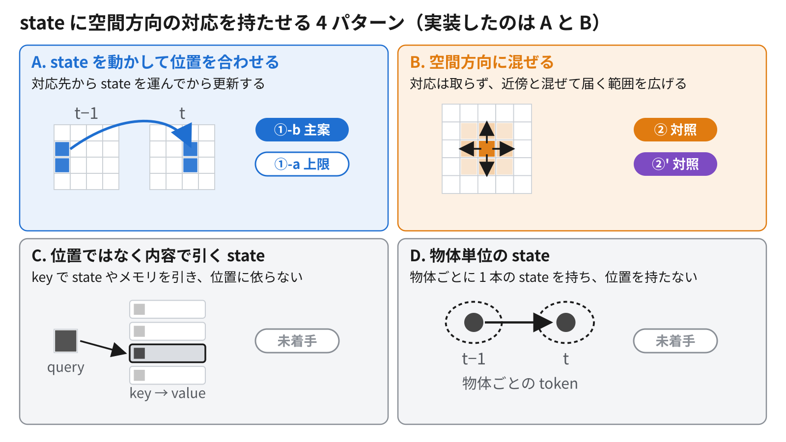
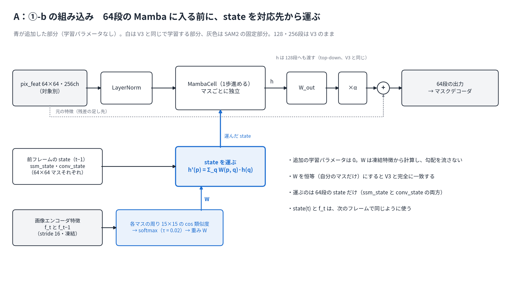
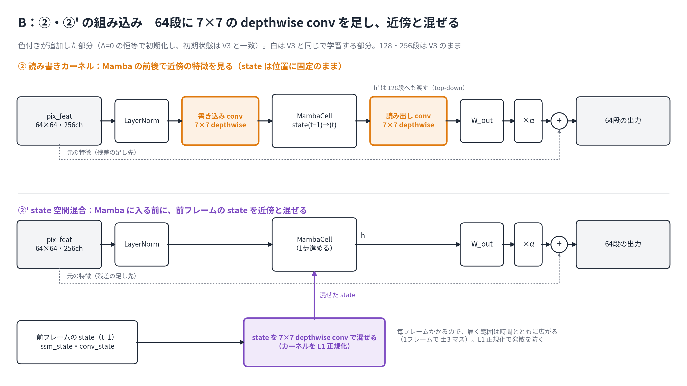

# 2026-11-06 MTG資料: state に空間方向の対応を持たせる 4 パターンと、実装した 2 パターン

詳細版（式・リスク・関連研究・擬似コード）：[Claude Docs](https://claude.ai/artifact/Gfboj2uoaWB3ktmNbjciEn)

## 0. 今日相談したいこと

1. state に空間方向の対応を持たせる方法を **4 パターン** に整理した（図6）。抜けや、別の分け方はないか。
2. そのうち **A（運ぶ：①-b）を主案、B（混ぜる：②・②'）を対照** として実装した。C・D を後回しにする判断でよいか。
3. 今の評価（MOSE val 125 動画）は 95% 区間の幅が 2〜3 pp あり、1 pp 未満の差は見分けられない。この先どう判定するか。

## 1. 現時点のまとめ

- V3 の state は画面上の位置に固定されていて、時間方向の情報をほぼ使っていない（前回 10/30 の結果）。
- 原因の候補は「物体が動くと、前フレームの state が別の内容を指す」こと（作業仮説）。そこで state に空間方向の対応を持たせる。
- 方法は 4 パターン考えられ、**A と B の 2 パターンを実装した**。
- B の ②・②' は評価済み。どちらも state の寄与を確認できず、②' の総合性能は V3（A）よりやや低かった。①-b は学習中で、評価はその後。

## 2. 4 パターン（図6）

| パターン | やること | 近い前例 | 本研究 |
|---|---|---|---|
| **A. 運ぶ** | 対応先から state を持ってきてから更新 | GRFP、TrajGRU | **①-b（実装・学習中）** |
| **B. 混ぜる** | 対応は取らず、近傍と混ぜて届く範囲を広げる | ConvLSTM、ConvS5 | **②・②'（実装・評価済み）** |
| C. 内容で引く | key で state を引く。位置に依らない | LiVOS、XMem | 未着手 |
| D. 物体単位 | 物体ごとに 1 本の state を持つ | Cutie、SAMURAI | 未着手 |

A・B を選んだ理由：

- **A**：先生の 10/30 の「潜在空間の中で対応を取る」に直接対応する。
- **B**：A の対照。A が B を上回って初めて、「混ぜる」のではなく「運ぶ」ことに意味があると言える。
- **C**：SAM2 の memory attention がすでに内容で引いているので、冗長になりやすい。
- **D**：別の軸。SAMURAI の Kalman filter を置き換えるという本研究の出発点に近い。

## 3. 実装した 2 パターン

### A：①-b 潜在特徴の対応で state を運ぶ

- 凍結した画像エンコーダ特徴（stride 16）で、各マスの周り 15×15 の類似度を取る。前フレームの似たマスから、64 段の state を重みつきで運んでから更新する。
- 追加の学習パラメータは 0。対応を恒等にすると V3 と完全に一致する。
- 対応の取り方は、学習前の計測で決めた（MOSE train 100 動画）。条件を満たしたのは **softmax（τ=0.02）** だけだった。詳細版の図2・図5 にある argmax＋往復チェックの案から変わっている。

学習前の計測。指標は保持質量 M（運んだ重みのうち、前フレームで同じ物体の前景から来た割合）：

| 物体の速さ | 対応なし（V3 と同じ） | ①-b（softmax） |
|---|---|---|
| 遅い | 0.830 | 0.888 |
| 中くらい | 0.717 | 0.847 |
| 速い | 0.545 | 0.811 |

- 速い物体ほど、対応を取る効果が大きい。
- 一方、1 マス（16 px）未満の動きでは、運ぶとかえって位置がぼやける（平行移動で確認）。MOSE の動きの中央値は 0.63 マス/フレームである。
- 状態：本学習は 11/5 12:33 に再開し、11/6 4 時の時点で 24,662 更新中 20,178 を超えた。朝に終わる見込みで、評価はその後。比較相手の A'（①-b と同じ GPU で V3 を学習し直したもの）は評価済みで、state の寄与は −0.03 [−1.32, +1.23] pp と確認できなかった。

### B：② 読み書きカーネル / ②' state 空間混合

- **②**：Mamba の入力と出力に 7×7 の空間 conv をかける。届く範囲は ±6 マスで頭打ち。カーネルの大きさは MOSE の動きの 90% 点（2.80 マス/フレーム）から決めた。
- **②'**：毎フレーム、更新前の state そのものを 7×7 で近傍と混ぜる。初版は長い系列で発散したので、カーネルを L1 正規化（‖K‖₁=1）した。学習後も数値は安定している。

②の結果（J&F、pp、95% 区間。動画単位の paired bootstrap、125 動画・313 対象）：

| 比較 | memory そのまま | memory を絞る（直前 1 枚） |
|---|---|---|
| ② − V3（A） | −0.16 [−1.45, +1.42] | −0.36 [−1.48, +0.65] |
| ② での state の寄与（持ち越し − 毎フレームリセット） | +0.20 [−0.94, +1.43] | +0.06 [−0.85, +0.95] |
| state の寄与の増加（V3 比） | +0.01 [−1.00, +1.08] | −0.68 [−1.80, +0.32] |

→ どれも区間が 0 を含む。②で state の寄与が増えたとも、総合性能が上がったとも言えない。

②' の結果（同じ評価条件）：

| 比較 | memory そのまま | memory を絞る（直前 1 枚） |
|---|---|---|
| ②' − V3（A） | **−0.86 [−1.87, −0.04]** | −0.58 [−1.38, +0.07] |
| ②' での state の寄与（持ち越し − 毎フレームリセット） | +0.26 [−0.40, +1.11] | +0.32 [−0.24, +0.96] |
| state の寄与の増加（V3 比） | +0.07 [−0.45, +0.62] | −0.43 [−1.20, +0.24] |

→ ②' でも、state の寄与とその増加の区間は 0 を含む。総合性能は memory そのままの条件で A よりやや低い（単一 seed・探索的な比較で、区間の上限は 0 に近い）。

- ②・②' を物体の速さ 3 層で分けても、どの層でも state の寄与とその増加の区間は 0 を含んだ。速い層での寄与の増加は、②が −0.14 pp、②' が +0.27 pp。
- ②' は学習後、カーネルの中心の重みが平均 0.56 まで下がっており、近傍との混合を実際に使っていた。state が平滑化されてぼやけ、性能が下がった可能性がある（推論）。対応を取らない B の結果だけでは、位置ずれ仮説の否定にはならない。

## 4. 今回言えること / まだ言えないこと

言えること：

- V3 は state をほぼ使っていない。memory を直前 1 枚に絞っても、state の寄与は確認できなかった（D2）。
- 空間方向の局所的な混合（②・②'）では、state の寄与を確認できなかった。memory を絞っても、速さで分けても同じ。
- 学習前の計測では、①-b の対応は、対応なしより同じ物体の state を多く運ぶ。特に速い物体で差が大きい。

まだ言えないこと：

- ①-b が性能を上げるか（学習中）。
- 反対仮説（SAM2 の memory と state が冗長）が正しいか。
- 1 pp 未満の差があるかないか（区間の幅が 2〜3 pp）。

## 5. 次に進む順番

1. ①-b の評価。比較相手は A' とし、state の寄与とその増加を見る。あわせて、推論だけ対応を恒等に戻す・類似度をシャッフルする・移動だけをなくす対照で、運んだ state に依存しているかを見る。
2. 評価済みの ②・②' に ①-b を加え、物体の速さ 3 層（結果を見る前に区切りを決めた）で比べる。位置ずれ仮説が正しければ、速い層で ①-b の差が大きくなるはず。
3. ①-b が効けば、①-a（外部 flow、上限）と長い学習へ進む方向を検討する。運んだ state に依存しても性能が変わらなければ、memory を絞った条件での学習を検討する。どちらも確認できなければ、16 フレームの学習などの診断と、①-a による上限の確認を比べて相談する（週次版・spec と同じ分岐）。

## 6. 参照ファイル

- 週次版：[11/6の週次進捗MTG資料](2026-11-06-weekly-progress-mtg-materials.md)（2026-11-06に②'の結果・層別結果・次の進め方を同期）
- 詳細版：[Claude Docs「MTG資料：潜在相関による state 運搬（①-b）と空間混合（②・②'）」](https://claude.ai/artifact/Gfboj2uoaWB3ktmNbjciEn)
- 実験ログ：[../experiments/2026-11-04-temporal-mamba-spatial-mixing.md](../experiments/2026-11-04-temporal-mamba-spatial-mixing.md)、[../experiments/2026-11-04-temporal-mamba-latent-correspondence.md](../experiments/2026-11-04-temporal-mamba-latent-correspondence.md)
- spec：[../specs/2026-11-04-temporal-mamba-spatial-mixing-spec.md](../specs/2026-11-04-temporal-mamba-spatial-mixing-spec.md)、[../specs/2026-11-04-temporal-mamba-latent-correspondence-spec.md](../specs/2026-11-04-temporal-mamba-latent-correspondence-spec.md)
- 前回 MTG：[../meetings/2026-10-30-mtg.md](../meetings/2026-10-30-mtg.md)
- 図（6 枚、うち図2・図5 は古い設計）：[figures/2026-11-06-state-spatial-correspondence/](figures/2026-11-06-state-spatial-correspondence/manifest.md)
