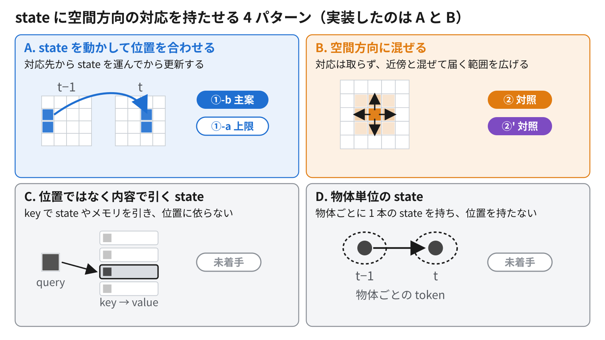
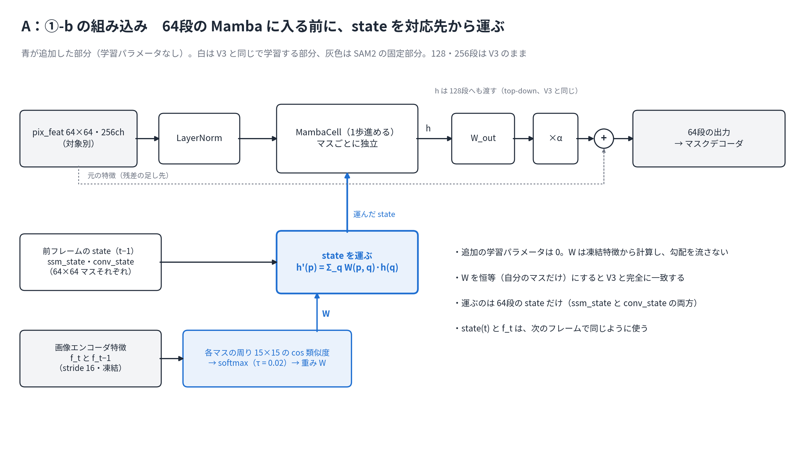
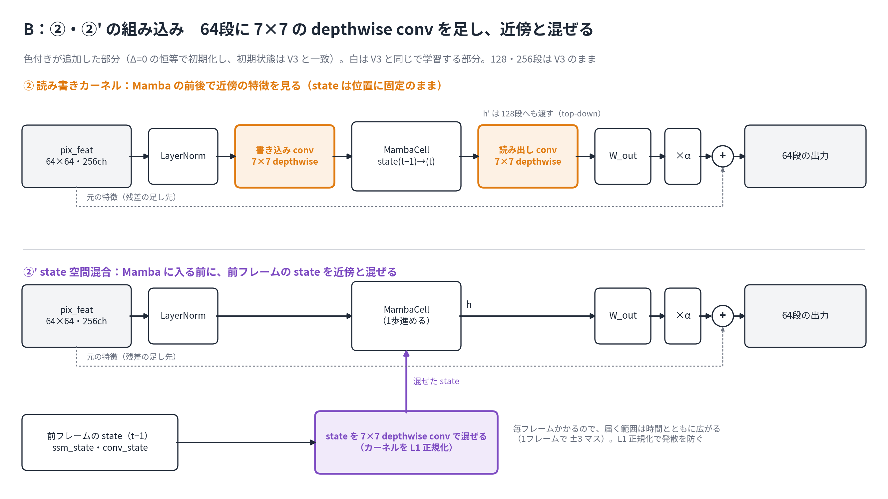

# 2026-11-06 MTG資料: state に空間方向の対応を持たせる（10/30〜11/6の進捗）

## 0. 今日相談したいこと

**一言でいうと**：10/30 の方針どおり、V3 の state に空間方向の対応を持たせる方法を考えた。方法は 4 パターンに整理でき、そのうち **A（対応先から運ぶ：①-b）と B（近傍と混ぜる：②・②'）の 2 パターンを実装した**。B では state は使われるようにならなかった。A は学習がもうすぐ終わる。

1. **4 パターンの整理**（3章、図6）：抜けや、別の分け方はないか。A を主案、B を対照、C・D を後回しにする判断でよいか。
2. **B が効かなかったことの読み方**（5・6章）：「局所的に混ぜるだけでは足りないので、明示的に対応を取る A に進む」でよいか。SAM2 の memory と冗長という反対仮説 (a) は、まだ支持も否定もできていない。
3. **開発用の学習の長さ**（2章）：10 epoch では V3 の効果がまだ見えなかった（A − F0 が 0 を含む）ので、今週も 22 epoch（約 12 時間）で回した。この設定でよいか。
4. **判定の解像度**：今の val（MOSE 125 動画、単一 seed）は 95% 区間の幅が 2〜3 pp あり、1 pp 未満の差は見分けられない。この先どう判定するか。

## 1. 実験条件の定義

| 記号 | 意味 |
|---|---|
| F0 | 前回までの全軌跡の学習で作ったモデル。比較の基準 |
| A | F0 から、V3 だけを 8 フレームの短い区間で 22 epoch 学習（SAM2 本体は固定）。前回までの V3 |
| A' | A と同じ設定を、①-b と同じ GPU（RTX A4000）で学習し直したもの。①-b の比較相手 |
| ②・②'・①-b | A に各部品を足し、A と同じ設定で学習したもの（4章） |
| reset1 | 推論時に state を毎フレーム 0 に戻す。state を使っているかを見るための比較 |
| M0 / M1 | 評価時に SAM2 の memory をそのまま使う / 直前 1 枚に絞る |

- **state の寄与 R** = （state を持ち越す）−（reset1）。**寄与の増加 I** = R(新しい条件) − R(A)。
- 評価はすべて MOSE val（125 動画・313 対象）の J&F。区間は動画単位の paired bootstrap による 95% 区間、単位は pp。

## 2. 前回（10/30）からの流れ

| 10/30 の TODO | 状況 |
|---|---|
| 空間方向の入れ込み方を考える（挿入位置は今のまま） | 4 パターンに整理し、A・B を実装（3〜5章） |
| 潜在空間での対応の先行研究を探す | サーベイを実施（11/2）。Mamba の state を凍結特徴の対応で運ぶ前例は、調べた範囲では見つからなかった |
| 画像空間のフローを潜在空間にマッピングする案（杉本さんの取り組み） | ①-a（外部 flow で運ぶ。①-b の上限）として計画に入れた。①-b が ②' を上回らなかったときだけ回す。杉本さんへの確認はまだ |
| ID ごとの出力に入れる案（multiplex など） | 4 パターンの D（物体単位の state）に位置づけた。未着手 |
| 開発用の設定を「Mambaだけ・10 epoch程度」にする | Mambaだけは採用。10 epoch は確認した結果、22 epoch のままにした（下） |
| 「Mambaだけ学習」の研究上のメリットを整理する | 未着手 |
| 修論を書き進める | 今週は進められていない |
| 資料の冒頭で条件を定義する | 1章 |

10 epoch の確認（A・B・C の 10 epoch 時点を val 全体で評価、11/2）：

- A − F0 は 10 epoch で +0.37 [−0.91, +1.65] と 0 を含み、22 epoch で +1.51 [+0.38, +2.79] になった。A は 10 → 22 epoch の間に有意に伸びた（+1.14 [+0.22, +2.29]）。
- V3 だけを学習する条件では、10 epoch で打ち切ると効果がまだ見えない。そのため、今週の比較はすべて 22 epoch で行った。

## 3. 空間方向の対応を持たせる 4 パターン

| パターン | やること | 近い前例 | 本研究 |
|---|---|---|---|
| **A. 運ぶ** | 対応先から state を持ってきてから更新 | GRFP、TrajGRU | **①-b（実装・学習中）** |
| **B. 混ぜる** | 対応は取らず、近傍と混ぜて届く範囲を広げる | ConvLSTM、ConvS5 | **②・②'（実装・評価済み）** |
| C. 内容で引く | key で state を引く。位置に依らない | LiVOS、XMem | 未着手 |
| D. 物体単位 | 物体ごとに 1 本の state を持つ | Cutie、SAMURAI | 未着手 |

- **A**：先生の 10/30 の「潜在空間の中で対応を取る」に直接対応する。
- **B**：A の対照。A が B を上回って初めて、「混ぜる」のではなく「運ぶ」ことに意味があると言える。
- **C**：SAM2 の memory attention がすでに内容で引いているので、冗長になりやすい。
- **D**：別の軸。SAMURAI の Kalman filter を置き換えるという本研究の出発点に近い。

## 4. 実装した 2 パターン

どちらも V3 の 64 段（memory attention 後の対象別特徴、64×64）だけを変え、128・256 段は V3 のままにした。追加部分を恒等にすると、どちらも V3 と完全に一致する。

### A：①-b 潜在特徴の対応で state を運ぶ

- 凍結した画像エンコーダ特徴（stride 16）で、各マスの周り 15×15 の cos 類似度を取り、softmax（τ=0.02）で重みにする。この重みで前フレームの state を運んでから、Mamba を 1 歩進める。
- 追加の学習パラメータは 0。
- 対応の取り方は、学習前の計測（5.3節）の条件を満たした唯一の設定として決めた。

### B：② 読み書きカーネル / ②' state 空間混合

- **②**：Mamba の前後に 7×7 の depthwise conv を入れる。届く範囲は ±6 マスで頭打ちになる。
- **②'**：毎フレーム、更新前の state そのものを 7×7 で近傍と混ぜる。
- カーネルの大きさは、MOSE の 1 フレームあたりの動きの 90% 点（2.80 マス）から決めた。
- 制約なしの ②' は、学習 300 更新の時点で長い系列に流すと発散した（state が 1 フレームごとに約 2 倍になり、20 フレーム目あたりで非有限）。8 フレームの学習の loss には現れなかった。カーネルを L1 正規化（‖K‖₁=1）して安定させた。

## 5. Evidence: 結果

### 5.1 B（②・②'）：state の寄与は増えなかった

| 指標（M0） | ② | ②' |
|---|---|---|
| I：state の寄与の増加（主な判定） | +0.01 [−1.00, +1.08] | +0.07 [−0.45, +0.62] |
| R：state の寄与 | +0.20 [−0.94, +1.43] | +0.26 [−0.40, +1.11] |
| 総合性能（− A） | −0.16 [−1.45, +1.42] | **−0.86 [−1.87, −0.04]** |

- ②・②' とも、I と R の区間は M0・M1 のどちらでも 0 を含む。
- ②' は総合性能が A よりやや低い（区間の上限が 0 をわずかに下回る）。
- 物体の速さで 3 層に分けても（区切りは結果を見る前に決めた）、どの層でも I・R は 0 を含む。位置ずれ仮説なら差が出るはずの「速い」層でも、I(②) −0.14、I(②') +0.27 だった。

### 5.2 D2：SAM2 の memory を絞っても、A の state の寄与は見えない

| | M0（そのまま） | M1（直前 1 枚） |
|---|---|---|
| R(A) | +0.19 [−0.44, +1.00] | +0.75 [−0.14, +1.91] |
| memory を絞ったときの低下（A） | — | −2.17 [−3.98, −0.48] |

- memory を絞ると性能は約 2 pp 下がるが、state の寄与は区間が 0 を含んだまま。
- 「memory を絞れば state が使われる」とは言えず、反対仮説 (a) を支持する材料にも否定する材料にもならなかった。

### 5.3 A（①-b）：学習前の計測では対応は正しく取れている。学習は終盤

学習前の計測（MOSE train 100 動画）。指標は保持質量 M（運んだ重みのうち、前フレームで同じ物体の前景から来た割合）：

| 物体の速さ | 対応なし（V3 と同じ） | ①-b（softmax） |
|---|---|---|
| 遅い | 0.830 | 0.888 |
| 中くらい | 0.717 | 0.847 |
| 速い | 0.545 | 0.811 |

- 速い物体ほど、対応を取る効果が大きい。
- 一方、1 マス（16 px）未満の動きでは、運ぶとかえって位置がぼやける（既知の量だけ平行移動した画像で確認）。MOSE の動きの中央値は 0.63 マス/フレームである。

学習と評価の状況：

- 比較相手の A' は学習・評価済み。R(A') = −0.03 [−1.32, +1.23] で、A と同じく state を使っていない。
- ①-b の本学習は 11/5 3:04 に始めたが、実装の不具合（学習前の val を推論モードで回したときに作った索引表が、学習の backward で使えない）で、1 回も更新せずに止まった。修正して 11/5 12:33 に再開した。
- 11/6 4 時の時点で 24,662 更新中 20,178 を超えており、朝に終わる見込み。評価はその後に行う（結果は次回）。

## 6. Interpretation: 現時点の見立て

- **近傍と混ぜるだけ（B）では、V3 は state を使うようにならない。** ②' は空間方向の混合を実際に使っていた（学習後、カーネルの中心の重みが平均 0.56 まで下がった）が、state の寄与は増えず、性能はやや下がった。state が平滑化されてぼやけた可能性がある（推論）。
- B は対応を取らないので、この結果は位置ずれ仮説の否定にはならない。明示的に対応を取る A（①-b）の結果で判断する。
- 文献では、強い attention memory の上に足した recurrent state の寄与は小さいという報告が多い。例えば XMem は sensory memory を除くと J&F が −1.1〜−1.9 下がるだけで、SAM2 の著者も memory に GRU を足して改善しなかったと報告している。①-b でも、memory をそのまま使う条件では差が 1 pp 未満にとどまる可能性が高い（予想）。

## 7. 今回言えること / まだ言えないこと

言えること：

- 空間方向の局所的な混合（②・②'）では、state の寄与を確認できなかった。速さで分けても同じ。
- memory を直前 1 枚に絞っても、A の state の寄与は確認できなかった。
- 学習前の計測では、①-b の対応は、対応なしより同じ物体の state を多く運ぶ。特に速い物体で差が大きい。
- state を再帰的に混ぜる操作は、制約がないと 8 フレームの学習では見えない形で発散する。

まだ言えないこと：

- ①-b が state を使うようになるか、性能を上げるか（学習中）。
- 反対仮説 (a)（SAM2 の memory と冗長）が正しいか。
- 1 pp 未満の差があるかないか（区間の幅が 2〜3 pp）。

## 8. 次に進む順番

1. ①-b の評価。主な判定は I(①-b) と R(①-b)（比較相手は A'）。あわせて、推論だけ対応を壊す対照で「運んだ state に依存しているか」を見る。
   - 対応を恒等に戻す（運ばない）
   - 類似度を窓の中でシャッフルする
   - 運ぶ量は同じまま、移動だけをなくす
2. ②・②'・①-b を物体の速さ 3 層で比べる。位置ずれ仮説が正しければ、速い層で ①-b の差が大きくなるはず。
3. 結果による分岐（spec で事前に決めた読み方）：
   - **①-b が効いた**：①-a（外部 flow、上限）と、長い学習で数字を出す方向へ。
   - **運んだ state に依存はするが、性能は変わらない**：反対仮説 (a) の可能性が残る。memory を絞った条件での学習を検討する。
   - **何も成り立たない**：「この対応の方式と学習条件では効果を確認できなかった」と読む。位置ずれ仮説の否定にはしない。16 フレームの学習などの診断と、①-a での上限の確認を比べて相談する。

## 9. 参照ファイル

- 実験ログ：[空間混合（②・②'）と D2](../experiments/2026-11-04-temporal-mamba-spatial-mixing.md)、[潜在空間の対応（①-b）](../experiments/2026-11-04-temporal-mamba-latent-correspondence.md)、[10 epoch の評価（補足）](../experiments/2026-10-27-temporal-mamba-short-clip-official-trainer.md)
- spec：[空間混合](../specs/2026-11-04-temporal-mamba-spatial-mixing-spec.md)、[潜在空間の対応](../specs/2026-11-04-temporal-mamba-latent-correspondence-spec.md)
- 文献調査：[空間対応のサーベイ（11/2）](../papers/2026-11-02-deep-research-spatial-correspondence-mamba-state.md)
- 提案手法の詳細版（式・リスク・関連研究）：[Claude Docs](https://claude.ai/artifact/Gfboj2uoaWB3ktmNbjciEn)。①-b の対応の取り方は argmax 案のまま古い
- 前回 MTG：[議事録](../meetings/2026-10-30-mtg.md)、[資料](2026-10-30-weekly-progress-mtg-materials.md)
- 図：[figures/2026-11-06-state-spatial-correspondence/](figures/2026-11-06-state-spatial-correspondence/manifest.md)
