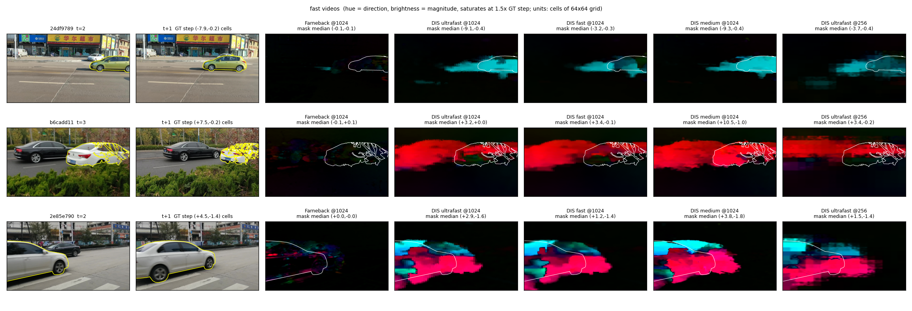
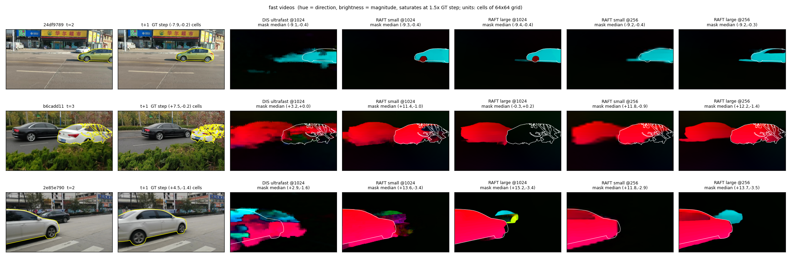

# やったこと

## A-a（旧①-a）の宿題：optical flowの計算時間（11/11）

- 前回の宿題「flowをとりあえず計算して、計算量が高いと言えるか確かめる」の答え
- OpenCVのDISとFarnebackを、MOSEの動画6本（速い3本・遅い3本）でCPUで測った

- 速い動画のflow（色が動きの向き、明るさが大きさ）。DISは車の向きを取れていて、Farnebackはほぼ真っ黒
- **DISなら、計算量はA-aをやらない理由にならない**
    - SAM2の入力と同じ1024×1024で14.8 ms/フレーム（1スレッド）。256×256なら0.9 ms
    - Farneback（OpenCVのサンプルの設定）は約250 msと重く、速い動きも取れない
- 気になること
    - DISは向きは合うが、物体の後ろの背景にはみ出す
    - 速い動画の大きさが合っているかは、まだ分からない。速い3本はどれも物体が画面の端から出入りしていて、正解マスクの重心の移動が実際の動きより小さく出るため
    - flowと潜在表現のマス（64×64）との対応の取り方は、まだ考えていない（前回、後回しでよいと言われた）
- 11/11 追記：GPUにすれば速くなるかを見るため、深層学習のRAFT（torchvisionに入っているもの）もGPU（RTX A4000）で測った

- RAFTのflowは物体の形どおりに出て、背景へのはみ出しがほとんどない（左から3枚目のDISと比べる）
- **ただし速さはDISより遅い**：small が1024で91 ms、256で37 ms／フレーム。SAM2の約30 ms（1物体・1フレーム）を超える
    - 速さならDIS、質ならRAFT、と見ている
- 詳細: [実験ログ](../experiments/2026-11-11-optical-flow-cost.md)
- **→ 相談：A-aは、A-bの改善が一段落してから入れるか、A-bと並行して比べるか**

# 次やること

-

---

## 記録メモ（仕上げで消す）

- 前回の宿題（11/6議事録の「次やること」）:
    - [ ] A-b（旧①-b）の対応付けを改善する（ノイズで形が崩れないように、空間的な制約などを入れる）
        - [ ] 対応付けのアルゴリズム（類似度最大、ハンガリアンマッチング、それ以外）を差し替えられる形にする
    - [x] optical flowを計算してみて、計算量と見た目を確かめる（A-a）
    - [ ] 英論文紹介の4本（MambaOut、TV3S、TS-Mamba、Memory as Dynamics）を読む
    - [ ] 修論を書く
    - [ ] 環境整備係: ウイルス対策ソフトの配布と案内、導入したマシンの管理、Macの一覧
- 記録したエントリ:
    - 11/11 A-aの宿題：optical flowの計算時間
    - 11/11 同上に追記：GPUのRAFTの時間と見た目、重心の移動との比較の限界
