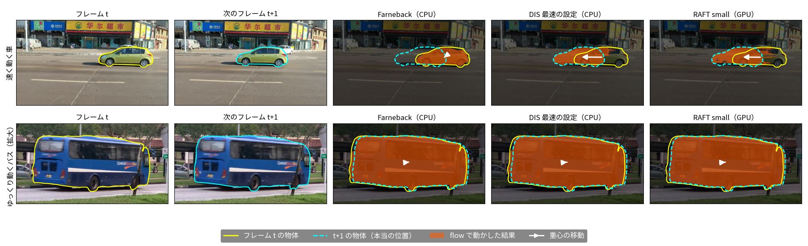
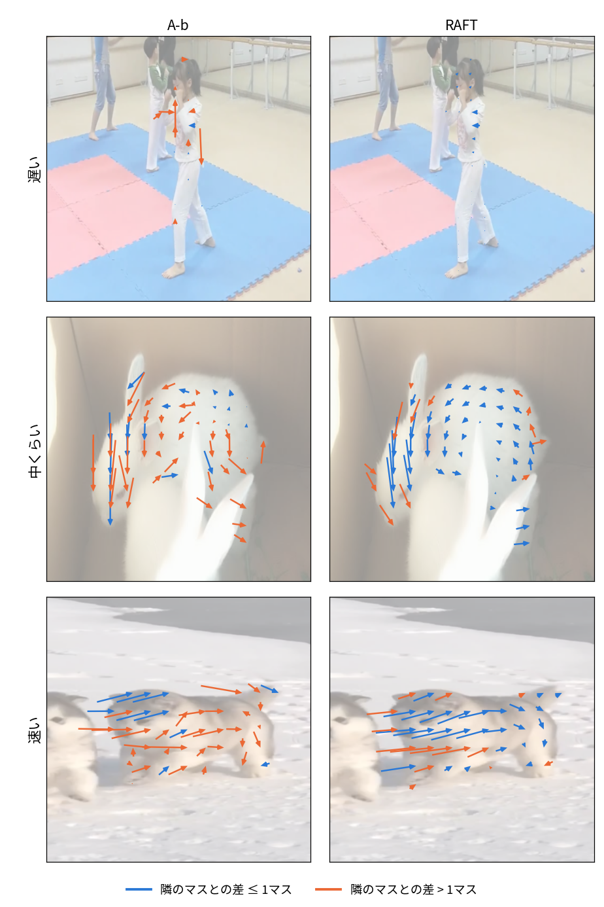
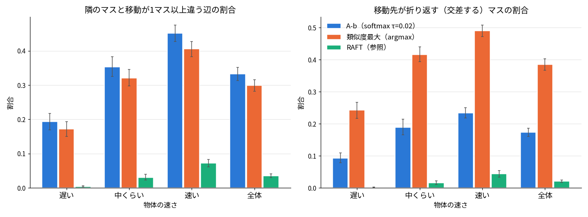
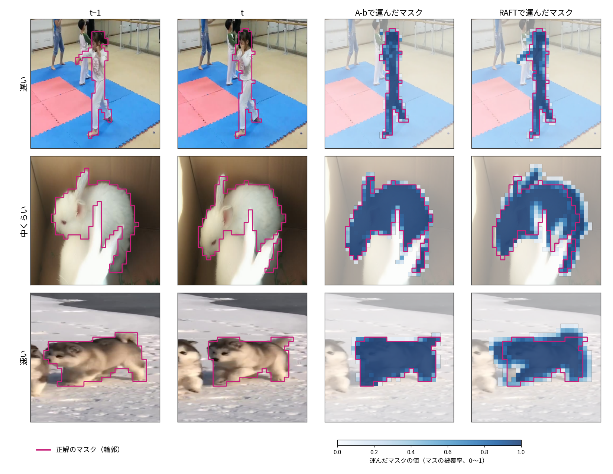
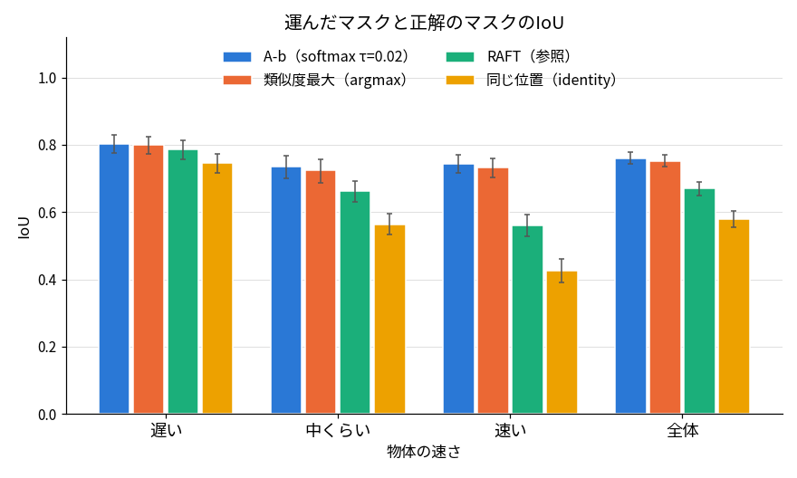
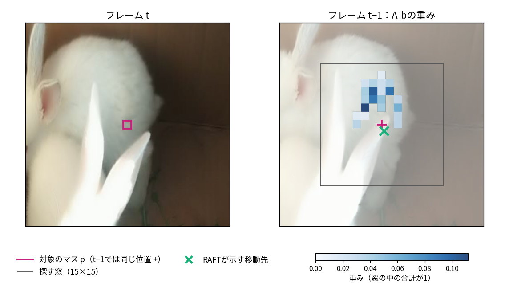
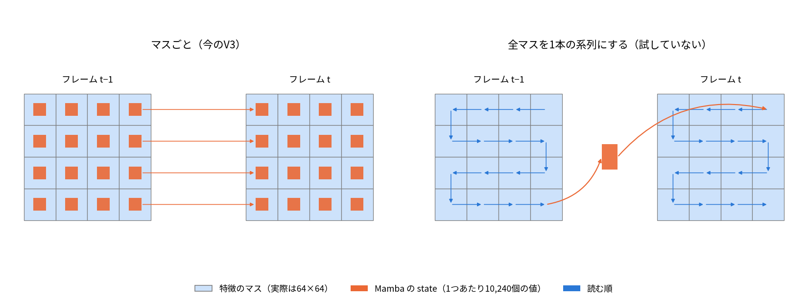
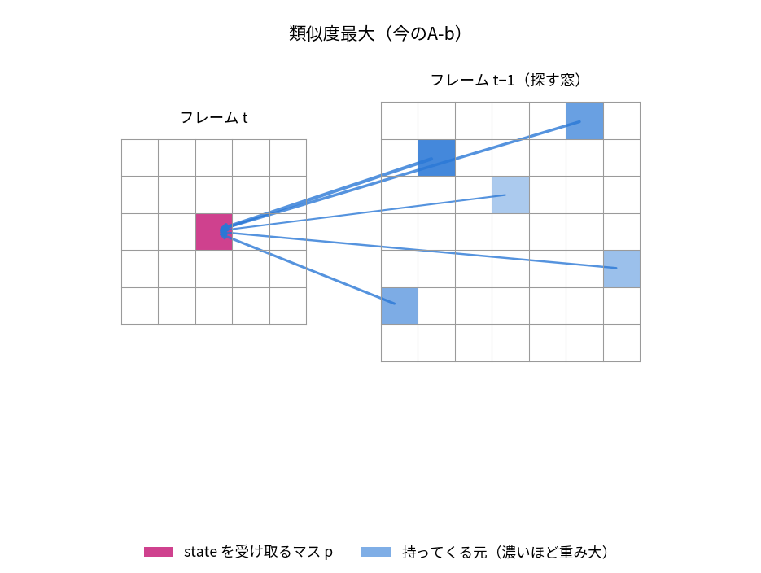
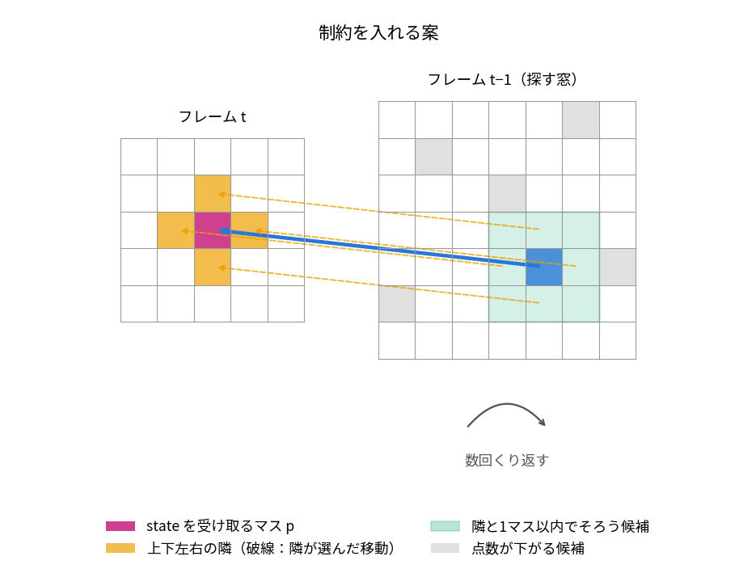
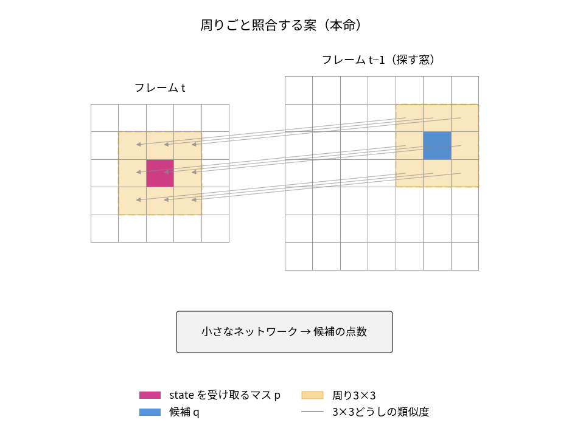

# やったこと

## A-a（旧①-a）の宿題：optical flowの計算時間（11/11）

- 前回の宿題「flowをとりあえず計算して、計算量が高いと言えるか確かめる」の答え
- OpenCVのFarnebackとDIS（CPU）、深層学習のRAFT（GPU）を、MOSEの動画6本（速い3本・遅い3本）で測った

1フレームあたりのflowの計算時間

| 手法 | 1024×1024（SAM2の入力と同じ） | 256×256 |
|---|---|---|
| Farneback（CPU） | 247 ms | 15 ms |
| **DIS（最速の設定、CPU）** | **15 ms** | **0.9 ms** |
| RAFT small（GPU） | 91 ms | 37 ms |
| RAFT large（GPU） | 214 ms | 60 ms |
| 参考：SAM2（GPU、1物体・1フレーム） | 約30 ms | |

- CPUは1スレッド、GPUはRTX A4000。6本・120組の中央値
- **DISなら、計算量はA-aをやらない理由にならない**（SAM2の約30 msより短い）
- **GPUにしても速くはならなかった**：RAFTは精度重視の手法で、GPUでもDISより遅い

- フレーム t の物体（黄）を、各手法のflowで動かした結果がオレンジ。次のフレームの本当の位置（水色の破線）に重なれば正しい
    - 速い車：Farnebackはほとんど動かない。DISは途中まで引き伸ばされる。RAFTはほぼ水色に重なる
    - ゆっくり動くバス：どの手法も重なる
    - 速さならDIS、質ならRAFT、と見ている
- 気になること
    - DISは向きは合うが、物体の後ろの背景にはみ出す
    - 速い物体で、DISが動きを小さく見積もるかどうかは、図の1例でしか見ていない。速い3本はどれも物体が画面の端から出入りする場面があり、正解マスクの重心の移動が実際の動きより小さく出るので、数値ではまだ比べられていない
    - flowと潜在表現のマス（64×64）との対応の取り方は、まだ考えていない（前回、後回しでよいと言われた）
- 詳細: [実験ログ](../experiments/2026-11-11-optical-flow-cost.md)
- **→ 相談（時間があれば）：A-aは、A-bの改善の比較相手（対応付けの差し替え口にflowを入れる）として扱う形でよいか**

## A-b（旧①-b）：「形が崩れる」がどれくらい起きているか（11/12）

- 前回の指摘「類似度が一番高い位置に運ぶと、隣のマスがまったく違う所に行って形が崩れる」への答え：**ご指摘どおり崩れていた。ただし、崩れているのは物体の外形ではなく、物体の内側の並び**
- 学習で使ったA-bの対応（画像エンコーダの特徴のcos類似度、15×15の窓＝±7マス、softmax τ=0.02）をそのまま使って測った。学習はしていない
- データはMOSEのtuning 125動画（A-bを評価したのと同じ動画）、310物体・3,185組（フレームt−1 → t）
- 比べる相手はRAFTのoptical flow。正解の動きではなく、参照として使う

**1. 各マスが、前のフレームのどこから state を持ってくるか**

- 矢印は、フレームtの物体の各マスについて、t−1の持ってくる元の位置からtのマスへ引いた。マスは物体の大きさに応じて間引いて表示した
- 矢印の色：隣のマスとの移動の差が1マス以下なら青、1マスを超えるならオレンジ
- 例は、目で選ばずに規則で選んだ：各速さで、A-bの「隣と1マス以上ずれる辺の割合」が中央値の組
- RAFTの矢印は物体の中で向きと長さが揃う。A-bは、ウサギ・犬では向きと長さがばらばら。ほとんど動かない女の子でも、一部のマスは数マス離れた所から持ってくる

**2. 隣のマスとのずれ・折り返しの割合**

- 物体ごとに平均し、速さの層で平均した。ひげは95%区間（物体のbootstrap）。物体数は遅い104・中くらい103・速い103
- 隣のマスと移動が1マス以上違う辺：A-b 33%、RAFT 4%。A-bは速いほど多い（遅い19%・速い45%）
- 移動先が折り返す（隣どうしが交差する）マス：A-b 17%、RAFT 2%
    - softmaxにしたことで、類似度最大の1マスを選ぶ場合（39%）の半分以下になっている
- **物体の内側の並びが崩れている**

**3. 前のフレームの物体のマスクを運んだ結果**

- t−1の物体のマスク（マスごとの被覆率）を、stateと同じ対応で運んだ。濃い青ほど多く運ばれている。赤紫の線は正解のマスクの輪郭
- 例は、1と同じ組
- A-bで運んだマスクは、正解の輪郭にほぼ収まる。RAFTは、物体の縁で背景側にはみ出す

**4. 運んだマスクと正解のIoU**

- 運んだマスクの0.5以上を物体とみなして、tの正解と比べた
- A-b 0.76。RAFT 0.67、動かさない場合 0.58より高い。速い物体で差が大きい（A-b 0.74・RAFT 0.56・動かさない 0.43）
- **外形は保たれている**

**まとめ**

- A-bは「どの物体から持ってくるか」は当てているが、「物体のどの位置から持ってくるか」は当てていない、と見ている。物体の中に似たマスが多いためと考えている（未確認）

- 1マスの例（上のウサギ。物体の内側のマスのうち、A-bの移動がRAFTから一番離れたマスを規則で選んだ）
    - A-bの重みは、ウサギの毛の広い範囲に散らばる。一番大きい重みでも0.11（窓の中の合計が1）
    - RAFTが示す移動先（同じ位置のすぐ下）には、ほとんど重みがない
    - 似たマスが多いと1マスどうしの比較では決まらない、という例
- 気になること
    - 遅い物体では、A-bの移動はRAFTから、動かさない場合より離れている（RAFTとの差 0.68マス、動かさない 0.46マス）
    - 内側の並びの崩れが性能にどれだけ効くかは、まだ測っていない
- 詳細: [実験ログ](../experiments/2026-11-12-latent-corr-shape-coherence.md)

## 手法2の位置づけ：state をどの単位で持ち、どう対応を取るか（11/12整理）

- 前回の質問「なぜ64×64のマスを1マスずつMambaに入れるのか」への答えの訂正：**メモリの制約は理由にならなかった**
    - 全マスを1本の系列にしても、Mambaの計算は系列の長さに比例するので、1フレームあたりの計算はほぼ同じ
    - 持ち越すstate（64×64の段、1物体）は、マスごとだと 4,096マス（64×64）× 1マスあたり10,240 ＝ 約4,200万個、1本の系列なら10,240個で、むしろ1本の方が小さい
        - 1マスあたり10,240 ＝ Mambaの内部のチャネル512（入力256ch × 2）×（ssm_stateの16 ＋ 畳み込みの窓の4）
    - マスごとにしているのは「位置ごとに記憶を持たせる」という設計の選択

- 左が今のV3（64×64のマスそれぞれにstateがあり、同じマスへ持ち越す。A-bはこれを対応に沿って運ぶ）。右は、今は試していない形で、全マスを決めた順に読み、1つのstateで次のフレームへ渡す。図は4×4に簡略化
- これまでの空間方向の案を、2つの軸で並べ直した（前回の4パターンは2つの軸が混ざっていた）

| 対応の取り方 ＼ stateの単位 | マスごと | 物体ごと | 画像全体で1本 |
|---|---|---|---|
| 取らない | 今のV3 | | 全マスを1本の系列にする（試していない） |
| 近くと混ぜる | ②・②'（効かなかった） | | |
| 潜在特徴の類似度で運ぶ | **A-b** | | |
| 画像のoptical flowで運ぶ | A-a | | |
| 物体の動き（boxなど） | | 手法1（動き予測のMamba）、SAMURAI | |

- 手法2は「マスごと」で考える
    - 物体ごとのstateは、手法1と役割が重なる
    - マスごとなら、物体の形や部分ごとの情報（変形、部分的な遮蔽）を持てる、と見ている（未確認）
- 近い研究との違い（英論文紹介の2本）

| | Memory as Dynamics（ICML'26） | TV3S（CVPR'25） | 手法2 |
|---|---|---|---|
| Mambaのstate | 持ち越さない（直近8フレームの窓で毎時刻作り直す） | 位置ごとに、動画を通して持ち越す | 位置（マス）ごとに、動画を通して持ち越す |
| 使い方 | 信頼度が低いときだけ、予測をdecoderに足す | 毎フレーム | 毎フレーム |
| 空間方向 | ― | 隣の位置とshiftで混ぜる | 対応に沿って運ぶ |
| タスク | 追跡（SAM2を固定） | 動画のセマンティックセグメンテーション | 追跡（SAM2を固定） |

- 位置ごとにstateを持ち越すのはTV3Sと同じ。違いは「混ぜる」ではなく「対応に沿って運ぶ」こと。混ぜる方式（②・②'）が効かなかったので、運ぶ方向を主軸にする
- **→ 相談：手法2は「マスごとのstateを、対応に沿って運ぶ」（A-b）に絞ってよいか**

## A-bの改善の候補：対応の取り方を差し替えて比べる（11/12）

- 前回の「対応付けを差し替えられる形にして、計算量と精度の関係を見る」に沿って、3段で考えている。違うのは「tのマスpが、t−1のどこからstateを持ってくるか」を決める部分だけで、運び方とMambaは共通
- 目標：同じ物体から持ってくる性質（運んだマスクのIoU）を保ったまま、物体の内側の並びを揃える
- 図の窓は7×7に簡略化（実際は15×15）。重みは説明用の例

**1. 類似度最大（今のA-b）**

- pと窓の各マスを1マスずつ比べ、似ている度合いで重みを付ける
- 各マスがばらばらに決めるので、隣どうしの移動がそろわない

**2. 制約を入れる案**

- 上下左右の隣が選んだ移動と、1マス以内でそろう候補の点数を上げて選び直す。これを数回くり返す。物体の境界ではそろえない
- 前回の「上下左右に制約をかける」古典的な方法（MRF）。「1マス以内」は、RAFTでは隣と1マス以上ずれる所が4%しかないことから決める
- 学習なし。追加の計算は類似度の計算の約1/20（見積もり）

**3. 周りごと照合する案（本命）**

- pの周り3×3と候補の周り3×3の類似度を、小さなネットワークで読んで点数を付け直す（図は対応する9組、実際は全組の81組）
- 点追跡の手法（LocoTrack 2024、CoTracker3 2025）の考え方。似たマスが多い所でも、周りの並びまで比べれば位置が決まる
- 学習するのは対応付けの部分だけ。学習前は今のA-bと同じになる（付け直しの重みを0から始める）
- 追加の計算は約6倍（候補を上位16に絞れば約0.4倍、見積もり）。今の類似度の表から計算できる

**進め方と気になること**

- ハンガリアンマッチング（1対1）は、前回の指摘どおり多対1を表せないので候補から外した
- まず学習なしで、今回の指標（隣とのずれ・折り返し・運んだマスクのIoU）で3つを比べ、良いものだけを学習する
- 気になること
    - 11/6の評価で、推論のときだけ対応をでたらめに並べ替えても、性能の差は小さかった（+0.27 pp、区間は0を含む）。並びを直しても性能が上がるかは分からない
    - 確かめるなら、学習済みのA-bで推論のときだけ対応をRAFTから作ったものに差し替え、性能とstateの寄与が上がるかを見る（対応が良くなったときの上限）
    - 上のウサギの1マスでは、周りごと照合のいちばん簡単な形（学習なしで、周り3×3の類似度を平均するだけ）でも、RAFTの移動先に重みが移らなかった（1マスの例）
- **→ 相談：周りごと照合する案を本命として詰めてよいか。それとも先に、対応が良くなれば性能が上がるか（RAFTに差し替えた上限）を確かめるべきか**

## 英論文紹介：4本のスライド

- 前回決めた4本（MambaOut → TV3S → TS-Mamba → Memory as Dynamics）を読み、研究室のテンプレートでスライドを作った。数値は原典と照合済み
- 4本は「過去の情報を何に紐付けるか」「どこまで信じるか」の2つの軸でつないだ。フレームをまたいでMambaのstateを持ち越すのはTV3Sだけで、TS-MambaとMemory as Dynamicsは長期の情報を別のmemoryに置く
- 手法2との違いは、上の「手法2の位置づけ」の表に入れた

# 次やること

- 今日の相談の結果に合わせて、A-bの対応付けを差し替えられる形にする（類似度最大・制約を入れる案・周りごと照合する案。比較用にflowも入れられるようにする）
- 学習なしで、今回の指標（隣とのずれ・折り返し・運んだマスクのIoU）で候補を比べる。先に上限を確かめることになった場合は、RAFTの対応に差し替えた推論を先に行う
- 英論文紹介の発表準備
- 修論を書く（手法1・手法2の章から）

# 研究外の連絡

- 環境整備係（ウイルス対策ソフトの配布と案内、導入したマシンの管理、Macの一覧）：【進み具合を記入】
