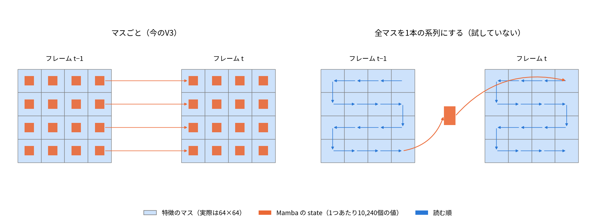

## stateの持ち方：シリアルか並列かを、入れる場所ごとに検討

- 前回の宿題「Mambaの入れ方（シリアル＝ラスタースキャン／並列＝マスごと）を、入れる場所ごとに検討する。Vision Mamba系の先行研究を調べる」への答え
- 先行研究を開いて確かめ、学習済みの重みからstateの残り方を計算した（CPUだけ。新しい学習・評価はしていない）

- 前回と同じ図。水色が特徴のマス、オレンジがMambaのstate、青い矢印が読む順、オレンジの矢印がstateの持ち越し。4×4に簡略化（実際は64×64）
- 左が並列（今のV3。マスごとにstateがあり、同じマスへ持ち越す）、右がシリアル（全マスを決めた順に読み、1つのstateを次のフレームへ渡す）

**1. 先行研究で分かったこと**

- 画像（Vision Mamba、VMambaなど）
    - シリアルにしても、マスの位置は位置埋め込みで渡すのが普通。失われやすいのは「縦の隣が、画像の幅ぶん遠くなる」こと
    - スキャン順の効き方は条件しだい。局所の畳み込みがあれば、1方向と4方向の差は0.34ポイント（VMamba、ImageNet）
- 動画
    - 動画認識（VideoMambaなど）は、全マスを1本に並べる双方向スキャンが主流。ただしクリップ単位で、フレームを1枚ずつ処理する追跡にはそのまま使えない
    - フレームを1枚ずつ処理してstateを持ち越す例は、マスごと（AUSM、TV3S）と1本（FlashDepth、MambaLCT）の両方がある
    - マスごとのstateを使う例は、どれも空間を混ぜる部品（attention、shift、畳み込み）を別に持っている。動きに合わせてstateを運ぶ例は見つからなかった
    - シリアルと並列を、未来を見ない設定で直接比べた例は1本だけ（動画生成の Long-Context State-Space Video World Models）。位置合わせなしの並列が最も悪かった（SSIM：並列 0.766、シリアル 0.845、中間の大きさを混ぜた版 0.855）
- 今のV3（並列、位置合わせなし）でstateの寄与が0付近だったことと、同じ向きの結果

**2. 学習済みの重みから計算したこと**

- Mambaのstateが半分に減るまでのステップ数は、中央値で約11（学習済みのV3。入力に依存する分は入れていない値）
    - 並列では1ステップ＝1フレームなので、約11フレーム
    - シリアルでは1ステップ＝1マスなので、約11マス。64×64の1フレーム分（4,096マス）先に残るのは、最大でも2%
- 画面全体をシリアルに読んでstateを次のフレームへ渡しても、今の設定のままでは、前のフレームの情報はほぼ届かない

**3. メモリ**

- 前回の「全マスを1つの状態ベクトルにすると載らない」は、重みの数で確かめた（64×64×256次元を1つの入力にすると、入力の射影だけで約4.4×10¹²個）
- 次のフレームへ渡すstateは、並列が1物体あたり約1.68億個（3つの解像度の合計、約576 MiB）、シリアルは約1.4万個
- 学習時のGPUメモリの実測は、V3が約9 GB、Mambaなしが約4 GB（RTX A4000、8フレーム。計測の条件はそろっていない）

**4. 場所ごとの案**

| 場所 | 案 | 理由 |
|---|---|---|
| 物体ごとの特徴（64×64、デコーダの入口。今の場所） | 並列のまま | 位置合わせ（stateを対応に沿って運ぶ）は、stateがマスに結び付いていないとできない |
| 高解像度の特徴（128×128、256×256） | 並列で持ち越すのをやめる方向で、先に確かめる | 並列のstateの3/4を占める。動きのずれが一番大きいのに、ここは運んでいない |
| 画面全体（物体に分ける前） | 入れるならシリアル。今は入れない | 前のフレームの情報が届かないので、時間方向の役に立たない見込み |
| 物体の領域だけをシリアルに読む | 今は作らない | 物体ごとに1つのstateになり、手法1（動き予測）と役割が重なる。物体の平行移動は位置合わせなしで吸収できるが、先にマスクが要る。先行例は見つからなかった |

- 自分の見立て「シリアルにすると位置の情報がなくなる」は言い直す。なくなるのは位置の情報ではなく、マスごとの記憶
- 気になること
    - 「並列＋位置合わせ」が「シリアル（位置合わせなし）」より良いかは、先行研究にも手元にもない
    - これまでMambaの有無の差が小さかったので、シリアルを作って比べても差が出ない可能性がある
- 詳細: [検討メモ](../../../../../secretary/notes/brainstorm/2026-11-17-state-design-serial-vs-parallel.md)、[実験ログ](../../experiments/2026-11-17-mamba-state-time-constants.md)
- **→ 相談：物体ごとの特徴（64×64）は並列のまま位置合わせを進め、シリアルは比較用に1本だけ学習する、でよいか。それとも、先にシリアルを作って並列と比べるべきか**

### 11/17 追加：Mambaのstateの時間の長さが、学習で動いていない

- 学習済みのV3の重みと、学習中の勾配を調べた（重みは更新しない短い計測）
- 分かったこと
    - stateがどれだけ長く残るかを決めるパラメータは、学習の前とほぼ同じ値のまま
    - 原因は、8フレームの区間の学習では、前のフレームから持ち越したstateが出力にほとんど効かないこと
        - 64×64の段で、Mambaの出力のうち持ち越したstateから来る分は2.5%以下（8フレームの範囲）
        - そのため、stateを長く残す向きの勾配がそろって出ない（区間ごとに向きがばらばら）
    - 長く残る成分ほど勾配が小さく、Adamの設定（eps）でさらに更新が弱められている
    - 推論（長い動画）では、持ち越したstateから来る分が、64×64の段で13%、128×128の段で35%まで育つ。学習では見ていない大きさ
- 気になること
    - 位置合わせでstateを正しく運んでも、8フレームの学習のままだと、stateを使うように学習されない可能性がある。学習の区間を16フレーム以上に延ばすことを、一緒に考える必要があると見ている（未確認）
- 詳細: [実験ログ](../../experiments/2026-11-17-mamba-state-time-constants.md)（「追記 16:45」）
