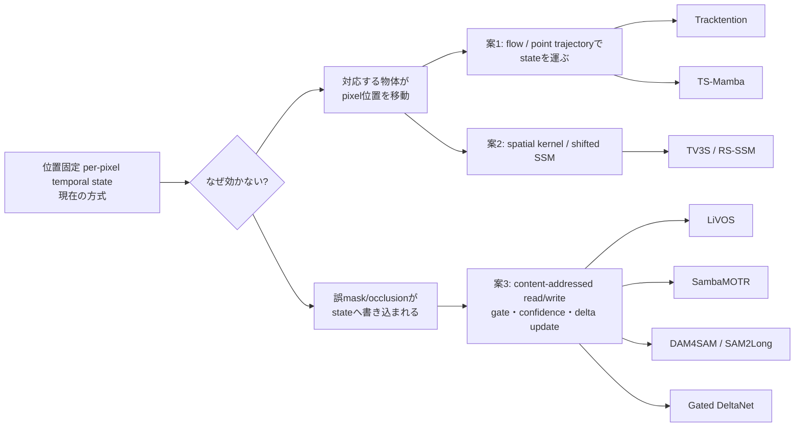

> 生成元：ChatGPT Deep Research（2026-11-05〜06）。[11/4のレポート](2026-11-04-deep-research-paper-intro-ssm-state-candidates.md)は既知候補との重複を除外していたため、既知候補も含めて候補を絞り直した版。プロンプトは11/4版の付録をもとにユーザーが調整したもの（調整後の全文は未保存）。以下はレポート本文をそのまま保存したもので、内容は書き換えていない。本文中の `citeturn...` はChatGPT内部の引用マーカーで、URLには解決できない。数値や採録状況を使う際は一次資料で再確認すること。

# 英論文紹介候補調査：SSM／線形再帰 state を用いた動画追跡と state の空間対応

## エグゼクティブサマリ

**第一推薦は「LiVOS → TV3S → Trajectory-aware Shifted SSM（TS-Mamba）」**である。LiVOS が「動画メモリを固定サイズの再帰 state に圧縮する」、TV3S が「同一空間位置に固定された state carry の限界を spatial shift で緩和する」、TS-Mamba が「明示的な軌跡対応を作ってから SSM に入力する」という順なので、現在の「per-pixel temporal Mamba は効かなかった → state に空間対応が必要では」という研究仮説に最も直接つながる。LiVOS の gate 除去で DAVIS17 J&F が 84.4→83.0、TV3S の shift 除去で mIoU が 39.5→38.9、TS-Mamba でも trajectory/token-selection 除去が性能を落とすため、三論文を「state・選択・対応」の三段階として比較できる。citeturn765092search2turn272344view1turn765092search6

**第二推薦は「SambaMOTR → LiVOS → Gated DeltaNet」**で、hidden-state contamination を主題にする場合に強い。SambaMOTR は不確実な観測を state update から除外する MaskObs だけで DanceTrack HOTA を 63.5→64.8 に改善し、LiVOS は data-dependent gate で保持／忘却を制御し、Gated DeltaNet は decay と delta-rule write を明示的に分離する。すなわち「汚染した観測を入れない／入れる量を gate する／既存 state の特定内容を書き換える」という一本の話になる。citeturn885147search5turn765092search2turn777888search6

**第三推薦は「Tracktention → TS-Mamba → DAM4SAM」**。point tracks による feature alignment、trajectory に沿う SSM、最後に tracking confidence／distractor を考慮した memory write という流れで、「どこから読むか」と「いつ書くか」を分けて論じられる。SSM 自体よりも空間対応・memory contamination を前面に出した発表に向く。citeturn489816search2turn896822search2turn241163search7

調査した範囲では、**新規に特に重要なのは TV3S（CVPR 2025）、RS-SSM（CVPR 2026）、AUSM（CVPR 2026 Findings）、Efficient-SAM2（ICLR 2026）**である。ユーザ提示済み候補の採録位置づけは概ね正しく、SAMURAI++ は通常 CVPR 本会議ではなく **CVPR 2026 Findings**、一方 SAMITE は検索時点で公式 proceedings 採録を確認できず本表から外すべきである。citeturn241163search4turn384755search1turn384755search0turn384755search4turn896822search0turn161332search20

## 調査範囲と全体像

対象期間は **2025年1月〜2026年11月5日**、主対象は CVPR / ICCV / ECCV / NeurIPS / ICLR / ICML の本会議および明記された併設 Findings とした。CVF Open Access、ICLR Proceedings / OpenReview、PMLR を採録確認の一次資料とし、arXiv は識別子確認または未採録論文の別枠化に用いた。2025–2026 年の該当文献では、「純粋な SSM tracking」よりも、①固定サイズ state に動画メモリを圧縮する研究、②trajectory / point track / spatial shift で対応を補う研究、③SAM2 の memory write/retrieval を選択的にする研究、の三群がはっきり形成されている。citeturn765092search1turn241163search4turn489816search2turn384755search4

現在の研究との対応を模式化すると次のようになる。

特に LiVOS は state が **\(C_k\times C_v\times N\)** の固定サイズ行列／テンソルで、画素位置そのものを保持しない。論文の Fig. 4 では、前時刻 state に data-dependent gate を掛け、現在の key–value outer product を足す recurrent linear matching として描かれている。したがって、現在試している「各 pixel に state を固定する Mamba」と設計思想が正反対であり、比較対象として非常に価値が高い。citeturn896558search5

## テーマ一：SSM・線形再帰 state を動画追跡／VOS／動画セグメンテーションに使う論文

| 論文 | 採録・arXiv・コード | state / 更新 | 空間対応 | 有効なアブレーション | backbone固定 | 3案との対応・contaminationへの示唆 | 紹介向き |
|---|---|---|---|---|---|---|---|
| **LiVOS: Light Video Object Segmentation with Gated Linear Matching** — Qin Liu et al. | **CVPR 2025**、[CVF] citeturn765092search1、arXiv **2411.02818** citeturn324153academia51、公式 code あり | state は \(S_t:C_k\times C_v\times N\) の固定サイズ行列／テンソル。概念的には \(S_t=G_t\odot S_{t-1}+\phi(K_t)^TV_t\)。softmax memory matching を recurrent linear attention に変換。citeturn896558search5 | **内容アドレス**。query key から state を読む。pixel位置を直接 carry しない | **Table 4**: Full 84.4 J&F、No gate 83.0 (**−1.4**)、No object memory 80.4 (**−4.0**)、No sensory memory 79.1 (**−5.3**) 。citeturn765092search2 | SAM2系ではなく独自VOS network。全面学習 | **案3**。誤観測を「空間位置」に固定保存せず key-addressed state に圧縮し、gate で retention を制御。contamination 対策を直接議論できる | **★★★★★**。式が簡潔、Fig.1/Fig.4 が非常に説明しやすい。本文約11頁 |
| **Samba: Synchronized Set-of-Sequences Modeling for MOT / SambaMOTR** — Mattia Segu et al. | **ICLR 2025 Spotlight**、公式 ICLR paper citeturn777888search4turn885147search1、arXiv **2410.01806**、codeあり citeturn885147search1 | object query ごとに SSM hidden state。複数 tracklet state を synchronization して joint dynamics を持たせる。citeturn777888search5 | object identity / query 単位。pixel対応ではないが tracklet 間同期あり | **Table 4**: vanilla SSM 63.5 HOTA → +MaskObs 64.8 (**+1.3**) → +Sync 65.9 → +longer training 67.2。MaskObs は不確実 observation を state update から mask。citeturn885147search0turn885147search5 | detector/backboneを含め追跡系を学習 | **案3寄り**。hidden-state contamination に最も直接的。「occluded/unreliable observation を update しない」というあなたの reset/gate 実験の強い先行根拠 | **★★★★★**。研究テーマとの言語的一致が最も強い |
| **MambaVLT: Time-Evolving Multimodal State Space Model for Vision-Language Tracking** — Xinqi Liu et al. | **CVPR 2025** [CVF] citeturn235049search1、arXiv **2411.15459** citeturn324153academia49、codeあり | visual / language reference を time-evolving hybrid SSM で更新 | explicit flowなし。multimodal reference/content に基づく update | component ablation は本文にあるが、本調査で「state reset/対応有無」を直接 isolating する表は確認できず | frozen SAMではない | **案3寄り**。reference drift と modality ambiguity を selective update で扱う | **★★★★☆**。tracking+Mambaとして直球だが空間対応の議論は弱め |
| **Exploiting Temporal State Space Sharing for Video Semantic Segmentation (TV3S)** — Syed Ariff Syed Hesham et al. | **CVPR 2025** [CVF] citeturn241163search4、arXiv **2503.20824** citeturn324153academia48、codeあり | spatial patch ごとに temporal hidden state \(H\) を carry。過去全フレームの context を hidden state に集約。citeturn272344view1 | **shifted spatial windows**。位置固定 state の隣接領域を意図的に混ぜる | **Table 3**: Directで 1 TSS/no shift 38.0、TV3S no shift 38.9、**shift 39.5**。**Table 6**: temporal context 1 frame→32 framesで mIoU 37.9→39.7、mVC16 79.1→87.8。citeturn272344view1turn891990view0 | ImageNet pretrained MiT/Swin を基に全系を訓練。frozenではない | **案2の最重要論文**。現在の fixed-position per-pixel Mamba とほぼ同じ問題設定に spatial shift を足している | **★★★★★**。今回の三本選定では最優先級 |
| **RS-SSM: Refining Forgotten Specifics in State Space Model for Video Semantic Segmentation** — Kai Zhu et al. | **CVPR 2026** [CVF] citeturn384755search1、codeあり | fixed-size SSM が圧縮時に捨てる pixel-level specifics を明示的に復元。Channel-wise Amplitude Perceptron と Forgetting Gate Information Refiner で forgetting gate を反転・補正。citeturn384755search1 | channel/spatiotemporal distribution alignment。flowではない | 主張の中心自体が forgetting gate の ablation。本調査では表の正確な数値を一次資料から安定取得できなかったため **数値未指定** | frozenではない | **案2/3**。contamination とは逆向きの「忘れすぎ」問題を扱うため、gateを強くすると必要情報まで消えるという対照例 | **★★★★☆**。2026年の発展として有力 |
| **Autoregressive Universal Video Segmentation Model (AUSM)** — Miran Heo et al. | **CVPR 2026 Findings** [CVF] citeturn384755search0 | History Compressor の Mamba が時間軸を再帰圧縮し、**single spatial state** だけを保持。self-attention は空間軸を担当。citeturn384755search8 | 空間 map state。explicit correspondenceなし | 本調査では state/off の定量表を一次資料から抽出できず **未指定** | frozen SAMではない | **案2寄り**。「spatial state + temporal Mamba」という構成は現在の実装に近い。Findingsである点は明記すべき | **★★★★☆** |
| **Long-Context State-Space Video World Models** — Ryan Po et al. | **ICCV 2025** [CVF] citeturn241163search2 | causal SSM hidden state。block-wise spatiotemporal scan + local causal attention | explicit flowなし。**block-wise scan によって同じ空間ブロックの temporal proximity を高める** | **Table 5**: Full SSIM 0.855 / LPIPS 0.099、no block-wise 0.845/0.113、block size 1 は 0.766/0.198、long-context trainingなし 0.809/0.143。citeturn765092search3 | generative world modelを学習 | **案2**。scan順序そのものが state の「誰と誰を隣接させるか」を決めることを示す | **★★★★☆**。追跡ではないが state-space設計の原理説明に優れる |

この群で最も重要な結果は、単に「Mamba が動画に効く」ということではない。**state を何に紐付けて carry するか、そして update をいつ拒否するかが性能差を作っている**。TV3S は spatial shift、SambaMOTR は MaskObs、LiVOS は gate という別々の方法で同じ根本問題を扱っている、と解釈するのが本研究には有用である。これは論文の直接主張ではなく、本調査からの統合的な推論である。根拠となる各 ablation は上表の通りである。citeturn272344view1turn885147search5turn765092search2

## テーマ二：再帰 state・時間特徴の空間対応

| 論文 | 採録・arXiv・コード | state / 時間特徴 | 空間対応 | 対応付けアブレーション | 3案との関係・示唆 | 紹介向き |
|---|---|---|---|---|---|---|
| **Trajectory-aware Shifted State Space Models for Online Video Super-Resolution (TS-Mamba)** — Qiang Zhu et al. | **ICLR 2026**、OpenReview上で "Published as a conference paper" citeturn896822search2、arXiv **2508.10453** citeturn765092academia5 | 過去フレームから類似 token を選び、trajectory に並べて shifted SSM で aggregate | **明示 trajectory / token gather**。Hilbert scanning + intra/inter-window shift | **Table 2**: trajectory generator/token selection、trajectory loss、IntraWCB、InterWCB、各 shift を除く全variantが full より低下。**Table 3**: selected tokens \(s\) を増やすと改善、\(s=3\) を採用。citeturn765092search6 | **案1 + 案2**。現在考えている「点軌跡で state を運ぶ」のほぼ直系。最重要 | **★★★★★**。三本の中心に据える価値あり |
| **Tracktention: Leveraging Point Tracking to Attend Videos Faster and Better** — Zihang Lai, Andrea Vedaldi | **CVPR 2025** [CVF] citeturn489816search2、arXiv **2503.19904** citeturn324153academia50、codeあり citeturn324153search3 | recurrent state ではなく video feature | **point tracks に沿って attention**。物体移動後も同一 physical point の特徴を時間集約 | point-track temporal alignment を導入したモデルが通常の temporal mechanism より temporal consistency を改善。正確な component差の数値は本調査では **未指定** | **案1**。stateそのものをwarpする設計ではないが、「同じ (x,y) を時間方向に接続してはいけない」という最も強い概念的根拠 | **★★★★★**。図で説明しやすい |
| **TV3S** | CVPR 2025 citeturn241163search4 | patch-wise temporal hidden state | **shift** | Table 3で no-shift 38.9 → shift 39.5 mIoU。citeturn272344view1 | **案2**。flowを使わない最小限の spatial correspondence | **★★★★★** |
| **Long-Context State-Space Video World Models** | ICCV 2025 citeturn241163search2 | causal SSM state | block-wise scan | block size=1 では空間相関が壊れ、single global scanでは temporal proximity が弱くなる。Full が最良。citeturn765092search3 | **案2**。1-D scan order の設計が空間対応問題になることを明瞭に示す | **★★★★☆** |
| **High-Resolution Spatiotemporal Modeling with Global-Local State Space Models for Video-Based Human Pose Estimation** — Runyang Feng et al. | **ICCV 2025** [CVF] citeturn241163search9 | global/local Mamba representations | **6D selective space-time scan**、windowed space-time scan | 本調査では対応の on/off 数値 **未指定** | **案2**。deformable alignmentではないが space-time scan の設計例 | **★★★☆☆** |
| **EVDM: Event-based Real-world Video Deblurring with Mamba** — Zhijing Sun et al. | **ICCV 2025** [CVF] citeturn241163search1 | motion-aware SSM | eventから得た motion clue で intra/inter-frame fusion を誘導 | 詳細数値 **未指定** | **案1/2参考**。motion cue が state propagation を条件付ける例。ただし event camera 前提 | **★★★☆☆** |

TS-Mamba は今回の探索で最も「次の実験」に直結する。典型的な optical-flow warp ではなく、**現在 token に対して過去フレーム内の最類似 token を集め、それらを一本の trajectory sequence として SSM に渡す**ため、「stateを座標ごとwarpする」案と「trajectory上で新しくstateを作る」案を比較する際の参照点になる。さらに shift を SSM scan 内に組み込むので、ユーザの案(1)と案(2)を一論文で橋渡ししている。citeturn896822search2turn765092search6

一方 Tracktention は SSM ではないが、研究仮説の検証にはむしろ重要である。point tracks を temporal attention の sampling path とすることで、大運動時にも同じ物理点を対応付ける設計なので、**「Mambaにしたから改善するのではなく、正しい correspondence が入ったから改善する」**という対照実験を設計する根拠になる。citeturn489816search2

## テーマ三・四：SAM2/SAM3 memory の改良と、SSM の必要性を問う論文

| 論文 | 採録 | memory / state 改良 | frozen backbone | アブレーション・重要結果 | contaminationへの示唆 | 紹介向き |
|---|---|---|---|---|---|---|
| **A Distractor-Aware Memory for Visual Object Tracking with SAM2 (DAM4SAM)** — Jovana Videnovic et al. | **CVPR 2025** [CVF] citeturn235049search0、arXiv **2411.17576** citeturn501765academia9 | distractor-aware memory + introspection-based update | SAM2.1を基盤。主眼は training-free memory policy | SAM2.1 と memory extension群を7 benchmarkで改善し6 benchmarkでSOTAと報告。citeturn241163search7 | **極めて直接的**。誤maskや distractor を「次フレームへ書かない」ことが重要 | **★★★★★** |
| **SAM2Long: Enhancing SAM 2 for Long Video Segmentation with a Training-Free Memory Tree** — Shuangrui Ding et al. | **ICCV 2025** [CVF] citeturn235049search2 | 単一路径の greedy memory を複数 branch の tree search に置換 | **training-free** | 12直接比較の平均で SAM2 を **+3.7**、長期 VOS では最大 **+5.3 J&F**。citeturn235049search2 | contaminationを「一度書いた誤りを不可逆にcarryしない」という search 問題として扱う | **★★★★★** |
| **EdgeTAM: On-Device Track Anything Model** — Chong Zhou et al. | **CVPR 2025** [CVF] citeturn175077search2 | dense memoryを固定数queryの **2D Spatial Perceiver** に圧縮。global + patch-level queryで空間構造を保持 | SAM2をそのままfreezeする方式ではなく軽量化/distillation | DAVIS17 87.7、MOSE 70.0、SA-V val 72.3、test 71.7 J&F、iPhone 15 Pro Max 16 FPS。citeturn175077search2 | state圧縮時にも spatial structure を捨てると問題、という示唆 | **★★★★☆** |
| **Efficient-SAM2: Accelerating SAM2 with Object-Aware Visual Encoding and Memory Retrieval** — Jing Zhang et al. | **ICLR 2026** 公式 Proceedings citeturn384755search4 | **Sparse Memory Retrieval**：各memory frameの salient tokenだけ再読込 | **post-training acceleration**、追加params/訓練は小さい | SAM2.1-Lを **1.68×**高速化、SA-V test accuracy drop 1.0%; SWR 1.83×、SMR 1.78× speedup。citeturn384755search4 | 「全memory tokenを常に読む必要はない」。内容選択的 read の実装例 | **★★★★☆** |
| **SAMWISE: Infusing Wisdom in SAM2 for Text-Driven Video Segmentation** — Claudia Cuttano et al. | **CVPR 2025** [CVF] citeturn489816search0 | Cross-Modal Temporal Adapter + Conditional Memory Encoder | **SAM2 weightsはfine-tuneしない**。追加約4.9M params。citeturn489816search0turn489816search1 | **Table 2**: MLP-only 45.2 J&F → full CMT+CME 55.5。CME追加だけでも 54.2→55.5。citeturn489816search6 | frozen backboneへの後付けという研究条件に最も近い | **★★★★☆** |
| **SAMURAI++ / Extending SAM2 to MOT by Optimizing Hierarchical Trajectory Memory** — Cheng-Yen Yang et al. | **CVPR 2026 Findings** [CVF] citeturn896822search0 | short-term motion-aware memory + long-term instance memory、bipartite matching | **training-free** | DanceTrack/MOT17で identity preservation を改善と報告。数値詳細は本調査表では未指定 | motion/identityで memory を階層化するため案1/3に近い | **★★★★☆** |
| **SAM 3: Segment Anything with Concepts** — Nicolas Carion et al. | **ICLR 2026** 公式 Proceedings citeturn161332search0 | image detector + **memory-based video tracker**、concept/exemplar prompt | foundation model自体を学習 | video PCSを含め既存systemのaccuracyを大幅改善と報告 | content/semantic identity を memory と結び付ける次世代基盤 | **★★★☆☆**。非常に大規模で紹介範囲を絞りにくい |
| **SeC: Advancing Complex VOS via Progressive Concept Construction** — Zhixiong Zhang et al. | **ICLR 2026** 公式 Proceedings citeturn489816search3 | LVLMで複数sceneの情報を統合し high-level object concept を progressive に構築 | SAM2単純freeze moduleではない | SeCVOSで SAM2.1 より **+11.8** points。citeturn489816search3 | low-level state が破損しても semantic concept をidentity anchorにできる可能性 | **★★★★☆** |

SAM系では、**SAM2Long と DAM4SAM が contamination 問題の最も近い比較対象**である。SAM2Long は「現在の予測を一つだけ信じてmemoryを更新する greedy carry」が error accumulation を起こすと明示し、複数候補経路を維持する。DAM4SAM は distractor を含む誤ったmemory updateを抑える。SambaMOTR の MaskObs と合わせると、異なるモデル群が独立に「bad observation を state/memory に書くことが長期誤差の主因」と指摘している構図になる。citeturn235049search2turn241163search7turn885147search5

SSMそのものの必要性を問う代表は **MambaOut: Do We Really Need Mamba for Vision?**（Weihao Yu, Xinchao Wang, CVPR 2025）である。著者らは Mamba から SSM token mixer を外した MambaOut を作り、ImageNet分類では Mamba系を上回る一方、COCO detection/ADE20K segmentation では強い visual Mamba に届かなかったことから、「Mambaは長系列かつautoregressiveな問題ほど自然で、単純な画像分類で必須とは言えない」と整理している。CVF採録確認済みで、Tables 2–3 がこの主張の中心である。citeturn175077search1turn175077search7

この点は現在の negative result を解釈する上で重要である。**frame間の同一pixelにMambaを置いただけで差が出ないこと自体は、SSMの存在が有効な temporal correspondence を自動的に作るわけではない**という仮説と整合する。ただしこれは MambaOut の直接的な実験結果ではなく、MambaOut・TV3S・TS-Mamba・Tracktentionを総合した本調査上の推論である。citeturn175077search1turn272344view1turn896822search2turn489816search2

Gated DeltaNet は vision 論文ではないが、hidden-state contamination の「更新則」そのものを議論する参考として非常に強い。ICLR 2025 採録論文で、gating による global decay と delta rule による key-specific modification を統合する。論文の主張は「gating は素早い memory erasure、delta rule は targeted update に向く」というものなので、per-pixel Mamba state を **単純 overwrite/reset ではなく、対応 key に沿って selective correction する**案の理論的雛型になる。citeturn777888search6turn885147search4

## 発表用の推薦組み合わせと読み方

**案A：LiVOS → TV3S → TS-Mamba**を最優先に薦める。発表ストーリーは「長い動画を全部保存できないので recurrent state に圧縮する（LiVOS）→しかし固定空間位置の state sharing だけでは移動を正しく追えないので shift を導入する（TV3S）→さらに明示的 trajectory を構築して対応点だけを SSM に流す（TS-Mamba）」となる。ユーザの実験結果から次の三案へ最短距離でつながり、三本とも図でアルゴリズムの違いを説明しやすい。LiVOS は案3、TV3Sは案2、TS-Mambaは案1+2をほぼ一対一でカバーする。citeturn896558search5turn272344view1turn896822search2

**案B：SambaMOTR → LiVOS → Gated DeltaNet**は contamination そのものを研究室で議論したい場合に薦める。SambaMOTR の MaskObs は「信頼できない入力を update しない」、LiVOS は「data-dependent gate で過去 state をどこまで残すか決める」、Gated DeltaNet は「過去をdecayした上で key-specific error correction をする」。リセットあり／なしが効かなかったという現在の結果を、「hard resetでは粒度が粗すぎ、input-dependent write/erase が必要ではないか」という次仮説に変換できる。citeturn885147search5turn765092search2turn777888search6

**案C：Tracktention → TS-Mamba → DAM4SAM**は、SSMより「correspondence と memory integrity」を中心にした構成である。Tracktentionで「どの過去位置を見るか」、TS-Mambaで「対応軌跡をどう長期集約するか」、DAM4SAMで「集約結果をmemoryへ書いてよいか」を扱う。最終的には、あなたの方式を `correspond → temporal update → validate/write` の三段階に分解して設計する流れに自然につながる。citeturn489816search2turn896822search2turn241163search7

三案の中では、**論文紹介としてのまとまりはA、研究そのものへの即効性はAまたはB、SAM2/SAMURAIとの距離の近さはC**が最も強い。特に TV3S は既知候補リストに入っていなかったにもかかわらず、「位置固定 temporal SSM + shifted spatial mixing」という現在の状況に非常に近いため、今回の探索で最重要の追加候補と判断する。citeturn241163search4turn272344view1

## 別枠：未採録プレプリント、準トップ会議・ジャーナル、不確実点

**未採録／公式採録を確認できないもの**は本表から分離すべきである。**SUMO: Segment and Track Any Motion with Nonlinear State Space Models** は arXiv **2606.29861** で、SAM2と nonlinear SSM / Selective Unscented Filter を結合する training-free tracker だが、今回の検索では指定トップ会議の公式採録を確認できなかった。研究テーマには非常に近いので参考文献としては重要である。citeturn501765search0 **LiAM-SAM: Lifecycle-Aware Memory for Robust SAM2-Based MOT** は arXiv **2609.28078** で、誤ったtrack initiation、interaction時のmemory drift、長期occlusion後のre-IDという三種類の memory integrity failure を明示しており、baseline比 +10.5 HOTA / +17.4 AssA、ID switch −96% と報告するが、現時点ではプレプリント扱いが妥当である。citeturn501765academia7 **Rethinking Memory Design in SAM-Based Visual Object Tracking** は arXiv **2512.22624** 自身が「This is a preprint」と明記しているため、本表には入れない。citeturn501765academia6

同様に **SENTRY: SAM2-Enhanced Neighbor-Aware and Temporally Reasoned Memory for Visual Tracking** は arXiv **2606.24449**。confidence-only write が drift の主因とし、候補maskを短いtrackletとしてbacktrackして cycle-consistency を検証してからmemoryへ書く **refine-before-write** 方式である。あなたの contamination テーマには極めて直接的だが、指定トップ会議採録を確認できないため「今後要追跡」に置くのが安全である。citeturn501765academia8

**SAMITE: Position Prompted SAM2 with Calibrated Memory for Visual Object Tracking** については注意が必要である。検索では OpenReview 上に **"Under review as a conference paper at ICLR 2026"** の版が確認でき、Prototypical Memory Bank と Positional Prompt Generator により occlusion/distractor時の誤memory propagationを抑える内容だが、ICLR 2026公式 proceedings の採録ページは今回確認できなかった。したがって、少なくとも本調査時点では **ICLR 2026採録論文として扱わず、採録未確認**とする。citeturn161332search20

ジャーナル枠の **SMTrack: State-Aware Mamba for Efficient Temporal Modeling in Visual Tracking** は **IEEE Transactions on Image Processing, vol.35, 2026, pp.2249–2261, DOI 10.1109/TIP.2026.3661393** と確認できる。トップ会議縛りでは本表外だが、Mambaの temporal state を visual tracking に直接使う点では参考度が高い。citeturn501765search4

ユーザ提示済み候補の採録状況については、**MambaOut = CVPR 2025、SambaMOTR = ICLR 2025、Gated DeltaNet = ICLR 2025、Long-Context State-Space Video World Models = ICCV 2025、MambaVLT = CVPR 2025、LiVOS = CVPR 2025、Tracktention = CVPR 2025、DAM4SAM = CVPR 2025、SAM2Long = ICCV 2025、EdgeTAM = CVPR 2025、SAMWISE = CVPR 2025、SAM 3 = ICLR 2026、SeC = ICLR 2026、Trajectory-aware Shifted SSM = ICLR 2026** は公式一次資料で確認できた。citeturn175077search1turn777888search4turn777888search6turn241163search2turn235049search1turn765092search1turn489816search2turn235049search0turn235049search2turn175077search2turn489816search0turn161332search0turn489816search3turn896822search2

一つ位置づけを修正すべきなのは **"Extending SAM2 to MOT / SAMURAI++"** で、正式タイトルは **Extending Segment Anything Model 2 to Multi-Object Tracking by Optimizing Hierarchical Trajectory Memory**、掲載先は **CVPR 2026 Findings** であり、CVPR main conference paper と混同しない方がよい。citeturn896822search0

また **STDDNet** は ICCV 2025 に Mambaを使った spatial-aligned temporal modeling として採録されているものの、医療動画（polyp segmentation）であり今回の明示的除外条件に該当するため本表から除外した。citeturn235049search7 **MoMa** は ICML 2025 で image foundation model に Mamba adapter を挿入する興味深い frozen/PEFT型動画認識研究だが、tracking/VOSでも spatial correspondenceでもないため補助的な位置づけに留めた。citeturn235049search6

最後に、今回の調査から最も強く得られる研究上の仮説は次である。**state carry の有無そのものよりも、①stateがどの物理対象に対応しているか、②現在の観測をstateへ書くべきか、③過去stateのどの部分を残す／消す／修正するか、の三点を分離して設計・ablateする方がよい。** TV3S/TS-Mamba/Tracktention が①、SambaMOTR/DAM4SAM/SAM2Long が②、LiVOS/Gated DeltaNet/RS-SSM が③についてそれぞれ独立の実験根拠を与えている。これは複数論文を横断した本調査の推論であり、各論文単独の主張ではない。citeturn272344view1turn896822search2turn489816search2turn885147search5turn241163search7turn235049search2turn765092search2turn777888search6turn384755search1
