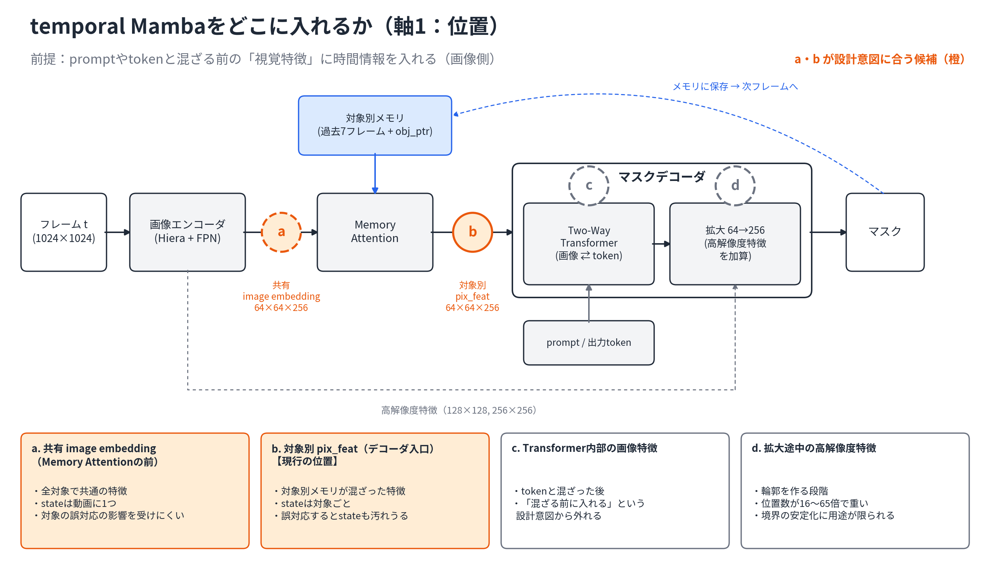
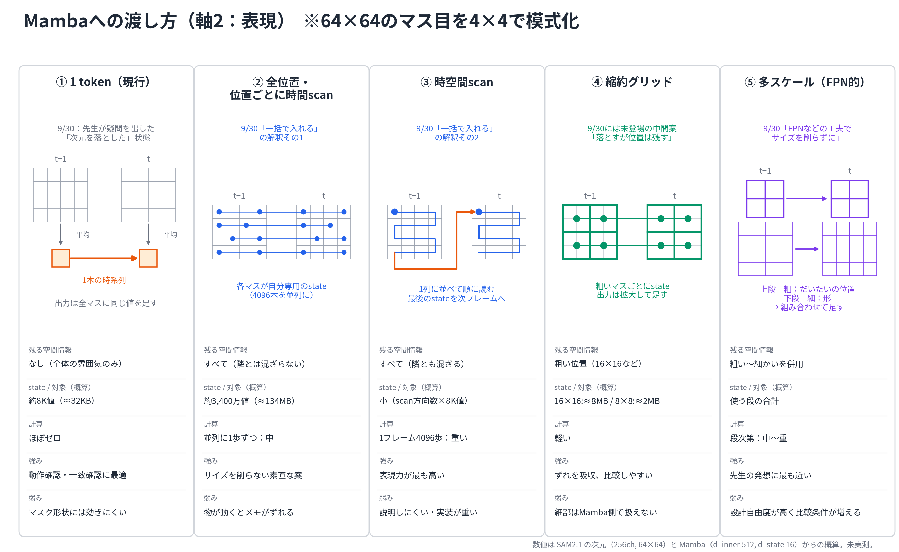
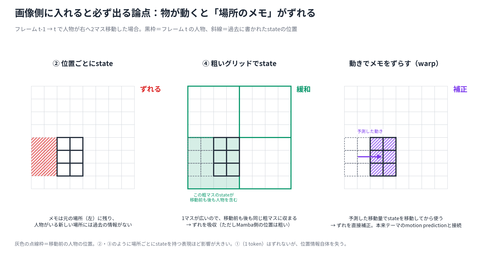
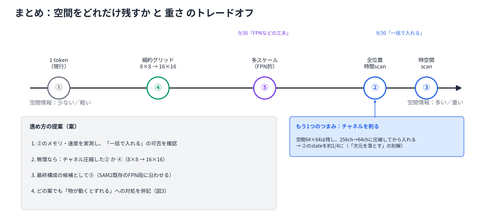

# temporal Mambaの画像側挿入の設計候補（位置と表現）

## 読み込んだ文脈

- プロジェクトREADME（`summary`、現在の状況）: MOSE F1 adapterはLR不足で実質未学習。Mambaの効果はまだ検証できていない。
- [9/30 MTG議事録](../../../lab/projects/sam2-mamba-motion-tracking/meetings/2026-09-30-mtg.md): 1 token構成（空間平均 → broadcast）は暫定扱い。空間情報・入力次元・計算資源・Mambaの役割を整理し、設計根拠を説明できるようにする。当日メモには「次元を落とす必要があるのか？画像全体を一括で入れられないかもしれない」「FPNなどを工夫し、サイズを削減せずに入れる可能性」とある。
- [10/9 週次MTG資料](../../../lab/projects/sam2-mamba-motion-tracking/materials/2026-10-09-weekly-progress-mtg-materials.md) の「9. 方針候補・比較」: (A) 1 tokenのままLRを直して再学習、(B) 空間表現を先に設計。
- [中間発表スライドレビュー](../../../lab/projects/sam2-mamba-motion-tracking/materials/2026-10-09-midterm-slide-review.md): 設計意図は「promptやtokenと混ざる前に、視覚特徴へ時間情報を加える」。
- 関連brainstorm: [ID依存の議論](2026-09-27-temporal-mamba-id-dependency-discussion.md)（共有image embedding案）、[adapter学習](2026-09-30-temporal-mamba-adapter-training.md)
- SAM2 repo `dev`: `sam2/modeling/sam/mask_decoder.py`、`sam2/modeling/sam2_base.py`、`sam2/modeling/temporal_mamba_adapter.py`（デコーダ構造と現行adapterの確認。読み取りのみ）
- 10/9 MTGの前に実施。MTGの結果は未反映。

## 相談の出発点

10/9 MTGの前に、9/30の宿題（空間情報を保つ設計候補）について、先生に見せられるアーキテクチャ候補を複数用意したい。

## 対象TODO

- [ ] SAM2 decoderに入れるtemporal Mambaについて、空間情報を保つ設計候補と計算量・メモリ、採用理由を整理する（2026-10-06 TODO）

## 問い

- Mambaに何を覚えさせるのか（役割）。SAM2の既存memory attention（過去7フレーム＋obj_ptr）に対して、何を足すのか。
- 画像側に入れるなら、どの特徴に入れるのか（軸1：位置）。
- 空間情報を潰さずに、どう渡すのか（軸2：表現）。9/30の「一括で入れる」「FPN的な工夫」は具体的にどの構成を指すのか。

## アイデア候補

### 前提の確認：画像側の方針は維持する

議論の途中で、token側（デコーダのmask tokenや物体有無tokenに入れる案）やデコーダ外の案も出した。ただしこれまでの前提（視覚特徴に時間情報を入れる）と9/30の指摘（画像側で空間情報をどう保つか）を踏まえ、**画像側の中で候補を並べる**方針に戻した。token側の案は保留扱い（後述）。

### 軸1：どこに入れるか

| 位置 | 中身 | 特徴 |
|---|---|---|
| a. 共有image embedding（Memory Attentionの前） | 全対象で共通の特徴 | stateは動画に1つ。対象の誤対応の影響を受けにくい |
| b. 対象別 `pix_feat`（デコーダ入口）【現行】 | 対象別メモリが混ざった特徴 | stateは対象ごと。誤対応するとstateも汚れうる |
| c. Transformer内部の画像特徴 | tokenと混ざった後 | 「混ざる前に入れる」という設計意図から外れる |
| d. 拡大途中の高解像度特徴 | 輪郭を作る段階 | 位置数が16〜65倍で重い。用途が境界の安定化に限られる |

設計意図に合うのはaとb。

### 軸2：Mambaへの渡し方

| 表現 | 9/30との対応 | 残る空間情報 | state / 対象（概算） | 強み | 弱み |
|---|---|---|---|---|---|
| ① 1 token（現行） | 先生が疑問を出した「次元を落とした」状態 | なし | 約8K値 | 動作確認・一致確認に最適 | マスク形状には効きにくい |
| ② 全位置・位置ごとに時間scan | 「一括で入れる」の解釈その1 | すべて（隣とは混ざらない） | 約3,400万値（fp32で≈134MB） | サイズを削らない素直な案 | 物が動くとメモがずれる |
| ③ 時空間scan（フレーム内を走査し、stateを次フレームへ持ち越す） | 「一括で入れる」の解釈その2 | すべて（隣とも混ざる） | 小（scan方向数×8K値） | 表現力が最も高い | 説明しにくい・1フレーム4096歩で重い・実装の手間 |
| ④ 縮約グリッド（16×16、8×8） | 9/30には未登場の中間案 | 粗い位置 | 16×16で≈8MB、8×8で≈2MB | ずれを吸収できる。落とす量を変えて比較しやすい | 細部はMamba側で扱えない |
| ⑤ 多スケール（FPN的） | 「FPNなどの工夫で、サイズを削らずに」 | 粗い〜細かいを併用 | 使う段の合計 | 先生の発想に最も近い。SAM2既存のFPN段に沿わせられる | 設計自由度が高く、比較条件が増える |

state量はSAM2.1の次元（256ch、64×64）とMamba（d_inner 512、d_state 16）から出した概算で、未実測。

別のつまみとして、**空間は残してチャネルを削る**（256ch → 64chに圧縮してから②）方法もある。これで②のstateは約1/4になり、「次元を落とす必要があるのか」への別の答え方になる。

### 画像側で必ず出る論点：物が動くと「場所のメモ」がずれる

- ②・③のように場所ごとにstateを持つ表現ほど影響が大きい。
- 対処の候補:
  - 粗いグリッドにして吸収する（④）
  - 隣のマスと情報を混ぜてから時間方向へ進める
  - 予測した動きでstateをずらしてから使う（warp）。本来テーマのmotion predictionと接続できる

### まとめ

空間情報の多さ（≒重さ）の順は ① < ④ < ⑤ ≦ ② / ③。

## 仮説候補

- 1 token構成では位置情報を失うため、adapterが学習されてもマスク形状の改善は限定的である（未検証）。
- 空間情報を保つ表現（④・⑤・②）にすると、時間情報がマスク品質に寄与しやすくなる（未検証）。
- 場所ごとのstateは物体移動でずれるため、粗い表現かmotion補償がないと、②の利点は打ち消される（未検証）。

## 実験・実装案

- ②のメモリ・速度を実測し、「一括で入れる」が可能かを確認する（対象数を変えて測る）。
- 無理なら、チャネル圧縮した②か、④（8×8 → 16×16）で比較する。
- 最終構成の候補として、⑤（SAM2既存のFPN段に沿わせる）を検討する。
- どの案でも、物体移動によるずれへの対処を併記する。

## 比較・評価軸

- 説明可能性（stateに何が入っているか言えるか）
- 研究の軸との接続（state carryの汚染を定義・観測できるか）
- 学習データ（mask教師が必要か）
- 計算量（対象20人規模で動くか）
- 1 token構成との差分を検証できるか

## 今回見えた方向性

- 画像側に入れる方針は維持する。9/30の宿題は「画像側で空間情報をどう保つか」であり、軸1（a/b）× 軸2（①〜⑤）の候補表として答えられる。
- 9/30の「一括で入れる」には②と③の2通りの解釈がありうる。MTGで先生の想定を確認する価値がある。
- 「物が動くとずれる」問題を認識し、対処の候補を示すことが、試行錯誤ではない設計根拠になる。

## 次アクション候補

1. 10/9 MTGで図1〜4を使って候補を説明し、「一括」の解釈と、a（共有特徴）も並行して比べるかを確認する。
2. ②のメモリ・速度を実測する（読み取り・計測のみ。実装変更はspec後）。
3. 収束フェーズとして、評価軸ごとに候補を絞り込む。

TODOには自動追加していない。

## Spec化候補

- 画像側表現の比較（①・④・②またはチャネル圧縮②）と、MOSE再学習のLR修正を組み合わせたspec。adapter LR・alpha初期化・学習量の見直しが共通前提。MTGでの方針確認と収束を経てから計画化する。

## 未解決の問い

- 先生の「一括で入れる」は②と③のどちらを想定していたか。
- aとbのどちらを先に比べるか。両方比べるか。
- (A) 1 tokenでLR修正の確認を先にするか、(B) 表現の設計を先にするか（10/9資料の相談事項）。
- warpに使う動きを、何から得るか（optical flow、予測bbox差分など）。

### 保留した案（画像側以外）

- token側（デコーダ内）: mask tokenの初期値、追加prompt token、Transformer出力後のmask token、物体有無token。軽く、対象ごとのstateで汚染を観測しやすい。ただし「tokenと混ざる前に視覚特徴へ」という前提から外れるため保留。
- デコーダ外: 古いmemoryの長期圧縮（SAM2Long等との差別化が課題）、bbox系列による動き予測ヘッド（本来のmotion prior、DanceTrackのbboxで学習可）。

## 関連ファイル

- [図フォルダとmanifest](../../../lab/projects/sam2-mamba-motion-tracking/materials/figures/2026-10-09-temporal-mamba-design-options/manifest.md)（作図スクリプト `make_figs.py` を同梱）
- [9/30 MTG議事録](../../../lab/projects/sam2-mamba-motion-tracking/meetings/2026-09-30-mtg.md)
- [10/9 週次MTG資料](../../../lab/projects/sam2-mamba-motion-tracking/materials/2026-10-09-weekly-progress-mtg-materials.md)
- [中間発表スライドレビュー](../../../lab/projects/sam2-mamba-motion-tracking/materials/2026-10-09-midterm-slide-review.md)
- [temporal Mamba ID依存の議論](2026-09-27-temporal-mamba-id-dependency-discussion.md)
- [temporal Mamba adapter学習](2026-09-30-temporal-mamba-adapter-training.md)
- [temporal Mamba decoder最小統合spec](../../../lab/projects/sam2-mamba-motion-tracking/specs/2026-09-27-temporal-mamba-decoder-minimal-integration-spec.md)
